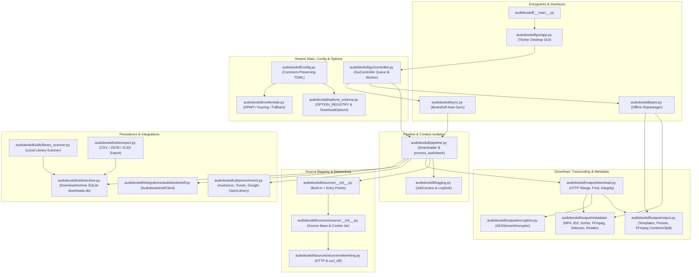
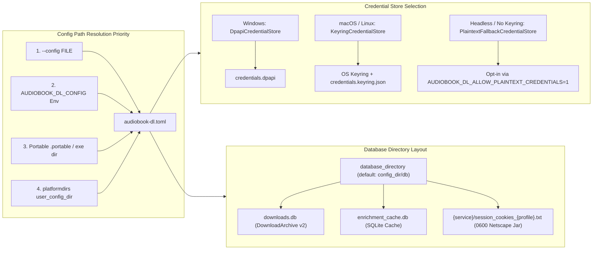

# System Architecture

`audiobook-dl` is structured around a shared configuration/option schema and an isolated job execution pipeline (`Downloader` + `JobContext`) consumed by the Tkinter Desktop GUI (`audiobookdl/gui/`).

## Layered Module Overview

## Key Architectural Design Patterns

### 1. Single-Source Option Registry (`OPTION_REGISTRY`)
All runtime options shared across TOML loading/saving, pipeline option merging, and Tkinter GUI state bindings are declared once in [`audiobookdl/options_schema.py`](../audiobookdl/options_schema.py) (`OPTION_REGISTRY` and `DownloadOptions`):
- `config_key`, `config_kind`, and `toml_serializer` drive validation and round-trip serialization in [`audiobookdl/config.py`](../audiobookdl/config.py).
- `merge_from_config` rules control how `apply_runtime_options()` in [`audiobookdl/pipeline.py`](../audiobookdl/pipeline.py) merges TOML defaults into `DownloadOptions` without overriding explicit overrides (`_explicit_fields`).
- `GuiBinding` maps options declaratively onto Tkinter variables in [`audiobookdl/gui/options_panel.py`](../audiobookdl/gui/options_panel.py) and [`audiobookdl/gui/controller.py`](../audiobookdl/gui/controller.py).

### 2. Per-Job Context Isolation (`JobContext`)
`Downloader` (and `run_downloads`) execute inside a `contextvars`-backed `logging.job_context(ctx)` ([`audiobookdl/logging.py`](../audiobookdl/logging.py)). Each `JobContext` encapsulates:
- `debug` and `quiet` flags
- `ffmpeg_dir` (custom FFmpeg directory override without global mutation)
- `sink` (`_EventLogSink` emitting structured `DownloadEvent`s or `GuiLogSink`)
- `interaction` (`GuiInteractionHandler` prompt synchronization or `NonInteractiveInteractionHandler`)
- `cancel_event` (`threading.Event`)
- `pause_event` (`threading.Event`)

This guarantees concurrent or embedded `Downloader` instances do not leak state across runs.

### 3. Desktop GUI & `GuiController`
The Tkinter desktop app ([`audiobookdl/gui/app.py`](../audiobookdl/gui/app.py)) delegates queue persistence (`gui_queue.json`), pause/resume/cancel orchestration, catalog browsing, and background download/pack/sync workers to `GuiController` ([`audiobookdl/gui/controller.py`](../audiobookdl/gui/controller.py)):
- **Desktop GUI**: [`audiobookdl/gui/app.py`](../audiobookdl/gui/app.py) hosts a left-sidebar navigation shell ([`audiobookdl/gui/shell.py`](../audiobookdl/gui/shell.py)) with persistent footer status and lazy-built pages under [`audiobookdl/gui/pages/`](../audiobookdl/gui/pages/) (`download_page.py`, `library_page.py`, `pack_page.py`, `accounts_page.py`, `settings_page.py`), standardized modal dialogs (`ModalDialog`), monitor-clamped window geometry/maximized/splitter persistence, and drains typed `GuiController` `ControllerEvent` objects via Tkinter timers.

### 4. Extensible Source Adapters & Cookie Persistence
Source adapters subclass `Source` ([`audiobookdl/sources/source/__init__.py`](../audiobookdl/sources/source/__init__.py)) and declare:
- `names` (canonical key + aliases) and `match` (URL regex list)
- `_authentication_methods` (`"cookies"`, `"login"`, or `[]`) and `login_data`
- `supports_search` / `search(query)` and `supports_library` / `list_library()`

[`audiobookdl/sources/__init__.py`](../audiobookdl/sources/__init__.py) combines the 18 built-in `_BUILTIN_SOURCES` with external plugins registered under the `audiobookdl.sources` `importlib.metadata` entry point group. For HTTP requests, `networking.py` supports standard `requests.Session` as well as optional TLS/HTTP2 browser fingerprint impersonation via `curl_cffi` (`impersonate`).

## Configuration, Credentials & State Layout

- **Comment-Preserving Config Updates**: [`audiobookdl/config.py`](../audiobookdl/config.py) updates existing keys in place when saving GUI/output preferences, `[audiobookshelf]`, `[enrichment.custom.<name>]` custom metadata providers (with vaulted `api_key` secrets), or migrating legacy plaintext passwords, retaining `#` comments and unknown sections.
- **SQLite Library Ledger (`downloads.db`)**: Schema version 2 tracks entries across `downloads` (with `source`, `profile`, `book_key`, `status` in `'downloaded' | 'pending' | 'trashed'`, `output_path`, `isbn`, `asin`, `series`, etc.) normalized alongside `item_tags` (including the reserved `'hidden'` tag).
