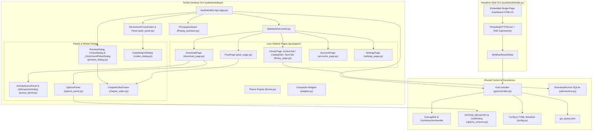

# Desktop & Web GUI Technical Audit and Engineering Roadmap

This document provides an exhaustive, code-level technical analysis of the `audiobook-dl` Graphical User Interface subsystem (`audiobookdl/gui/` and the shared headless web interface `audiobookdl/web.py`). It catalogs prioritized bugs, architectural shortcomings, performance bottlenecks, UI/UX gaps, API/Web parity deficits, testing blind spots, tooling constraints, and feature enhancements, complete with root-cause explanations and actionable implementation steps.

---

## Architecture & Subsystem Topology



---

## Executive Prioritization Matrix

| ID | Priority | Category | Title | Primary Files Affected |
|---|---|---|---|---|
| **GUI-01** | **P0 (Critical)** | `Bug / UI / Theme` | `apply_theme_to_widget_tree` passes `palette.bg` (`str`) to `widget.apply_theme()`, corrupting page/editor palettes and crashing modal dialogs | `gui/theme.py`, `gui/widgets.py`, `gui/pages/*.py`, `gui/chapter_editor.py` |
| **GUI-02** | **P0 (Critical)** | `Bug / Architecture` | Starting on a non-`download` page duplicates persisted queue records in `gui_queue.json` and eagerly forces `DownloadPage` instantiation on log events | `gui/app.py`, `gui/controller.py`, `gui/queue_panel.py` |
| **GUI-03** | **P0 (Critical)** | `Bug / Concurrency` | Unattended `CliInteractionHandler` fallback in `AccountsPage._test_all_logins` and `POST /api/catalog` hangs or raises `EOFError` on interactive auth | `gui/pages/accounts_page.py`, `web.py`, `pipeline.py` |
| **GUI-04** | **P0 (Critical)** | `Bug / Features` | `PackPage` stores edited chapters in a single scalar attribute and strips them during multi-book batch submission | `gui/pages/pack_page.py`, `pack.py` |
| **GUI-05** | **P1 (High)** | `Bug / UI / UX` | `ActivityQueuePanel` column sorting desynchronizes `queue_tree` visual order from `GuiController.pending_jobs` and breaks drag/button reordering | `gui/queue_panel.py`, `gui/widgets.py` |
| **GUI-06** | **P1 (High)** | `Bug / Configuration` | "Save Schedule" in `SyncTab` and "Monitor clipboard" in `SettingsPage` are ephemeral and never persisted to `audiobook-dl.toml` | `gui/app.py`, `gui/pages/library_page.py`, `gui/pages/settings_page.py`, `options_schema.py`, `config.py` |
| **GUI-07** | **P1 (High)** | `Performance` | Main-thread synchronous `os.walk` size calculation, cover decoding, and 100k-row `os.path.exists` verification freeze `ArchiveTab` | `gui/pages/library_page.py` |
| **GUI-08** | **P1 (High)** | `Performance` | Un-debounced `ScrolledText` log re-rendering (`MAX_LOG_LINES = 5000`) and queue/series search traces cause severe keystroke lag | `gui/queue_panel.py`, `gui/preview_dialog.py` |

| **GUI-09** | **P1 (High)** | `UI / UX` | `PreviewDialog` metadata tab lacks a `ScrollableFrame`, clipping read-only metadata and description fields on 768p/HiDPI displays | `gui/preview_dialog.py` |
| **GUI-10** | **P1 (High)** | `Bug / UI / Tooling` | OS file and URL drag-and-drop (`_bind_drop_target`) is a silent no-op on standard Tkinter and frozen Windows builds | `gui/app.py`, `pyproject.toml`, `scripts/build_exe.py` |
| **GUI-11** | **P1 (High)** | `Architecture / Networking` | `CatalogTab` cover fetcher uses bare `requests.get()`, bypassing `GuiController` session pooling, timeouts, and `--proxy` configuration | `gui/pages/library_page.py`, `gui/app.py`, `gui/controller.py` |
| **GUI-12** | **P1 (High)** | `Architecture / Concurrency` | Queue pause (`pause_event`) only pauses between top-level jobs, continuing through entire multi-book `Series` and multi-segment downloads | `gui/controller.py`, `pipeline.py`, `output/download.py` |
| **GUI-13** | **P2 (Medium)** | `UI / UX / Concurrency` | `CatalogTab` and `AccountsPage` background tasks lack cancellation controls and leak `ScrollableFrame` root event bindings | `gui/pages/library_page.py`, `gui/pages/accounts_page.py`, `gui/controller.py`, `gui/widgets.py` |
| **GUI-14** | **P2 (Medium)** | `UI / UX` | `ScrollableFrame` wheel handler scrolls over active `ttk.Combobox` widgets, inadvertently mutating `OptionsPanel` dropdown values | `gui/widgets.py`, `gui/pages/download_page.py` |
| **GUI-15** | **P2 (Medium)** | `Architecture / Auth` | Multi-service URL batches drop non-default profile selections and cannot bind per-service profiles automatically | `gui/auth_panel.py`, `gui/app.py`, `pipeline.py` |

| **GUI-16** | **P2 (Medium)** | `UI / UX / Features` | Queue table lacks per-row live progress/stage updates, inline profile column, and per-job option editing | `gui/queue_panel.py`, `gui/controller.py` |
| **GUI-17** | **P2 (Medium)** | `Features / UI` | `ArchiveTab` lacks pagination (`limit=1000` hard cap), inline metadata editing, and rich book detail inspection | `gui/pages/library_page.py`, `utils/archive.py` |
| **GUI-18** | **P2 (Medium)** | `Features / UI` | `PreviewDialog` series view cannot inspect/enrich individual books in a series, and `ChapterEditorFrame` cannot add/shift/split chapters | `gui/preview_dialog.py`, `gui/chapter_editor.py` |
| **GUI-19** | **P2 (Medium)** | `API / Web UI` | Headless Web UI (`web.py`) lacks Preview, Series selection, Local Pack, Account/Cookie management, and Library mutation endpoints | `web.py` |
| **GUI-20** | **P3 (Low / Strategic)** | `DX / Architecture` | Monolithic `AudiobookDLApp` (`2,586` LOC) and untyped tuple `event_queue` messages hinder maintainability and static analysis | `gui/app.py`, `gui/controller.py`, `gui/queue_panel.py` |
| **GUI-21** | **P3 (Low / Strategic)** | `Testing / Tooling / Docs` | E2E GUI test suite covers only 1 of 5 pages; `README.md` documents legacy GUI layout; Windows toast notifications use PowerShell AUMID | `tests/e2e/test_gui_e2e.py`, `README.md`, `gui/notifications.py`, `scripts/build_exe.py` |

---

## Detailed Analysis & Actionable Implementation Steps

---

### Priority P0: Critical Bugs & State/Data Corruption

#### GUI-01: `apply_theme_to_widget_tree` Hook Signature Mismatch Corrupts `ThemePalette` State
- **Category**: `Bug` · `UI / Theme` · `Architecture`
- **Location**:
  - [`audiobookdl/gui/theme.py`](../audiobookdl/gui/theme.py#L560-L565)
  - [`audiobookdl/gui/shell.py`](../audiobookdl/gui/shell.py#L220-L222)
  - [`audiobookdl/gui/widgets.py`](../audiobookdl/gui/widgets.py#L385-L389)
  - [`audiobookdl/gui/pages/pack_page.py`](../audiobookdl/gui/pages/pack_page.py#L108-L112)
  - [`audiobookdl/gui/pages/settings_page.py`](../audiobookdl/gui/pages/settings_page.py#L222-L225)
  - [`audiobookdl/gui/pages/accounts_page.py`](../audiobookdl/gui/pages/accounts_page.py#L114-L118)
  - [`audiobookdl/gui/pages/download_page.py`](../audiobookdl/gui/pages/download_page.py#L317-L320)
  - [`audiobookdl/gui/pages/library_page.py`](../audiobookdl/gui/pages/library_page.py#L207-L214)
- **Current Shortcoming**:
  In `audiobookdl/gui/theme.py` (lines 560–565), `apply_theme_to_widget_tree` checks for a custom `apply_theme` method on any visited widget and invokes it with `palette.bg` (a hex color `str` such as `"#f0f0f0"` or `"#1e1e1e"`):
  ```python
  apply_hook = getattr(widget, "apply_theme", None)
  if callable(apply_hook) and not isinstance(widget, (tk.Tk, tk.Toplevel)):
      try:
          apply_hook(palette.bg)
      except Exception:
          pass
  ```
  While `ScrollableFrame.apply_theme(self, background: str)` expects a `str`, every page and tab class (`SidebarShell`, `DownloadPage`, `LibraryPage`, `ArchiveTab`, `CatalogTab`, `PackPage`, `AccountsPage`, `SettingsPage`) also defines `def apply_theme(self, palette: ThemePalette) -> None:`.
  When `SidebarShell.ensure_page()` instantiates a page and calls `apply_theme_to_widget_tree(page, self._palette_provider())` (`shell.py:222`), or when `apply_theme()` walks `self.root` (`theme.py:597`), `apply_theme_to_widget_tree` invokes `page.apply_theme(palette.bg)` with a `str`:
  1. In `PackPage.apply_theme(self, palette)` (`pack_page.py:108`), `self._palette = palette` and `self._chapter_editor._palette = palette` succeed without raising, **overwriting the `ThemePalette` instance with the string `"#f0f0f0"` (or `"#1e1e1e"`)**. When the user subsequently double-clicks a chapter in `PackPage` to open `_ChapterEditDialog` (`chapter_editor.py:255`), `ModalDialog.finalize_modal()` calls `apply_theme_to_window(self, self._palette)`, which crashes with `AttributeError: 'str' object has no attribute 'mode'` (`theme.py:576`).
  2. In `SettingsPage.apply_theme(self, palette)` (`settings_page.py:222`) and `AccountsPage.apply_theme(self, palette)` (`accounts_page.py:114`), `self._palette = palette` first overwrites `self._palette` with the hex string before raising `AttributeError` on `palette.bg` / `palette.success`, which is silently swallowed by `except Exception: pass`, leaving `self._palette` permanently corrupted.
- **Actionable Implementation Steps**:
  1. Standardize the theme hook contract across all widgets so `apply_theme(self, palette: ThemePalette) -> None` **always** accepts a `ThemePalette` object (or rename `ScrollableFrame.apply_theme(background: str)` to `ScrollableFrame.apply_theme(self, palette: ThemePalette | str) -> None` where `bg = palette.bg if isinstance(palette, ThemePalette) else palette`).
  2. Update `apply_theme_to_widget_tree` in `audiobookdl/gui/theme.py` (line 563) to pass `palette` (the `ThemePalette` instance) instead of `palette.bg`.
  3. Add `ChapterEditorFrame.apply_theme(self, palette: ThemePalette) -> None` to update `self._palette = palette` cleanly.
  4. Remove the bare `except Exception: pass` around `apply_hook(palette)` in `theme.py` (catching only `tk.TclError` where appropriate) so type mismatches fail loudly in tests.

---

#### GUI-02: Duplicate Queue Restoration & Premature `DownloadPage` Instantiation When Starting on Non-Download Pages
- **Category**: `Bug` · `Architecture` · `State Management`
- **Location**:
  - [`audiobookdl/gui/app.py`](../audiobookdl/gui/app.py#L246-L252)
  - [`audiobookdl/gui/app.py`](../audiobookdl/gui/app.py#L384-L426)
  - [`audiobookdl/gui/app.py`](../audiobookdl/gui/app.py#L569)
  - [`audiobookdl/gui/app.py`](../audiobookdl/gui/app.py#L752-L756)
  - [`audiobookdl/gui/controller.py`](../audiobookdl/gui/controller.py#L570-L632)
  - [`audiobookdl/gui/queue_panel.py`](../audiobookdl/gui/queue_panel.py#L824-L836)
- **Current Shortcoming**:
  1. When `config.gui.active_page` is saved as `"library"`, `"pack"`, `"accounts"`, or `"settings"`, `AudiobookDLApp.__init__` (`app.py:250–251`) runs `self._refresh_saved_queue_badge()`, which calls `self._controller.load_saved_queue_records()`.
  2. `GuiController.load_saved_queue_records()` (`controller.py:605, 630`) generates a new UUID (`job_id = self.make_job_id()`) for each entry in `gui_queue.json` and inserts it into `self.queue_records[job_id] = rec`.
  3. Later, when the user navigates to `"download"` (or when any background task such as `_schedule_update_check`, `verify_current_auth`, or `_reload_config` logs a message via `self._queue_panel.append_log`), `self.shell.ensure_page("download")` runs `_create_download_page()`, which calls `page.queue_panel.restore_saved_queue_history()` (`app.py:569`), invoking `self._controller.load_saved_queue_records()` a **second time**.
  4. Because `load_saved_queue_records()` does not check whether `gui_queue.json` has already been loaded into `self.queue_records`, it creates a second set of UUIDs in `self.queue_records`. Only the second set is inserted into `queue_tree._queue_order`, while the first set remains orphaned in `self._controller.queue_records`! When `save_queue_state()` runs (`controller.py:514`), it serializes `self.queue_records.values()`, **doubling all persisted queue entries on disk** on every app launch that starts on a non-`download` tab.
  5. Additionally, `self._queue_panel` (`app.py:424`) accesses `self.download_page.queue_panel` (`self.shell.ensure_page("download")`), defeating lazy creation of `DownloadPage` whenever any log event is emitted.
- **Actionable Implementation Steps**:
  1. Make `GuiController.load_saved_queue_records()` idempotent during a session by tracking `self._saved_queue_loaded: bool = False` (or returning existing `run_id == 0` records from `self.queue_records` if already loaded).
  2. Add a lightweight `GuiController.peek_saved_queue_counts() -> tuple[int, int]` (or load into `self.queue_records` once in `GuiController.__init__` and have `restore_saved_queue_history()` read the already-loaded `run_id == 0` records from `self._controller.queue_records`).
  3. Decouple log buffering from `DownloadPage` widget instantiation, or if `DownloadPage` is always needed for `ActivityQueuePanel`, either buffer logs in `GuiController` until `DownloadPage` is mounted or mount `DownloadPage` upfront without duplicating `load_saved_queue_records()`.

---

#### GUI-03: Unattended `CliInteractionHandler` Fallback in `AccountsPage` and `WebDashboardState`
- **Category**: `Bug` · `Concurrency` · `API / Web UI`
- **Location**:
  - [`audiobookdl/gui/pages/accounts_page.py`](../audiobookdl/gui/pages/accounts_page.py#L259-L273)
  - [`audiobookdl/web.py`](../audiobookdl/web.py#L1295-L1314)
  - [`audiobookdl/pipeline.py`](../audiobookdl/pipeline.py#L433)
- **Current Shortcoming**:
  1. In `AccountsPage._test_all_logins` (`accounts_page.py:270`), the background worker calls `verify_service_auth(svc_key, opts, cfg)` **without passing `interaction=...`**. Inside `pipeline.py`, `verify_service_auth` defaults to `CliInteractionHandler()` when `interaction is None`. If a configured profile is missing a password, library ID, or triggers an interactive login prompt, `CliInteractionHandler` calls `rich.prompt.Prompt.ask()` on `sys.stdin` from a background thread in a GUI app—hanging indefinitely when launched from a terminal or raising `EOFError` in a `--windowed` PyInstaller executable where `sys.stdin` is `None`.
  2. In `audiobookdl/web.py` (`do_POST` for `/api/catalog`, lines 1308–1310), `list_service_library(service_key, opts, cfg)` and `search_service(service_key, query_text, opts, cfg)` are likewise called without an `interaction` handler, falling back to `CliInteractionHandler` instead of routing through `GuiInteractionHandler(self.state.controller.event_queue, cancel_ev)` (which `WebDashboardState` already bridges to SSE `prompt` events!).
- **Actionable Implementation Steps**:
  1. In `AccountsPage._test_all_logins`, create a `GuiInteractionHandler(self._controller.event_queue, cancel_ev)` (registered via `self._controller._register_aux_interaction(interaction)`) or a non-interactive handler that raises a clear `"Interactive prompt required (missing field)"` error during batch verification, and pass `interaction=interaction` to `verify_service_auth`.
  2. In `web.py` (`POST /api/catalog`), pass `interaction=GuiInteractionHandler(self.state.controller.event_queue, cancel_ev)` to `list_service_library` and `search_service` so web UI users receive interactive SSE prompts if a service requests credentials or choices.

---

#### GUI-04: `PackPage` Discards Per-Book Chapter Edits in Multi-Book Mode and Leaks Edited Chapters Across Selection
- **Category**: `Bug` · `Features` · `UI / UX`
- **Location**:
  - [`audiobookdl/gui/pages/pack_page.py`](../audiobookdl/gui/pages/pack_page.py#L56)
  - [`audiobookdl/gui/pages/pack_page.py`](../audiobookdl/gui/pages/pack_page.py#L343-L375)
  - [`audiobookdl/gui/pages/pack_page.py`](../audiobookdl/gui/pages/pack_page.py#L434-L470)
  - [`audiobookdl/gui/pages/pack_page.py`](../audiobookdl/gui/pages/pack_page.py#L604-L635)
  - [`audiobookdl/pack.py`](../audiobookdl/pack.py#L440-L462)
- **Current Shortcoming**:
  1. `PackPage` stores `self._edited_chapters: list[Chapter] | None = None` as a single page-level variable (`pack_page.py:56`) rather than per `PackBookSpec` index.
  2. When a user selects Book A in `_tree`, edits its chapters in `ChapterEditorFrame`, and then selects Book B, `self._edited_chapters` still holds Book A's chapters. If the user then clicks `Scan & Preview` or packs a single book, `_build_overrides()` attaches `self._edited_chapters` globally.
  3. Worse, when multiple books are detected (`len(self._preview_specs) > 1`, `pack_page.py:604–617`), `_submit()` calls `batch_overrides = scope_overrides_for_batch(overrides, len(self._preview_specs))`, which strips `chapters` (along with `title`, `asin`, `isbn`), **silently throwing away all chapter edits** the user made in `ChapterEditorFrame` for each book in `self._preview_specs`!
- **Actionable Implementation Steps**:
  1. Replace `self._edited_chapters: list[Chapter] | None` on `PackPage` with `self._edited_chapters_by_idx: dict[int, list[Chapter]] = {}` (or store a boolean `chapters_edited: bool` on each `PackBookSpec`).
  2. In `PackPage._submit()`, when `len(self._preview_specs) > 1`, construct per-book `PackOverrides` for each `spec` in `self._preview_specs` by merging `batch_overrides` with `chapters=self._edited_chapters_by_idx.get(idx)` so per-book chapter edits made in the GUI are preserved in each `PackJobRequest`.
  3. Allow per-book Title/Author/SeriesOrder inline editing in `PackPage._tree` (or sync the form fields to the selected `PackBookSpec` when multiple books are loaded).

---

### Priority P1: High-Impact Bugs, Performance Bottlenecks & UX Shortcomings

#### GUI-05: `ActivityQueuePanel` Column Sorting Desynchronizes Queue Order and Breaks Reordering
- **Category**: `Bug` · `UI / UX`
- **Location**:
  - [`audiobookdl/gui/queue_panel.py`](../audiobookdl/gui/queue_panel.py#L394-L405)
  - [`audiobookdl/gui/queue_panel.py`](../audiobookdl/gui/queue_panel.py#L783-L795)
  - [`audiobookdl/gui/queue_panel.py`](../audiobookdl/gui/queue_panel.py#L1091-L1144)
  - [`audiobookdl/gui/widgets.py`](../audiobookdl/gui/widgets.py#L308-L342)
- **Current Shortcoming**:
  1. `ActivityQueuePanel` creates `self._scrolled_queue = ScrolledTreeview(queue_tab, queue_columns, selectmode="extended", height=3)` with `enable_sorting=True` (the default).
  2. Clicking any column heading in `queue_tree` sorts the visual `Treeview` items in place via `self.tree.move()`, which does **not** update `self._queue_order` or `self._controller.pending_jobs`.
  3. On the very next `job_status` event (`update_queue_row` -> `_apply_queue_filter()`), `_apply_queue_filter()` reattaches all visible rows according to `self._queue_order`, wiping out the visual sort while leaving the `▲`/`▼` indicator on the column header.
  4. If the user clicks `Move Up` / `Move Down` (`move_selected_item`, lines 1103–1107) while a status filter (`queue_filter_var != "All"`) or search query (`queue_search_var != ""`) is active, `self._controller.move_pending_job()` swaps `job_id` with its immediate neighbor in `pending_jobs` (which may be detached/hidden by the filter!), and `self.queue_tree.index(neighbor_id)` raises `tk.TclError` if `neighbor_id` is currently detached!
  5. Drag-and-drop reordering (`_on_queue_drag_start` / `_on_queue_drag_drop`, lines 1126–1144) triggers on any `<ButtonPress-1>` + `<ButtonRelease-1>` without a minimum drag distance threshold, visual drop indicator, or guard against active column sorting.
- **Actionable Implementation Steps**:
  1. Either disable arbitrary visual column sorting on `queue_tree` (`enable_sorting=False`, since `queue_tree` represents an execution-ordered FIFO queue) or make column sorting explicitly reorder `pending_jobs` / clear sort indicators when `_apply_queue_filter()` restores queue execution order.
  2. In `move_selected_item()`, replace the manual `self.queue_tree.index()` swap (which crashes when `neighbor_id` is detached by a filter) with `self._apply_queue_filter()`, matching `move_selected_to_edge()`.
  3. In `_on_queue_drag_start` / `_on_queue_drag_drop`, record `self._drag_start_y = event.y`, require `abs(event.y - self._drag_start_y) >= scale_px(self, 6)`, and highlight the hovered target row during `<B1-Motion>`.

---

#### GUI-06: Ephemeral Settings ("Save Schedule" in `SyncTab`, Clipboard Monitor, Update Check Toggle)
- **Category**: `Bug` · `Configuration` · `UI / UX`
- **Location**:
  - [`audiobookdl/gui/pages/library_page.py`](../audiobookdl/gui/pages/library_page.py#L1439-L1546)
  - [`audiobookdl/gui/pages/settings_page.py`](../audiobookdl/gui/pages/settings_page.py#L106-L112)
  - [`audiobookdl/gui/app.py`](../audiobookdl/gui/app.py#L197-L202)
  - [`audiobookdl/gui/app.py`](../audiobookdl/gui/app.py#L1673-L1697)
  - [`audiobookdl/options_schema.py`](../audiobookdl/options_schema.py#L19-L33)
  - [`audiobookdl/config.py`](../audiobookdl/config.py#L44-L57)
- **Current Shortcoming**:
  1. `SyncTab` has a prominent **`"Save Schedule"`** button (`library_page.py:1459`) that invokes `_save_schedule()`. However, `_save_schedule()` only updates `AudiobookDLApp._auto_sync_enabled` and `AudiobookDLApp._auto_sync_minutes` in RAM (`app.py:1673`) and provides **zero visual feedback** (status bar is not even updated!). When the application restarts, the schedule, sync mode (`enqueue` / `scan_only` / `dry_run`), and selected sync target accounts are completely lost.
  2. `SettingsPage` has a `"Monitor clipboard for audiobook URLs"` checkbox (`settings_page.py:106`), but `clipboard_monitor` is absent from `GuiConfig` (`config.py:44`) and `GUI_CONFIG_KEYS` (`options_schema.py:19`), so it resets to `False` on every restart.
  3. `Config.check_updates` (`config.py:97`) is supported in TOML, but `SettingsPage` provides no checkbox to toggle automatic startup update checks.
- **Actionable Implementation Steps**:
  1. Add `clipboard_monitor: bool | None = None`, `auto_sync_enabled: bool | None = None`, `auto_sync_minutes: int | None = None`, `auto_sync_mode: str | None = None`, and `auto_sync_targets: list[str] | None = None` to `GuiConfig` in `audiobookdl/config.py` and `GUI_CONFIG_KEYS` in `audiobookdl/options_schema.py`.
  2. Persist and restore these fields in `AudiobookDLApp._init_variables()`, `_save_schedule()`, and `_on_close()`.
  3. Update `SyncTab._save_schedule()` to persist immediately via `self._controller.save_gui_preferences(...)` and update the status bar (`"Saved auto-sync schedule (every N min)"`).
  4. Add a `"Automatically check for updates at startup"` checkbox in `SettingsPage` bound to `check_updates`.

---

#### GUI-07: Main-Thread Blocking File I/O in `ArchiveTab` (`os.walk` on Selection & Synchronous 100k-Row Verification)
- **Category**: `Performance` · `UI / UX`
- **Location**:
  - [`audiobookdl/gui/pages/library_page.py`](../audiobookdl/gui/pages/library_page.py#L275-L359)
  - [`audiobookdl/gui/pages/library_page.py`](../audiobookdl/gui/pages/library_page.py#L443-L456)
- **Current Shortcoming**:
  1. **Synchronous `os.walk` and image decoding on `<<TreeviewSelect>>`**: Every time the user selects a row or navigates with arrow keys in `ArchiveTab`, `_on_entry_selected()` (`library_page.py:308`) synchronously calls `_format_size(e.output_path)` (which runs a recursive `os.walk()` + `os.path.getsize()` over the directory) and `load_cover_from_file()` + `render_cover_thumbnail()` on the Tkinter main thread. When `output_path` points to a multi-file audiobook folder or a NAS/SMB mount, arrow-key navigation stutters or freezes the UI.
  2. **Synchronous `_verify_missing_files()`**: Clicking `Verify Missing` (`library_page.py:443`) iterates over up to `100,000` SQLite entries and calls `os.path.exists(entry.output_path)` synchronously on the main thread without showing `self._loading_bar`.
- **Actionable Implementation Steps**:
  1. In `ArchiveTab._on_entry_selected()`, render all in-memory SQLite metadata fields immediately, set `Size: Calculating...`, and dispatch the filesystem `os.walk` size calculation and cover file reading to a background worker thread using `self._cb_queue` (guarded by a selection token `self._detail_token += 1` so rapid arrow-key navigation cancels stale work).
  2. Convert `ArchiveTab._verify_missing_files()` to run on a background thread using a dedicated `DownloadArchive(self._archive_path, persistent=True)` instance, activating `self._loading_bar` and posting results via `self._cb_queue` (matching `scan_folder(..., background=True)`).

---

#### GUI-08: Un-debounced `ScrolledText` Log Re-rendering and Search Filter Traces
- **Category**: `Performance` · `UI / UX`
- **Location**:
  - [`audiobookdl/gui/queue_panel.py`](../audiobookdl/gui/queue_panel.py#L326)
  - [`audiobookdl/gui/queue_panel.py`](../audiobookdl/gui/queue_panel.py#L392)
  - [`audiobookdl/gui/queue_panel.py`](../audiobookdl/gui/queue_panel.py#L558-L571)
  - [`audiobookdl/gui/preview_dialog.py`](../audiobookdl/gui/preview_dialog.py#L875)
- **Current Shortcoming**:
  1. In `ActivityQueuePanel` (`queue_panel.py:326`), `self.log_search_var.trace_add("write", lambda *_args: self._rerender_logs())` runs `_rerender_logs()` synchronously on every keystroke. When `self._log_entries` holds up to `MAX_LOG_LINES = 5000` lines, each keystroke deletes all text in `self.log_text` and executes up to 5,000 individual `self.log_text.insert(tk.END, line + "\n", (tag,))` Tcl calls on the main thread!
  2. Even within `_rerender_logs()` and `append_log_batch()`, calling `self.log_text.insert()` inside a Python `for` loop issues $O(N)$ Tcl interpreter crossings instead of coalescing consecutive lines sharing the same tag or passing flat `(text, tag, text, tag, ...)` arguments to a single `self.log_text.insert(tk.END, *flat_args)` call.
  3. Similarly, `self.queue_search_var` (`queue_panel.py:392`) and `PreviewDialog._filter_var` (`preview_dialog.py:875`) run synchronous tree detach/reattach loops on every keystroke without a 120–150ms `after()` debounce.
- **Actionable Implementation Steps**:
  1. Add a 150ms `after()` debounce timer (`_schedule_rerender_logs`) to `self.log_search_var` and `self.queue_search_var` in `ActivityQueuePanel`, and to `self._filter_var` in `PreviewDialog` (mirroring `ArchiveTab._schedule_refresh` at `library_page.py:562`).
  2. Optimize `_rerender_logs()` and `append_log_batch()` to build a flat list `flat_chunks: list[str | tuple[str, ...]] = []` and invoke `self.log_text.insert(tk.END, *flat_chunks)` in a **single Tcl call**, reducing 5,000 Tcl calls to 1.

---

#### GUI-09: `PreviewDialog` Metadata View Lacks a Scrollable Container, Clipping Content on Small/HiDPI Screens
- **Category**: `UI / UX` · `Accessibility`
- **Location**:
  - [`audiobookdl/gui/preview_dialog.py`](../audiobookdl/gui/preview_dialog.py#L277-L283)
  - [`audiobookdl/gui/preview_dialog.py`](../audiobookdl/gui/preview_dialog.py#L479-L559)
- **Current Shortcoming**:
  In `PreviewDialog._build_audiobook_view`, `meta_frame` directly grids 7 rows of `ttk.Entry` fields, a hint label, a `ScrolledText` description widget, and `self._readonly_frame` (which renders `Parts`, `Chapters`, etc.) inside a non-scrollable `ttk.Frame` with `min_size=(560, 420)`. On 1366×768 displays or 150%+ HiDPI scaling, `meta_frame`'s vertical height exceeds the notebook viewport, compressing `self._desc_text` and clipping `self._readonly_frame` behind the bottom button bar.
- **Actionable Implementation Steps**:
  1. Wrap the `Metadata` tab content of `PreviewDialog` in a `ScrollableFrame` (passing `inner_scrollables=lambda: (self._desc_text,) if self._desc_text else ()`), matching `DownloadPage` and `SettingsPage`.
  2. Ensure `ScrollableFrame.apply_theme` is wired when `PreviewDialog` is finalized.

---

#### GUI-10: Drag-and-Drop (`_bind_drop_target`) Is a Silent No-Op on Standard Tkinter & Portable Builds
- **Category**: `Bug` · `UI / UX` · `Tooling`
- **Location**:
  - [`audiobookdl/gui/app.py`](../audiobookdl/gui/app.py#L758-L775)
  - [`audiobookdl/gui/app.py`](../audiobookdl/gui/app.py#L2579)
  - [`pyproject.toml`](../pyproject.toml#L19-L50)
  - [`scripts/build_exe.py`](../scripts/build_exe.py#L124-L176)
- **Current Shortcoming**:
  `README.md` (line 76) states that users can *"Paste, drag, or load `.txt` URL lists"*, and `AudiobookDLApp` implements `_on_url_drop`, `_split_dropped_tokens`, and `_partition_input_tokens`. However, `_bind_drop_target` checks `if not (hasattr(target, "drop_target_register") and hasattr(target, "dnd_bind")): return`. Standard `tk.Tk()` has neither method unless `tkinterdnd2` is installed and `TkinterDnD.Tk()` is used as the root window, or native Windows `WM_DROPFILES` (`Shell32.DragAcceptFiles`) is hooked. Consequently, dragging `.txt` files, audio folders, or URLs onto the window does nothing on all platforms.
- **Actionable Implementation Steps**:
  1. On Windows (`sys.platform.startswith("win")`), implement zero-dependency native file drop support using `ctypes.windll.shell32.DragAcceptFiles(hwnd, True)` and a `SetWindowLongPtrW` `GWLP_WNDPROC` hook for `WM_DROPFILES` (`0x0233`) + `DragQueryFileW` + `DragFinish`, forwarding dropped file/folder paths directly to `self._on_url_drop()`.
  2. Optionally support `tkinterdnd2` when installed (`try: from tkinterdnd2 import TkinterDnD; root = TkinterDnD.Tk() except ImportError: root = tk.Tk()`) and bundle its tkdnd binaries in `scripts/build_exe.py` if present.

---

#### GUI-11: `CatalogTab` Cover Thumbnail Fetcher Bypasses Proxy, Timeout, and Session Pooling
- **Category**: `Architecture` · `Networking` · `Performance`
- **Location**:
  - [`audiobookdl/gui/pages/library_page.py`](../audiobookdl/gui/pages/library_page.py#L1128-L1143)
  - [`audiobookdl/gui/app.py`](../audiobookdl/gui/app.py#L661-L686)
- **Current Shortcoming**:
  `CatalogTab._default_fetch_cover_bytes(url)` (`library_page.py:1132`) calls `requests.get(url, timeout=10, headers={"User-Agent": "audiobook-dl"})` directly:
  - It creates a brand-new unpooled TCP/TLS connection for every cover thumbnail across up to 6 worker threads (`ThreadPoolExecutor(max_workers=6)`).
  - It ignores `self._controller.get_http_session()` and ignores user-configured `--proxy` (`self.proxy_var`) and `--timeout` (`self.timeout_var`), leaking direct connections when a user has configured a proxy in the GUI or `audiobook-dl.toml`.
- **Actionable Implementation Steps**:
  1. Add a helper `GuiController.fetch_cover_bytes(url: str, *, proxy: str | None = None, timeout: float = 10.0, max_bytes: int = 5 * 1024 * 1024) -> bytes | None` that uses `self.get_http_session()` (which is already thread-local and closed on controller shutdown!) with `stream=True` (checking `Content-Length` header before downloading >5 MB payloads) and applies configured `proxy` and `timeout`.
  2. Pass `cover_fetcher=lambda url: self._controller.fetch_cover_bytes(url, proxy=self.proxy_var.get().strip() or None)` when constructing `LibraryPage` / `CatalogTab` in `AudiobookDLApp._create_library_page()`.

---

#### GUI-12: Queue Pause Only Pauses Between Top-Level Jobs, Ignoring Multi-Book Series & Multi-Part Downloads
- **Category**: `Architecture` · `Concurrency` · `UI / UX`
- **Location**:
  - [`audiobookdl/gui/controller.py`](../audiobookdl/gui/controller.py#L1176-L1184)
  - [`audiobookdl/logging.py`](../audiobookdl/logging.py#L80-L91)
  - [`audiobookdl/pipeline.py`](../audiobookdl/pipeline.py#L646-L651)
  - [`audiobookdl/output/download.py`](../audiobookdl/output/download.py)
- **Current Shortcoming**:
  `GuiController.pause_event` is only checked in `GuiController._worker_loop` before popping the next `QueuedJob` (`controller.py:1176`). When a user is downloading a 30-book `Series` or a 200-segment HLS/multi-part audiobook and clicks `Pause`, the status says `"Queue paused (pausing before next job)"`, and network/disk activity continues unabated until the entire `QueuedJob` completes.
- **Actionable Implementation Steps**:
  1. Add `pause_event: threading.Event | None = None` to `logging.JobContext` (`logging.py:80`) and `Downloader.__init__` (`pipeline.py:224`), defaulting to `None` (unpaused).
  2. Add a helper `logging.wait_if_paused(cancel_event: threading.Event | None = None)` that waits on `ctx.pause_event` in 0.2s increments while checking `cancel_event.is_set()`.
  3. Call `wait_if_paused()` between books in `pipeline.py:download_result` (`Series` loop, line 647) and between segment/chunk downloads in `audiobookdl/output/download.py`.
  4. Pass `pause_event=self.pause_event` from `GuiController._worker_loop` into `run_downloads` and `run_pack`, and update the UI status immediately to `"Paused"` when `pause_event` is cleared.

---

### Priority P2: Medium-Priority Architecture, UX Polish & Feature Parity

#### GUI-13: Missing Cancellation Controls in `CatalogTab` & `AccountsPage`, and `ScrollableFrame` Root Binding Leaks
- **Category**: `UI / UX` · `Concurrency` · `Architecture`
- **Location**:
  - [`audiobookdl/gui/pages/library_page.py`](../audiobookdl/gui/pages/library_page.py#L1083-L1106)
  - [`audiobookdl/gui/pages/accounts_page.py`](../audiobookdl/gui/pages/accounts_page.py#L217-L294)
  - [`audiobookdl/gui/controller.py`](../audiobookdl/gui/controller.py#L1438-L1489)
  - [`audiobookdl/gui/widgets.py`](../audiobookdl/gui/widgets.py#L380-L384)
- **Current Shortcoming**:
  1. `CatalogTab.run_fetch()` disables `Search` and `List Library` while fetching, and `GuiController.start_catalog_fetch()` creates a `cancel_ev = threading.Event()` (`controller.py:1452`), but neither `GuiController` nor `CatalogTab` provides a `Cancel` button or `cancel_catalog_fetch()` method.
  2. Similarly, `AccountsPage._test_all_logins()` cannot be cancelled once started.
  3. `ScrollableFrame.__init__` (`widgets.py:380–384`) binds `<FocusIn>`, `<MouseWheel>`, `<Button-4>`, and `<Button-5>` onto `self.winfo_toplevel()` with `add="+"` and never cleans them up if the `ScrollableFrame` (or a dialog hosting it) is destroyed.
- **Actionable Implementation Steps**:
  1. Store `self.catalog_cancel_event: threading.Event | None` on `GuiController`, add `GuiController.cancel_catalog_fetch()`, and add a `Cancel` button (or toggle the active fetch button to `Cancel`) in `CatalogTab` while a request is in flight.
  2. Add a `self._cancel_test_event = threading.Event()` in `AccountsPage._test_all_logins()` so clicking `Cancel Test` stops testing remaining profiles.
  3. In `ScrollableFrame`, guard `ensure_focus_visible` and `on_mousewheel` with `try: if not self.winfo_exists(): return except tk.TclError: return` at the very top (already partially present, but avoid retaining dead bound closures on `root` by dispatching through a single root-level wheel/focus router or unbinding on `<Destroy>`).

---

#### GUI-14: `ScrollableFrame` Mousewheel Handler Scrolls Over Active `ttk.Combobox` Controls
- **Category**: `UI / UX`
- **Location**:
  - [`audiobookdl/gui/widgets.py`](../audiobookdl/gui/widgets.py#L480-L525)
  - [`audiobookdl/gui/pages/download_page.py`](../audiobookdl/gui/pages/download_page.py#L125-L130)
- **Current Shortcoming**:
  When `Options` is expanded on `DownloadPage` and the user scrolls the mouse wheel vertically, if the cursor passes over a `ttk.Combobox` (`Format`, `Overwrite`, `Media`, `M4B Quality`, `Impersonate`, `Preset`) or `ttk.Spinbox` (`Max workers`, `Book delay`, `Timeout`), Tk's default class binding on `TCombobox` / `TSpinbox` cycles the dropdown value **at the same time** `ScrollableFrame.on_mousewheel` scrolls the pane—silently changing user settings while scrolling.
- **Actionable Implementation Steps**:
  1. Bind `<MouseWheel>`, `<Button-4>`, and `<Button-5>` on `ttk.Combobox` and `ttk.Spinbox` widgets inside `ScrollableFrame` (when their dropdown popdown is not open and they do not have explicit focus) to forward the scroll event to the parent `ScrollableFrame` and return `"break"`, preventing accidental value changes while scrolling.

---

#### GUI-15: Multi-Service Batch URLs Drop Non-Default Profile Selections
- **Category**: `Architecture` · `Authentication` · `UI / UX`
- **Location**:
  - [`audiobookdl/gui/auth_panel.py`](../audiobookdl/gui/auth_panel.py#L409-L436)
  - [`audiobookdl/gui/app.py`](../audiobookdl/gui/app.py#L1836-L1845)
  - [`audiobookdl/pipeline.py`](../audiobookdl/pipeline.py#L800-L830)
- **Current Shortcoming**:
  When a user pastes URLs from multiple services (e.g., a Storytel URL and an Everand URL) into the URL box:
  1. `ServiceAuthCoordinator.on_urls_changed` (`auth_panel.py:137`) only inspects `urls[0]` to select the active service in `ServiceAuthCoordinator`.
  2. When `_start_or_enqueue_urls` builds per-URL `DownloadOptions` (`app.py:1840–1844`), `extract_options_auth([u])` only applies `profile` and unsaved form credentials to URLs matching `self.selected_service()`. For any URL belonging to another service where the user only configured a named profile (e.g., `[sources.everand.profiles.work]`) and no `default` profile, `opts.profile` is `None`, causing authentication to fail even though a single configured profile exists for that service!
- **Actionable Implementation Steps**:
  1. In `ServiceAuthCoordinator.extract_options_auth(urls)` (and `pipeline.py:authenticate`), when `urls` targets a single service `svc_key` that is not the currently selected service in the GUI form, check `list_source_profiles(cfg, svc_key)`: if `default` is not configured and exactly one named profile exists, automatically select that profile.
  2. Allow per-job profile selection in the Queue context menu (`Change Profile...`) for `Queued` / `Failed` jobs.

---

#### GUI-16: Queue Table Lacks Live Per-Job Progress/Stage, Profile Column, and Per-Job Option Editing
- **Category**: `UI / UX` · `Features`
- **Location**:
  - [`audiobookdl/gui/queue_panel.py`](../audiobookdl/gui/queue_panel.py#L394-L400)
  - [`audiobookdl/gui/queue_panel.py`](../audiobookdl/gui/queue_panel.py#L1190-L1253)
- **Current Shortcoming**:
  1. While a job is actively running, its row in `queue_tree` displays `Status = "Running"` and `Detail = ""` until it finishes (`Completed` / `Failed`). All progress percentage, transfer speed, ETA, and stage information (`Stage: Combining & muxing`) is shown only in the header above the notebook, not in the `Detail` column of the running row.
  2. Users cannot see which account `profile` or output format override is bound to a queued row without opening the modal `JobInspectorDialog`.
  3. Once a job is in `Queued`, `Failed`, or `Interrupted` status, users cannot edit its `profile` or `job_overrides` (`output_format`, `combine`, `split_chapters`, `media_type`) before retrying.
- **Actionable Implementation Steps**:
  1. In `ActivityQueuePanel.handle_activity_event()`, update the active running job's `Detail` cell (throttled to ~2 Hz alongside `update_metrics_display`) with live stage and progress (e.g., `Downloading 64% • 4.2 MB/s` or `Stage: Combining & muxing`), without triggering disk writes to `gui_queue.json` on transient progress updates.
  2. Add an `"Edit Job Options..."` button to `JobInspectorDialog` (enabled when `status in ("Queued", "Paused", "Failed", "Cancelled", "Interrupted")`) allowing the user to adjust `profile`, `output_format`, `combine`, and `media_type` on that specific queue record.

---

#### GUI-17: `ArchiveTab` Hard-Caps Display at 1,000 Entries and Lacks Inline Metadata Editing
- **Category**: `Features` · `UI / UX`
- **Location**:
  - [`audiobookdl/gui/pages/library_page.py`](../audiobookdl/gui/pages/library_page.py#L512-L560)
  - [`audiobookdl/utils/archive.py`](../audiobookdl/utils/archive.py)
- **Current Shortcoming**:
  1. `ArchiveTab._refresh()` calls `ledger.list_entries(query=..., limit=1000, ...)` (`library_page.py:514`). Libraries with >1,000 entries are silently truncated at 1,000 items with the status bar reporting `"Showing 1000 items"`, giving no indication that additional entries exist in `downloads.db` and no way to page or increase the limit.
  2. Users can only edit `tags` on archive entries (`_edit_selected_tags`). They cannot edit `title`, `author`, `narrator`, `series`, `series_order`, or relink a moved `output_path` for an existing archive entry.
- **Actionable Implementation Steps**:
  1. Add `DownloadArchive.count_entries(query=..., include_trashed=..., include_hidden=..., status=...) -> int` in `audiobookdl/utils/archive.py` and display `"Showing 1,000 of N items"` with a `"Load All"` / pagination control in `ArchiveTab` when `total > len(entries)`.
  2. Add an `"Edit Metadata..."` action in `ArchiveTab` (button and context menu) opening a themed `ModalDialog` to edit `title`, `author`, `narrator`, `series`, `series_order`, `isbn`, `asin`, `output_path`, and `status`.

---

#### GUI-18: `PreviewDialog` Series View Cannot Inspect Individual Books & `ChapterEditorFrame` Lacks Add/Shift/Split Operations
- **Category**: `Features` · `UI / UX`
- **Location**:
  - [`audiobookdl/gui/preview_dialog.py`](../audiobookdl/gui/preview_dialog.py#L789-L901)
  - [`audiobookdl/gui/chapter_editor.py`](../audiobookdl/gui/chapter_editor.py#L162-L294)
- **Current Shortcoming**:
  1. When previewing a `Series` URL, `PreviewDialog._build_series_view()` displays a checklist of book titles/IDs, but users cannot inspect the metadata/chapters of an individual book in the series or override the series title before queueing.
  2. `ChapterEditorFrame` (`chapter_editor.py:162–173`) supports `Edit...`, `Delete`, `Merge Next`, and `Import .cue/.json...`, but lacks:
     - **`Add Chapter...`** (inserting a new chapter marker at a timestamp)
     - **`Shift Timestamps...`** (applying a `+/- ms` offset or scaling factor to selected/all chapters interactively and seeing the updated timestamps immediately)
     - **`Export .cue/.json...`** (saving edited chapters back out to a sidecar file)
- **Actionable Implementation Steps**:
  1. Add `Add...`, `Shift All/Selected...`, and `Export...` buttons to `ChapterEditorFrame` in `audiobookdl/gui/chapter_editor.py`.
  2. In `PreviewDialog._build_series_view()`, add an editable `Series Title` field and a `"Preview Selected Book..."` button (when a `Series` entry is an `Audiobook` or resolvable via `source.download_from_id` on a worker thread).

---

#### GUI-19: Headless Web UI (`audiobookdl/web.py`) Feature & Endpoint Parity Gaps
- **Category**: `API / Web UI` · `Features`
- **Location**:
  - [`audiobookdl/web.py`](../audiobookdl/web.py#L661-L1327)
- **Current Shortcoming**:
  While `WebDashboardState` shares `GuiController`, the Web UI and JSON API lack several capabilities available in the desktop GUI:
  1. **No Metadata Preview / Series Selection API**: Users cannot preview a URL (`POST /api/preview`) or select specific books from a `Series` (`selected_indices` is supported on retry in `web.py:621` but not exposed in `POST /api/download` or the Web UI).
  2. **No Local Pack API**: `GuiController` supports `PackJobRequest`, but `web.py` exposes no `/api/pack/inspect` or `/api/pack/enqueue` endpoints for repackaging local folders on a NAS/Docker server.
  3. **No Library Mutation / Scan / Export Endpoints**: `GET /api/library` is read-only (`limit <= 500`) with no endpoints for tagging (`POST /api/library/tags`), hiding/trashing (`POST /api/library/status`), scanning local folders (`POST /api/library/scan`), or downloading CSV/JSON/XLSX exports (`GET /api/library/export`).
  4. **No Theme Toggle in Web UI**: `_render_dashboard_html` hardcodes `:root { color-scheme: dark; ... }` without a light/system theme toggle or responsive mobile table layout.
- **Actionable Implementation Steps**:
  1. Add `selected_indices` support to `POST /api/download` in `WebDashboardState.queue_urls()`.
  2. Add `POST /api/preview` (returning resolved metadata, chapters, cover data URL, or series book list) and a Preview modal in `_render_dashboard_html()`.
  3. Add `POST /api/library/tags`, `POST /api/library/status`, and `GET /api/library/export` endpoints to `_WebRequestHandler`.

---

### Priority P3: Strategic Enhancements, DX, Testing, Tooling & Documentation

#### GUI-20: Decompose `AudiobookDLApp` (`2,586` LOC) & Introduce Typed Controller Events
- **Category**: `Architecture` · `DX`
- **Location**:
  - [`audiobookdl/gui/app.py`](../audiobookdl/gui/app.py)
  - [`audiobookdl/gui/controller.py`](../audiobookdl/gui/controller.py#L192-L260)
- **Current Shortcoming**:
  1. `AudiobookDLApp` in `audiobookdl/gui/app.py` has grown to `2,586` lines, mixing Tkinter variable initialization, window geometry management, drag-and-drop parsing, clipboard polling, auto-sync scheduling, preview orchestration, `_series_book_exists` disk/archive heuristics, and CLI/GUI entrypoint routing.
  2. `GuiController.event_queue` (`queue.Queue[tuple]`) uses untyped positional tuples (`("log", level, msg)`, `("batch_item", run_id, idx, total, url)`, `("catalog_loaded", req_id, tab, payload, exc)`, etc.). Adding or changing a field in an event tuple is error-prone and invisible to `mypy`.
- **Actionable Implementation Steps**:
  1. Define a union of frozen `@dataclass(frozen=True, slots=True)` event types (or `TypedDict` / `NamedTuple` variants) in `audiobookdl/gui/events.py` so `mypy` statically verifies every producer in `GuiController`/`GuiLogSink` and every consumer in `AudiobookDLApp`, `ActivityQueuePanel`, and `WebDashboardState`.
  2. Extract clipboard monitoring and auto-sync timer management from `AudiobookDLApp` into focused coordinator helpers, and move `_series_book_exists` into `audiobookdl/gui/formatting.py` or `audiobookdl/pipeline.py`.

---

#### GUI-21: Expand E2E GUI Test Coverage, Upgrade Windows Toast AUMID, and Update Documentation
- **Category**: `Testing` · `Tooling` · `Documentation`
- **Location**:
  - [`tests/e2e/test_gui_e2e.py`](../tests/e2e/test_gui_e2e.py)
  - [`audiobookdl/gui/notifications.py`](../audiobookdl/gui/notifications.py#L106)
  - [`README.md`](../README.md#L67-L83)
  - [`docs/README.md`](../docs/README.md)
- **Current Shortcoming**:
  1. **E2E GUI Tests (`tests/e2e/test_gui_e2e.py`)**: Only tests `run_gui_self_test` and a single happy-path LibriVox `.m4b` preview+download. It does not exercise `PackPage` end-to-end (scanning local MP3 fixtures, editing chapters, packing to `.m4b`), `LibraryPage` (`CatalogTab` search/cover loading against `LocalAudiobookServer`, `ArchiveTab` scan/export, `SyncTab`), `AccountsPage` login verification, or `SettingsPage` persistence.
  2. **Windows Toast Notification App Identity (`notifications.py:106`)**: `_send_windows_toast` uses PowerShell's AUMID (`{1AC14E77-02E7-4E5D-B744-2EB1AE5198B7}\WindowsPowerShell\v1.0\powershell.exe`), so Windows notifications display "Windows PowerShell" as the sender header instead of `audiobook-dl`.
  3. **Root `README.md` GUI Section (`README.md:67–83`)**: Does not document the 5-page sidebar navigation (`Download`, `Library`, `Pack`, `Accounts`, `Settings`), keyboard shortcuts (`Ctrl+1`–`Ctrl+5`, `Ctrl+O`, `Ctrl+P`, `F5`, `Ctrl+Enter`, `Ctrl+Q`), interactive `ChapterEditorFrame`, enrichment diff picker, or queue import/export.
- **Actionable Implementation Steps**:
  1. Add E2E tests in `tests/e2e/test_gui_e2e.py` covering:
     - `PackPage` local folder scan -> chapter edit -> pack to `.m4b` -> verify output tags & chapters via `ffprobe`/`mutagen`.
     - `LibraryPage` (`CatalogTab` search & cover loading against `LocalAudiobookServer` -> one-click download -> `ArchiveTab` verification & CSV/JSON export).
     - Non-`download` initial `active_page` startup + queue restoration without duplicate records.
  2. Update `README.md` ("Desktop GUI" section) to document the 5-page sidebar architecture, keyboard shortcuts, local pack workflow, and chapter editor.
  3. Link this audit and roadmap in [`docs/README.md`](./README.md).
