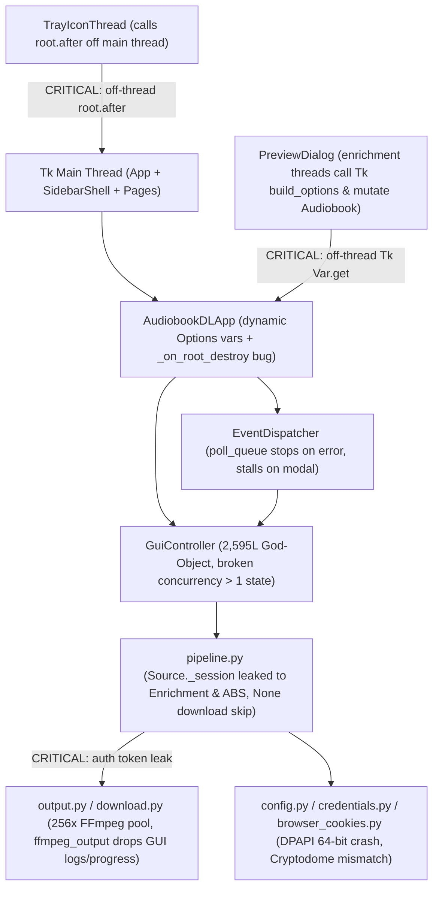
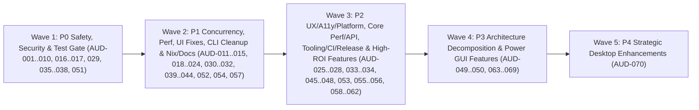

# audiobook-dl Technical Audit & Engineering Roadmap

**Target Version:** `0.7.3`  
**Audit Date:** 2026-11-18  
**Primary Focus:** Desktop GUI architecture, concurrency, responsiveness, theming/accessibility, and complete removal of legacy CLI remains; full-stack coverage across core pipeline, security, testing, tooling/DX, packaging, CI/CD, and documentation.

---

## Executive Summary

`audiobook-dl` has evolved from a terminal CLI downloader into a multi-page Tkinter desktop application (`~22.8k LOC` across 39 GUI modules out of `~56.4k LOC` across 100 package Python files, and `~87.8k LOC` across 149 total `.py` files including tests and build scripts, spanning 18 built-in audiobook sources and 40 test files with 736 collected test cases). While the core feature set—multi-source downloads, DRM inspection, audio packaging, chapter editing, SQLite archive ledger with FTS5, library sync, Audiobookshelf integration, and Windows/PyInstaller packaging—is substantial, rapid growth has introduced severe threading hazards, UI scalability bottlenecks, cross-origin credential leaks, architectural god-objects, and lingering CLI assumptions.

### Measured Codebase Baseline

| Metric / Check | Observed Result |
|---|---|
| Repository scope | 199 files (excluding caches/build artifacts); 149 `.py` files (`87,775` lines) |
| Package code (`audiobookdl/`) | 100 `.py` files (`56,415` lines); 18 built-in sources; 18 error templates |
| Desktop GUI (`audiobookdl/gui/`) | 39 `.py` files (`22,810` lines); top monoliths: `controller.py` (`2,595L`), `queue_panel.py` (`2,096L`), `preview_dialog.py` (`1,288L`), `catalog_tab.py` (`1,152L`), `widgets.py` (`1,140L`), `archive_tab.py` (`1,048L`) |
| Core monoliths | `output/output.py` (`2,397L`), `output/download.py` (`2,181L`), `config.py` (`1,779L`), `utils/enrichment.py` (`1,697L`), `pipeline.py` (`1,682L`), `options_schema.py` (`1,624L`), `utils/archive.py` (`1,540L`) |
| `ruff check .` (current narrow ruleset) | Passes (`All checks passed!`) |
| `ruff` with standard rules (`I`, `S`, `DTZ`, `RUF`, `SIM`, `PLW1510`) | Surfaces `200` `I001`, `110` `RUF012`, `38` `S110`, `28` `SIM115`, `14` `S608`, `5` `PLW1510`, `4` `DTZ*` violations |
| `mypy audiobookdl` (current relaxed config) | Passes (`Success: no issues found in 100 source files`) |
| `mypy` with strictness flags / on `tests/` | Surfaces `148` errors across 36 `audiobookdl/` files; `327` errors across 26 test files |
| `uv run --no-sync pytest --collect-only -q` | **Fails** collection (`ModuleNotFoundError: No module named 'tests'`) without `pythonpath = ["."]` (`python -m pytest` collects `736` items) |

### Priority Rubric

- **P0 — Critical**: Crashes, Tcl/Tk cross-thread safety violations, data corruption, silent security/credential exfiltration, broken test collection, or broken user-visible debug/progress pipelines.
- **P1 — High**: Concurrency/cancellation races, main-thread UI freezes, WCAG 2.1 AA contrast & layout clipping defects, broken Nix packaging, stale docs with runtime impact, and high-impact CLI remains.
- **P2 — Medium**: Scalability/memory optimizations, keyboard accessibility & HiDPI polish, dead CLI schema/entry-point cleanup, CI/PyInstaller/tooling upgrades, and high-leverage GUI enhancements.
- **P3 — Refactoring & Mid-Term Features**: Monolith decomposition, test suite modularization, and rich page-level desktop features.
- **P4 — Strategic**: Long-horizon power-user desktop capabilities.

### Audit Matrix (70 Items by Primary Category × Priority)

> Items are counted once by primary category so totals sum cleanly to **70**; multi-category impacts are listed in the Master Index and per-item headers.

| Primary Category | P0 | P1 | P2 | P3 | P4 | Total |
|---|---:|---:|---:|---:|---:|---:|
| **UI** | 4 | 7 | 4 | 0 | 0 | **15** |
| **Concurrency** | 5 | 3 | 0 | 0 | 0 | **8** |
| **Performance** | 2 | 4 | 2 | 0 | 0 | **8** |
| **Security** | 5 | 2 | 0 | 0 | 0 | **7** |
| **CLI Cleanup** | 1 | 3 | 2 | 0 | 0 | **6** |
| **API** | 0 | 1 | 1 | 0 | 0 | **2** |
| **Reliability** | 0 | 1 | 0 | 0 | 0 | **1** |
| **Architecture** | 0 | 0 | 1 | 2 | 0 | **3** |
| **Testing** | 0 | 1 | 1 | 0 | 0 | **2** |
| **Tooling & DX** | 1 | 0 | 1 | 0 | 0 | **2** |
| **Packaging** | 0 | 1 | 1 | 0 | 0 | **2** |
| **Documentation** | 0 | 1 | 1 | 0 | 0 | **2** |
| **Features** | 0 | 0 | 4 | 7 | 1 | **12** |
| **Total** | **18** | **24** | **18** | **9** | **1** | **70** |

### Architectural Fault Lines



---

## Master Prioritized Backlog Index

| ID | Priority | Category | Area | Title | Effort | Key Files |
|---|---|---|---|---|---|---|
| `AUD-001` | P0 | Concurrency, UI | GUI | Cross-thread Tkinter `Variable.get()` reads in `PreviewDialog` enrichment | S | `gui/preview_coordinator.py`, `gui/preview_dialog.py`, `gui/options_state.py` |
| `AUD-002` | P0 | Concurrency, UI, Platform | GUI | Off-thread `root.after()` from `TrayIconThread`, macOS AppKit crash, Linux `start()` crash & races | M | `gui/tray.py`, `gui/window_manager.py` |
| `AUD-003` | P0 | Concurrency, UI | GUI | Broken `queue_concurrency > 1` worker tracking, ghost paused jobs & shared scalar progress thrashing | L | `gui/controller.py`, `gui/queue_panel.py` |
| `AUD-004` | P0 | UI, Reliability | GUI | `_on_root_destroy` indentation bug killing auto-sync & clipboard monitor on any child destroy | S | `gui/app.py` |
| `AUD-005` | P0 | UI, Reliability | GUI | Unhandled exceptions permanently kill event polling; unbounded queues; modal stalls | M | `gui/event_dispatcher.py`, `gui/widgets.py`, `gui/controller.py` |
| `AUD-006` | P0 | Concurrency, UI | GUI | In-place `Audiobook`/`Source` mutation, premature `source.close()` & unawaited series sub-dialogs | M | `gui/preview_dialog.py` |
| `AUD-007` | P0 | UI, Reliability | GUI | Silent corruption of tristate `overwrite` and unset optional booleans in `_JobOptionsDialog` | S | `gui/queue_panel.py`, `options_schema.py` |
| `AUD-008` | P0 | UI, Accessibility | GUI | Nested `ModalDialog` grab loss & `finalize_modal()` ignoring requested size (button clipping) | M | `gui/widgets.py`, `gui/queue_panel.py`, `gui/pages/settings_page.py` |
| `AUD-009` | P0 | Concurrency, UI | GUI | `GuiInteractionHandler` deadlock, dead `fatal_exc` UI lock, worker-start race & `shutdown()` races | L | `gui/controller.py`, `gui/run_coordinator.py` |
| `AUD-010` | P0 | Security, UI | GUI | Silent `post_exec` loading at startup & flattening safe TOML `list[str]` into `shell=True` strings | M | `gui/options_state.py`, `options_schema.py` |
| `AUD-016` | P0 | Performance, UI | GUI | Main-thread blocking HTTP (`ereolen.dk`), subprocesses (`defaults`/`gsettings`/`ffmpeg`), & browser scan | M | `gui/coordinators.py`, `gui/window_manager.py`, `gui/ffmpeg_assistant.py`, `gui/cookie_dialog.py`, `gui/chapter_editor.py` |
| `AUD-017` | P0 | Performance, UI, Concurrency | GUI | `CatalogCoverLoader`/`GuiController` `requests.Session` leak & `CatalogTab` arrow-key thread storm | M | `gui/pages/catalog_covers.py`, `gui/pages/catalog_tab.py`, `gui/controller.py` |
| `AUD-029` | P0 | CLI Cleanup, UI, Reliability | CLI/GUI | Remove legacy `ffmpeg_output` passthrough breaking GUI Debug FFmpeg logs & progress bars | M | `pipeline.py`, `output/output.py`, `output/metadata/ffmpeg.py`, `utils/__init__.py`, `utils/concurrency.py`, `logging.py` |
| `AUD-035` | P0 | Security, API | Core | Cross-origin auth token exfiltration via shared `Source._session` to Enrichment, ABS & CDNs | M | `pipeline.py`, `utils/enrichment.py`, `integrations/audiobookshelf.py`, `sources/storytel.py`, `sources/bookbeat.py`, `sources/nextory.py` |
| `AUD-036` | P0 | Security, Platform, Packaging | Core | 64-bit Windows DPAPI `ArgumentError`/UB crash, unsynced `windll` mutation & `Cryptodome` vs `Crypto` mismatch | S | `utils/browser_cookies.py`, `credentials.py`, `utils/fs.py`, `tests/test_browser_cookies.py` |
| `AUD-037` | P0 | Security | Core | Arbitrary local file read via OPF cover path traversal & unsafe stdlib XML parsing | S | `output/metadata/reader.py` |
| `AUD-038` | P0 | Security, Architecture | Core | `metadata_provider:*` polluting `Config.sources`, unscrubbed ABS `api_key`, ephemeral fallback vault & TOCTOU migration | M | `config.py`, `credentials.py` |
| `AUD-051` | P0 | Tooling & DX, Testing | Tooling | Fix `pytest` collection (`pythonpath = ["."]`) & drop unused `setuptools-scm` blocking Nix | S | `pyproject.toml` |
| `AUD-011` | P1 | Concurrency, UI | GUI | `AccountsPage._test_all_logins` thread races, 30s+ blocking Cancel, shared 2FA & status wipe | M | `gui/pages/accounts_page.py`, `gui/controller.py` |
| `AUD-012` | P1 | UI, Concurrency | GUI | `SettingsPage` unlocked `controller.config` mutation, discarded edits on `on_show()`, dual scroll | S | `gui/pages/settings_page.py`, `gui/page_factories.py` |
| `AUD-013` | P1 | UI, Reliability | GUI | `auth_panel.py` & `cookie_dialog.py` unwired OAuth Cancel, `<FocusOut>` form wipe & stale state bugs | M | `gui/auth_panel.py`, `gui/cookie_dialog.py` |
| `AUD-014` | P1 | UI, Reliability | GUI | `_on_close` `TclError` abort, tray silent force-exit, Linux `-zoomed` geometry corruption & tray modal popups | M | `gui/app.py`, `gui/window_manager.py`, `gui/sync_coordinator.py` |
| `AUD-015` | P1 | UI, Reliability | GUI | Logic & filter bugs across Queue, Archive, Catalog, Pack, Preview, Options, Coordinators & FFmpeg Assistant | L | `gui/queue_panel.py`, `gui/run_coordinator.py`, `gui/pages/*.py`, `gui/options_*.py`, `gui/coordinators.py`, `gui/ffmpeg_assistant.py`, `gui/widgets.py` |
| `AUD-018` | P1 | Performance, UI | GUI | Queue O(N²) registration, M-write bulk delete, 20/s disk saves, double TOML writes & UNC hang | M | `gui/queue_panel.py`, `gui/controller.py`, `gui/run_coordinator.py` |
| `AUD-019` | P1 | Performance, UI | GUI | Catalog eager download of all covers, O(N²) row scan & 2,000 live `PhotoImage` RAM bloat | L | `gui/pages/catalog_covers.py`, `gui/pages/catalog_tab.py` |
| `AUD-020` | P1 | Performance, UI, Concurrency | GUI | Synchronous SQLite/exports on Tk thread, `database is locked` races & redundant multi-tab refreshes | L | `gui/pages/archive_tab.py`, `gui/pages/library_page.py`, `gui/preview_coordinator.py`, `gui/page_factories.py` |
| `AUD-021` | P1 | Performance, UI, Architecture | GUI | Eager startup import chain, triple theme walks, 26-trace `reload_config()` storm & `<Configure>` thrashing | M | `gui/app.py`, `gui/page_factories.py`, `gui/options_state.py`, `gui/widgets.py`, `gui/pages/download_page.py`, `sources/__init__.py` |
| `AUD-022` | P1 | UI, Accessibility | GUI | WCAG 2.1 AA contrast failures in Light & Dark palettes + missing active/pressed button feedback | S | `gui/theme.py` |
| `AUD-023` | P1 | UI, Theming | GUI | Incomplete live theme switching (Combobox popdowns, `tk` dialogs/menus, nested `Toplevel`, DWM lag) | M | `gui/theme.py`, `gui/window_manager.py`, `gui/pages/download_page.py`, `gui/preview_dialog.py`, `gui/widgets.py` |
| `AUD-024` | P1 | UI, Layout | GUI | `OptionsPanel` horizontal clipping, 7 overflowing toolbars, 6 unscrollable boxes & static `wraplength` | L | `gui/options_panel.py`, `gui/widgets.py`, `gui/shell.py`, `gui/pages/*.py` |
| `AUD-030` | P1 | CLI Cleanup, UI | CLI/GUI | Purge Rich markup from 18 error templates & 36 call sites; add `logging.warning()`; remove `strip_markup` | M | `assets/errors/*.txt`, `logging.py`, `exceptions.py`, `output/download.py`, `pipeline.py`, `pack.py` |
| `AUD-031` | P1 | CLI Cleanup, UI, Documentation | CLI/GUI | Replace `--impersonate chrome`, `-f mp4`, `pip install`, and `--debug` issue-template CLI guidance | S | `output/download.py`, `sources/source/networking.py`, `sources/oreilly.py`, `sources/source/__init__.py`, `.github/ISSUE_TEMPLATE/bug_report.md` |
| `AUD-032` | P1 | CLI Cleanup, API | CLI/Core | Remove `.print()`, unused `progress([])` param, stderr `print()`, `./cookies.txt` CWD trap & fix `str(NoSourceFound())` | M | `exceptions.py`, `logging.py`, `pipeline.py`, `pack.py`, `output/output.py`, `integrations/audiobookshelf.py` |
| `AUD-039` | P1 | Security, Concurrency | Core | Harden OAuth loopback server (host check, DoS prevention, `server_close()` race, refresh header leak) | M | `utils/oauth.py` |
| `AUD-040` | P1 | Security, Reliability | Core | Harden `force_cookies`, Netscape cookie injection, URL/body log redaction, `format_map` & `post_exec` default | M | `sources/source/networking.py`, `utils/browser_cookies.py`, `logging.py`, `output/output.py`, `pipeline.py` |
| `AUD-041` | P1 | Concurrency, Performance, Platform | Core | Bound 256× nested FFmpeg pools, parallel progress thrashing, Windows zombie `ffmpeg.exe` & uncached probes | L | `output/output.py`, `utils/concurrency.py`, `utils/__init__.py` |
| `AUD-042` | P1 | API, Reliability | Core | Return structured `DownloadOutcome` on skip, wrap raw `RequestException`, pure `apply_runtime_options`, `skip_unavailable` order | M | `output/download.py`, `pipeline.py` |
| `AUD-043` | P1 | Concurrency, Reliability | Core | Propagate `cancel_event` across enrichment/ABS/CENC/pack/sources; lock `Source.__pages`; fix pool teardown race | L | `utils/enrichment.py`, `integrations/audiobookshelf.py`, `output/encryption.py`, `pack.py`, `sources/source/__init__.py`, `utils/concurrency.py` |
| `AUD-044` | P1 | Reliability, Platform | Core | Stage single-file tagging, verify before chapter remux overwrite, atomic sidecars/covers & Windows `os.replace` retries | M | `output/download.py`, `output/output.py`, `output/metadata/ffmpeg.py`, `output/metadata/sidecars.py`, `utils/fs.py` |
| `AUD-052` | P1 | Testing, Concurrency | Tests | Un-cap `AUDIOBOOK_DL_MAX_WORKERS=1` & `FFMPEG_THREADS=1` in CI; scope autouse `ffprobe` stub & sleep/GC overhead | M | `tests/conftest.py`, `tests/test_download.py` |
| `AUD-054` | P1 | Packaging, DX | Nix | Fix broken `flake.nix` (`tomlkit`, `yt-dlp`, `tkinter`, remove `rich`, `makeDesktopItem`, update `flake.lock`) | S | `flake.nix`, `flake.lock` |
| `AUD-057` | P1 | Documentation | Docs | Fix 18 verified doc inaccuracies (`SECURITY.md`, `configuration.md`, `plugins.md`, `README.md`, `architecture.md`, etc.) | M | `README.md`, `SECURITY.md`, `CHANGELOG.md`, `CONTRIBUTING.md`, `docs/*.md` |
| `AUD-025` | P2 | UI, DPI, Platform | GUI | Per-monitor DPI updates (`WM_DPICHANGED`), scaled paddings, relative bold font sizes & Linux/macOS clamping | L | `gui/theme.py`, `gui/options_panel.py`, `gui/widgets.py`, `gui/formatting.py` |
| `AUD-026` | P2 | UI, Accessibility | GUI | macOS `Cmd+` shortcuts, unified `Ctrl+F`/`Ctrl+A`/`Delete`/`Enter`/`Escape`, tooltip clamping & precision mousewheel | M | `gui/window_manager.py`, `gui/widgets.py`, `gui/options_panel.py`, `gui/preview_dialog.py`, `gui/pages/*.py` |
| `AUD-027` | P2 | UI, UX | GUI | Destructive confirmations, selection-aware buttons, missing empty/loading states, DnD cues & Archive SQLite sort | L | `gui/queue_panel.py`, `gui/auth_panel.py`, `gui/chapter_editor.py`, `gui/pages/*.py` |
| `AUD-028` | P2 | UI, Platform | GUI | Win32 `SetWindowSubclass` + UIPI DnD, NotifyIcon 200ms fix, `--onefile` `IconUri`, Explorer `/select,` & `iconphoto` | M | `gui/dnd.py`, `gui/notifications.py`, `gui/window_manager.py` |
| `AUD-033` | P2 | CLI Cleanup, Architecture | Core/GUI | Prune dead `options_schema.py` CLI fields (`service`, `OUTPUT_PRESET_CHOICES`, `SyncOptions.watch`, `urls`, etc.) & CLI tooltips | M | `options_schema.py`, `pipeline.py`, `gui/options_panel.py`, `tests/test_options*.py` |
| `AUD-034` | P2 | CLI Cleanup, Packaging, Testing | Packaging | Drop `audiobook-dl-gui` alias, consolidate `gui/__main__.py`, harden windowed `parse_gui_args`, prune E2E `CliRunner` code | S | `pyproject.toml`, `gui/__main__.py`, `gui/app.py`, `tests/e2e/harness.py`, `tests/e2e/config.py` |
| `AUD-045` | P2 | Performance, Reliability | Core | Eliminate `resp.content` RAM buffering on streams, stream SAMPLE-AES, single cover resize per book & HTTP retry/close fixes | M | `utils/drm_inspect.py`, `output/download.py`, `output/encryption.py`, `output/metadata/_cover.py`, `utils/http.py`, `integrations/audiobookshelf.py` |
| `AUD-046` | P2 | Performance, Storage | Core | Fix `archive.py` indexes/statuses/upserts, `persistent=True` pooling, `enrichment_cache.py` TTL pruning & `library_scanner.py` double reads | L | `utils/archive.py`, `utils/enrichment_cache.py`, `utils/enrichment.py`, `utils/library_scanner.py` |
| `AUD-047` | P2 | API, Architecture, Reliability | Core | Unify `LogSink`/`ProgressTracker`, pass `sink`/`cancel_event` to service helpers, structured `ErrorInfo`, lazy `SourceDescriptor` & source fixes | L | `logging.py`, `exceptions.py`, `pipeline.py`, `sources/__init__.py`, `sources/*.py`, `utils/updater.py` |
| `AUD-048` | P2 | Architecture, UI | GUI | Decompose `GuiController` (2,595L) into 5 headless services, `OptionsViewModel`, typed page deps & remove Tk widget events | XL | `gui/controller.py`, `gui/events.py`, `gui/options_state.py`, `gui/page_factories.py`, `gui/run_coordinator.py` |
| `AUD-053` | P2 | Testing, UI | Tests | Split `test_gui_core.py` (`6,760L`), add shared Tk fixtures, cover untested GUI modules/contrast/races & upgrade E2E suite | XL | `tests/test_gui_core.py`, `tests/e2e/*.py`, `tests/test_audiobookshelf.py`, `tests/test_library_scanner.py` |
| `AUD-055` | P2 | Packaging, Tooling, Security | Build | Disable UPX, slim `pycountry` (`-18.6 MB`) & `yt_dlp`, add `pystray`/`curl_cffi` hooks, expand `--self-test` & harden `release.yml` | L | `scripts/build_exe.py`, `gui/app.py`, `.github/workflows/release.yml` |
| `AUD-056` | P2 | Tooling & DX, Testing | CI/DX | Expand `ruff` & `mypy` strictness (`148` core / `327` test errors), add `pre-commit`, `.gitattributes`, `uv.lock` CI & Python 3.12 | L | `pyproject.toml`, `.github/workflows/ci.yml`, `.gitignore` |
| `AUD-058` | P2 | Documentation, Testing | Docs | Expand `tests/test_docs_sync.py` parity checks; add GUI screenshots, `docs/troubleshooting.md` & `docs/api.md` | M | `tests/test_docs_sync.py`, `docs/` |
| `AUD-059` | P2 | Features, UI, Concurrency | GUI | Per-job progress bars, speed/ETA, stage badges & individual job cancel/pause in parallel queue mode | L | `gui/events.py`, `gui/controller.py`, `gui/queue_panel.py` |
| `AUD-060` | P2 | Features, UI | GUI | Unified themed `TextInputDialog` & rich FFmpeg Diagnostics/Setup modal dialog | M | `gui/widgets.py`, `gui/ffmpeg_assistant.py`, `gui/auth_panel.py`, `gui/pages/archive_tab.py` |
| `AUD-061` | P2 | Features, UI, Performance | GUI | Viewport-lazy catalog cover loading + persistent resized thumbnail disk cache (`cover_cache/`) | L | `gui/pages/catalog_covers.py`, `gui/pages/catalog_tab.py` |
| `AUD-062` | P2 | Features, UI | GUI | One-click "Preview & Enrich..." action directly from `CatalogTab` context menu & details pane | S | `gui/pages/catalog_tab.py`, `gui/page_factories.py`, `gui/preview_coordinator.py` |
| `AUD-049` | P3 | Architecture, UI | GUI | Decompose 7 GUI view monoliths, extract I/O from Tk pages, extract shared panes, prune GUI dead code & narrow `except Exception` | XL | `gui/queue_panel.py`, `gui/preview_dialog.py`, `gui/pages/*.py`, `gui/auth_panel.py`, `gui/app.py` |
| `AUD-050` | P3 | Architecture, API | Core | Decouple `GuiBinding` from `options_schema.py`, split 6 core monoliths, deduplicate helpers & enforce `DownloadCancelled` re-raise | XL | `options_schema.py`, `output/*.py`, `config.py`, `utils/enrichment.py`, `pipeline.py`, `utils/archive.py` |
| `AUD-063` | P3 | Features, UI | GUI | Archive Ledger smart filter chips, non-destructive bulk Add/Remove Tags modal, SQLite sort & `Re-download Missing` | L | `gui/pages/archive_tab.py`, `utils/archive.py` |
| `AUD-064` | P3 | Features, UI | GUI | Pack Page cover thumbnail preview, track Up/Down reorder, live Target Path refresh, Cancel Scan & in-page metadata enrich | M | `gui/pages/pack_page.py`, `gui/controller.py` |
| `AUD-065` | P3 | Features, UI | GUI | Chapter Editor Undo/Redo, batch auto-numbering, duplicate-timestamp warnings, Silence Detection & configurable audition length | L | `gui/chapter_editor.py`, `output/output.py` |
| `AUD-066` | P3 | Features, UI | GUI | Library Sync Dashboard in `SyncTab` (last-sync stats, per-account health, inline progress + Cancel, dry-run diff, Select All) | M | `gui/pages/sync_tab.py`, `gui/sync_coordinator.py` |
| `AUD-067` | P3 | Features, UI, Security | GUI | Cookie Importer browser-profile selector, expiry badges & selective per-cookie export | M | `gui/cookie_dialog.py`, `utils/browser_cookies.py` |
| `AUD-068` | P3 | Features, UI, Packaging | GUI | Interactive Update Dialog with release notes, clickable release link & SHA256-verified binary updater | M | `gui/event_dispatcher.py`, `utils/updater.py` |
| `AUD-069` | P3 | Features, UI | GUI | Enhanced DRM Inspection Dialog (`TkFixedFont`, auto-inspect `initial_target`, progress + Cancel, Copy/Export Report) | S | `gui/pages/drm_inspect_dialog.py` |
| `AUD-070` | P4 | Features, UI | GUI | Global Command Palette (`Ctrl+K`), named Download/Output Profiles & bandwidth scheduling | XL | `gui/shell.py`, `gui/window_manager.py`, `config.py` |

---

## Section A — GUI Reliability, Threading, State & Event Loop

### AUD-001 — Cross-Thread Tkinter `Variable.get()` Reads in `PreviewDialog` Enrichment
- **Priority:** `P0` | **Categories:** `Concurrency`, `UI` | **Effort:** `S`
- **Locations:**
  - [`audiobookdl/gui/preview_coordinator.py`](../audiobookdl/gui/preview_coordinator.py#L188-L194) (`show_preview_dialog` closures `_search_enrichment`, `_apply_enrichment`)
  - [`audiobookdl/gui/preview_dialog.py`](../audiobookdl/gui/preview_dialog.py#L749-L772) (`PreviewDialog._start_enrichment`)
  - [`audiobookdl/gui/preview_dialog.py`](../audiobookdl/gui/preview_dialog.py#L813-L841) (`PreviewDialog._on_enrichment_search_done` `_apply_worker`)
  - [`audiobookdl/gui/options_state.py`](../audiobookdl/gui/options_state.py#L306-L345) (`OptionsCoordinator.build_options`)
- **Current Shortcomings:**
  `PreviewDialog._start_enrichment` and `_on_enrichment_search_done` spawn daemon `threading.Thread` workers (`_worker` and `_apply_worker`) that invoke the injected `search_fn(audiobook)` and `apply_fn(audiobook, chosen)` callbacks. Those closures in `PreviewCoordinator.show_preview_dialog` execute `self._options.build_options(urls_override=[url])` **inside the background worker thread**, which reads `~45` Tkinter `StringVar`/`BooleanVar` widgets on `AudiobookDLApp` plus 8 auth variables via `self._auth.extract_options_auth()`. Tcl/Tk variables are single-apartment objects bound to the main Tk thread; reading them off-thread triggers `RuntimeError: main thread is not in main loop`, deadlocks when Tcl acquires the interpreter lock, or causes Tcl heap corruption on Windows.
- **Actionable Implementation Steps:**
  1. Change the `search_fn` and `apply_fn` callback signatures in `PreviewDialog` (or bind options in `PreviewCoordinator`) so `OptionsCoordinator.build_options(urls_override=[url])` is called **on the Tk main thread** immediately before spawning `_worker` / `_apply_worker`.
  2. Pass the resulting immutable `DownloadOptions` snapshot into the background thread closure so workers never touch `tk.Variable` instances.
  3. Add a main-thread assertion guard (`if threading.current_thread() is not threading.main_thread(): raise RuntimeError(...)`) inside `OptionsCoordinator.build_options()` during tests.

### AUD-002 — Cross-Thread `root.after()` from `TrayIconThread`, macOS Crash & Linux `start()` Failures
- **Priority:** `P0` | **Categories:** `Concurrency`, `UI`, `Platform` | **Effort:** `M`
- **Locations:**
  - [`audiobookdl/gui/window_manager.py`](../audiobookdl/gui/window_manager.py#L270-L275) (`WindowManager.__init__` `TrayIconController` instantiation)
  - [`audiobookdl/gui/tray.py`](../audiobookdl/gui/tray.py#L12-L36) (`is_tray_supported`, `_load_tray_image`)
  - [`audiobookdl/gui/tray.py`](../audiobookdl/gui/tray.py#L70-L111) (`TrayIconController.start`, `stop`)
- **Current Shortcomings:**
  1. `TrayIconController` launches `pystray.Icon.run` inside daemon thread `TrayIconThread` (`tray.py:97`), and tray menu callbacks execute `dispatch=lambda cb: self._root.after(0, cb)` directly from that non-main thread. In Tkinter, calling `root.after()` off the main thread is thread-unsafe and can raise `RuntimeError` or corrupt the Tcl notifier; `tray.py:83` silently swallows any `Exception` in `_invoke()`, causing tray clicks (`Open`, `Sync Now`, `Exit`) to vanish silently.
  2. On macOS (`darwin`), `pystray` uses AppKit/NSStatusItem which **crashes** (`NSInternalInconsistencyException`) when started off the main thread.
  3. `TrayIconController.start()` has no exception handling around `import pystray` / `pystray.Icon(...)` (`tray.py:77, 94`), so headless/broken Linux DBus/AppIndicator setups throw an unhandled exception inside `WindowManager.should_minimize_on_close()`, breaking window close.
  4. `start()` releases `self._lock` between checking `self._icon is not None` (`73`) and assigning it (`96`), enabling double-start races; `stop()` calling `icon.stop()` before `icon.run()` completes initialization is a known `pystray` no-op and never joins `_thread`.
  5. `_load_tray_image()` (`21-31`) resolves `assets` via `__file__` (fragile in frozen/zipped builds) and leaks the open `Image.open(candidate)` file handle without calling `.load()` + `.close()`.
- **Actionable Implementation Steps:**
  1. Replace direct `self._root.after(0, cb)` in `TrayIconController` with a thread-safe `queue.SimpleQueue[Literal["restore", "sync", "exit"]]` (or `ControllerEvent` subtype) drained by `EventDispatcher.poll_queue()` at a low-overhead 250ms tick whenever `tray_controller.is_running` is True.
  2. Return `False` from `is_tray_supported()` on `sys.platform == "darwin"` (or until main-thread Cocoa integration exists) and on Linux when neither `DISPLAY`/`WAYLAND_DISPLAY` nor an AppIndicator/StatusNotifier backend is available; wrap `start()` backend creation in `try/except Exception` returning `False` cleanly.
  3. Hold `self._lock` across `start()` icon creation, track a `threading.Event` for `icon.run` readiness before `stop()`, and join `_thread` briefly on `stop()`.
  4. Load tray icon bytes via `importlib.resources.files("audiobookdl").joinpath("assets/icon.ico")` and wrap `Image.open(...)` in `with` + `img.copy()`.

### AUD-003 — Multi-Worker `queue_concurrency > 1` State Corruption & Shared Scalar Progress Thrashing
- **Priority:** `P0` | **Categories:** `Concurrency`, `UI` | **Effort:** `L`
- **Locations:**
  - [`audiobookdl/gui/controller.py`](../audiobookdl/gui/controller.py#L1637-L1652) (`_pop_next_job_locked`)
  - [`audiobookdl/gui/controller.py`](../audiobookdl/gui/controller.py#L1015-L1031) (`pause_queue`, `resume_queue`)
  - [`audiobookdl/gui/controller.py`](../audiobookdl/gui/controller.py#L1482-L1494) (`remove_pending_job`)
  - [`audiobookdl/gui/controller.py`](../audiobookdl/gui/controller.py#L243-L348) (`GuiLogSink`)
  - [`audiobookdl/gui/queue_panel.py`](../audiobookdl/gui/queue_panel.py#L517-L525) (`ActivityQueuePanel` scalar progress state)
  - [`audiobookdl/gui/queue_panel.py`](../audiobookdl/gui/queue_panel.py#L1247-L1274), [`L1960-L2035`](../audiobookdl/gui/queue_panel.py#L1960-L2035) (`handle_activity_event`)
- **Current Shortcomings:**
  1. When `queue_concurrency` is `2–4`, the first worker in `_pop_next_job_locked()` (`controller.py:1639-1643`) to observe an empty `pending_jobs` deque unconditionally clears `self.worker_has_active_run = False`, `self.active_job_id = None`, and `self.active_job_running = False` **while 1–3 sibling workers are still actively downloading**. Line `1651` likewise resets `self.active_job_running = False` whenever any worker pops a subsequent job. This makes `has_active_background_tasks()` falsely return `False` mid-batch, allowing a new run to bump `worker_run_id`, clear `cancel_event`, and overwrite `interaction` while the old `ThreadPoolExecutor` is still running.
  2. `pause_queue()` and `resume_queue()` (`1018-1030`) only emit `JobStatusEvent` for scalar `self.active_job_id`, leaving parallel active jobs visually stuck in `"Running"`/`"Paused"`.
  3. `remove_pending_job()` (`1482-1494`) checks `elif self.active_job_id == job_id:` instead of `job_id in self.active_job_ids`. Any job popped by a sibling worker while paused falls into the `else:` branch, deletes `queue_records[job_id]` without adding `job_id` to `cancelled_job_ids` or decrementing `batch_total`, and executes as an un-tracked ghost job upon resume.
  4. `ProgressStartEvent`, `ProgressAdvanceEvent`, `ProgressMetricsEvent`, `ProgressFinishEvent`, and `DownloadEstimateEvent` do not carry `job_id` (even though `GuiLogSink` already tracks thread-local `_job_state()["job_id"]`), and `ActivityQueuePanel` stores only scalar `_active_job_id`, `_last_pct`, `_last_speed_bps`, `_last_eta_seconds`, `_last_bytes_downloaded`, and `stage_var`. Parallel downloads thrash each other's percentages and ETAs, and finishing any single job sets `self._active_job_id = None` (`queue_panel.py:1971`), freezing row progress updates for all remaining active jobs.
- **Actionable Implementation Steps:**
  1. Never clear `worker_has_active_run` inside `_pop_next_job_locked()`; clear it strictly in `_worker_loop` after `job_pool` completes all futures (when `not self.active_job_ids`). Replace scalar `active_job_running` with an explicit `running_job_ids: set[str]` protected by `self.queue_lock`.
  2. Update `pause_queue()`, `resume_queue()`, and `remove_pending_job()` to iterate/check `self.active_job_ids`.
  3. Add optional `job_id: str | None = None` to all `Progress*Event` and `DownloadEstimateEvent` classes (`events.py`), populated from `GuiLogSink._job_state()["job_id"]`.
  4. Replace scalar progress fields in `ActivityQueuePanel` with a `dict[str, _JobProgressState]` keyed by `job_id` so every running row tracks independent stage/progress/speed/ETA while the header bar displays aggregate progress.

### AUD-004 — `_on_root_destroy` Indentation Bug Kills Auto-Sync & Clipboard Monitor
- **Priority:** `P0` | **Categories:** `UI`, `Reliability` | **Effort:** `S`
- **Locations:**
  - [`audiobookdl/gui/app.py`](../audiobookdl/gui/app.py#L530-L536) (`AudiobookDLApp._on_root_destroy`)
- **Current Shortcomings:**
  In `_on_root_destroy`:
  ```python
  if getattr(event, "widget", None) is self.root:
      self._events.cancel_poll_timer()
      self._window.cancel_theme_watch()
      self._urls.cancel_debounce()
  self._automation.cancel_auto_sync()
  self._automation.cancel_clipboard()
  ```
  In Tkinter, a `<Destroy>` binding on `self.root` is delivered to **all descendants** unless filtered by `event.widget is self.root`. Because lines `535-536` sit outside the `if` guard, destroying *any* child widget (a popup context menu, modal dialog, tooltip `Toplevel`, or dynamic `Label` in `PreviewDialog`) immediately cancels both `auto_sync` and `clipboard` timers for the rest of the session.
- **Actionable Implementation Steps:**
  1. Indent `self._automation.cancel_auto_sync()` and `self._automation.cancel_clipboard()` inside `if getattr(event, "widget", None) is self.root:`.
  2. Add a unit test verifying that creating and destroying a child `Toplevel` or `tk.Menu` under `root` preserves active `auto_sync_after_id` and `clipboard_after_id`.

### AUD-005 — Unhandled Exceptions Kill Event Polling Forever, Unbounded Queues & Modal Stalls
- **Priority:** `P0` | **Categories:** `UI`, `Reliability` | **Effort:** `M`
- **Locations:**
  - [`audiobookdl/gui/event_dispatcher.py`](../audiobookdl/gui/event_dispatcher.py#L204-L232), [`L265-L296`](../audiobookdl/gui/event_dispatcher.py#L265-L296) (`EventDispatcher.poll_queue`, `handle_event`)
  - [`audiobookdl/gui/widgets.py`](../audiobookdl/gui/widgets.py#L743-L818) (`MainThreadCallbackQueue`)
  - [`audiobookdl/gui/controller.py`](../audiobookdl/gui/controller.py#L439) (`GuiController.event_queue`)
- **Current Shortcomings:**
  1. `EventDispatcher.poll_queue()` clears `_poll_after_id = None` at entry (`205`) and only calls `schedule_poll_soon()` at lines `221-231` after `drain_events()`. If any single event handler raises an exception, **queue polling terminates permanently** and the GUI freezes silently with no further logs, progress, or completion events.
  2. `MainThreadCallbackQueue._poll()` (`widgets.py:792-818`) has the identical flaw (no `try/finally` around `cb()` before rescheduling), has **no batch size limit** (a flood of background callbacks freezes the Tk main loop), skips polling when `post()` is called without `begin_task()`, and reads `self._destroyed` without `self._lock` (`begin_task()` locks it).
  3. `GuiController.event_queue` is `queue.Queue()` (`maxsize=0`, unbounded): under debug logging or 4×20 parallel segment threads while a modal blocks `poll_queue()`, thousands of `LogEvent`/`ProgressAdvanceEvent` objects pile up in RAM.
  4. When `PromptInputEvent`, `PromptConfirmEvent`, `PromptChoiceEvent`, or `messagebox` opens inside `handle_event()`, `_poll_after_id` is already `None`, so the nested Tk event loop stops draining non-modal progress/log updates until the modal closes.
- **Actionable Implementation Steps:**
  1. In `EventDispatcher.poll_queue()` and `MainThreadCallbackQueue._poll()`, wrap individual item handling in `try/except Exception` (logging errors via `append_log` / `logging.debug`) and move timer rescheduling into a `finally:` block.
  2. Schedule the next `poll_queue` timer *before* running modal prompt loops (with a `_in_poll` / modal guard so queued `Prompt*Event`s continue deferring via `_deferred_modal_events`).
  3. Bound `MainThreadCallbackQueue._poll()` to `max_batch=100`, protect `self._destroyed` consistently with `self._lock`, and ensure `post()` triggers `_ensure_polling()` when active.
  4. Add bounded backpressure / aggressive coalescing for `LogEvent`/`ProgressAdvanceEvent`/`ProgressMetricsEvent` on `GuiController.event_queue` (e.g., bounded `maxsize` or pre-enqueue progress coalescing slot).

### AUD-006 — In-Place `Audiobook`/`Source` Mutation & Premature `source.close()` Races in `PreviewDialog`
- **Priority:** `P0` | **Categories:** `Concurrency`, `UI` | **Effort:** `M`
- **Locations:**
  - [`audiobookdl/gui/preview_dialog.py`](../audiobookdl/gui/preview_dialog.py#L353-L376) (`_close_untransferred_source`, `destroy`)
  - [`audiobookdl/gui/preview_dialog.py`](../audiobookdl/gui/preview_dialog.py#L625-L632) (`_confirm_book`)
  - [`audiobookdl/gui/preview_dialog.py`](../audiobookdl/gui/preview_dialog.py#L697-L713) (`_start_size_estimate_probe`)
  - [`audiobookdl/gui/preview_dialog.py`](../audiobookdl/gui/preview_dialog.py#L758-L772), [`L823-L841`](../audiobookdl/gui/preview_dialog.py#L823-L841) (`_start_enrichment`, `_on_enrichment_search_done`)
  - [`audiobookdl/gui/preview_dialog.py`](../audiobookdl/gui/preview_dialog.py#L1056-L1087), [`L1126-L1152`](../audiobookdl/gui/preview_dialog.py#L1126-L1152) (`preview_selected_book`, `_open_series_book_subdialog`)
- **Current Shortcomings:**
  1. `_confirm_book()` (`Download` / `Add to Queue` button) stays **enabled** while enrichment (`_apply_worker`) is actively mutating `audiobook` metadata/chapters/cover and reading `self._source._session` in a background thread. Clicking Confirm hands the live mutating `audiobook` and `source` straight to `GuiController`'s download worker simultaneously.
  2. `PreviewDialog.destroy()` (`375`) calls `self._close_untransferred_source()` (`source.close()`) immediately on the main thread even while `_start_size_estimate_probe()`, enrichment, or `preview_selected_book()` (`download_by_id`) daemon threads are mid-HTTP request on `self._source`.
  3. `_open_series_book_subdialog()` (`1126-1152`) spawns a child `PreviewDialog` without awaiting it or tracking open children, allowing users to open duplicate overlapping book previews or confirm/close the parent `Series` dialog (closing `self._source`) while a sub-dialog is active.
- **Actionable Implementation Steps:**
  1. Add a reference-counted worker tracker + `cancel_event` on `PreviewDialog`: defer `self._source.close()` until active worker count drops to `0` (only when `_transferred` is `False`).
  2. Disable the confirm (`Download`/`Add to Queue`) button while enrichment is searching or applying; apply enrichment against a snapshot/copy of `Audiobook` and commit atomically on the main thread when complete.
  3. Track open series sub-dialogs in `PreviewDialog` (or await via `wait_window`) and block parent confirm/close until child dialogs close cleanly.

### AUD-007 — Silent Corruption of Tristate `overwrite` & Optional Booleans in `_JobOptionsDialog`
- **Priority:** `P0` | **Categories:** `UI`, `Reliability` | **Effort:** `S`
- **Locations:**
  - [`audiobookdl/gui/queue_panel.py`](../audiobookdl/gui/queue_panel.py#L172-L176), [`L242-L265`](../audiobookdl/gui/queue_panel.py#L242-L265), [`L289-L301`](../audiobookdl/gui/queue_panel.py#L289-L301) (`_JobOptionsDialog`)
  - [`audiobookdl/options_schema.py`](../audiobookdl/options_schema.py#L488-L502) (`overwrite` tristate semantics)
- **Current Shortcomings:**
  `DownloadOptions.overwrite` is a **tristate** `bool | None` (`None` = Ask, `True` = Overwrite, `False` = Keep existing). `_JobOptionsDialog` binds `overwrite` to a 2-state `tk.BooleanVar(value=bool(ov_map.get("overwrite", False)))`. Opening `_JobOptionsDialog` solely to inspect or edit Profile/Format and clicking Save silently writes `"overwrite": False`, converting `"Ask"` (`None`) into `"Keep existing"` (`False`). It also writes explicit `False` for `combine`, `split_chapters`, `write_abs_metadata`, and `upload_to_abs`—even for `pack` jobs where `combine` and `split_chapters` checkboxes are disabled (`L246, 252`).
- **Actionable Implementation Steps:**
  1. Replace the `overwrite` checkbox in `_JobOptionsDialog` with a readonly `ttk.Combobox` matching `GUI_OVERWRITE_OPTIONS` (`"Default (inherit)"`, `"Ask"`, `"Overwrite"`, `"Keep existing"`), mapping `Default` to removing `"overwrite"` from `overrides`.
  2. Use `"Default"` / `"On"` / `"Off"` tristate controls (consistent with `skip_downloaded` on `L225-230`) for `combine`, `split_chapters`, `write_abs_metadata`, and `upload_to_abs`, and skip saving disabled fields when `is_pack=True`.

### AUD-008 — Nested `ModalDialog` Grab Loss & `finalize_modal()` Window Clipping
- **Priority:** `P0` | **Categories:** `UI`, `Accessibility` | **Effort:** `M`
- **Locations:**
  - [`audiobookdl/gui/widgets.py`](../audiobookdl/gui/widgets.py#L1051-L1140) (`ModalDialog`, `finalize_modal`, `_on_modal_map`, `destroy`)
  - [`audiobookdl/gui/queue_panel.py`](../audiobookdl/gui/queue_panel.py#L134), [`L1652`](../audiobookdl/gui/queue_panel.py#L1652) (`_JobOptionsDialog`, Change Profile dialog)
  - [`audiobookdl/gui/pages/settings_page.py`](../audiobookdl/gui/pages/settings_page.py#L65) (`_CustomProviderDialog`)
- **Current Shortcomings:**
  1. When a child `ModalDialog` opens above a parent `ModalDialog` (e.g., `PreviewDialog` -> `_EnrichmentPickerDialog` / `_ChapterEditDialog` / `_ChapterShiftDialog` / series sub-dialog, or `JobInspectorDialog` -> `_JobOptionsDialog`), the child acquires `grab_set()`. When the child closes, `ModalDialog.destroy()` calls `self.grab_release()`, leaving `grab_current() == None`. Because the parent's `<Map>` does not re-fire, the parent modal loses modality and users can interact with the main window underneath.
  2. `ModalDialog.finalize_modal()` (`1081-1086`) uses `max(min_w, scale_px(default_size))` **without** taking `max(..., winfo_reqwidth(), winfo_reqheight())`. Combined with `resizable=(True, False)` in `_JobOptionsDialog`, Change Profile, and `_CustomProviderDialog`, 125–150% OS font scaling pushes `Save`/`Cancel` buttons below the fixed height and clips them off-screen.
  3. `<Escape>` (`1051`) unconditionally closes the dialog even when a `ttk.Combobox` dropdown popdown is open.
- **Actionable Implementation Steps:**
  1. In `ModalDialog.destroy()`, inspect `self._owner` (or `self.master.winfo_toplevel()`); if it is a `ModalDialog` and `winfo_exists()`, restore `owner.grab_set()` and `owner.focus_set()` before releasing/destroying.
  2. In `finalize_modal()`, call `self.update_idletasks()` and compute target width/height as `max(default_or_min, self.winfo_reqwidth(), ...)` and `max(default_or_min_h, self.winfo_reqheight(), ...)`, and allow vertical resizing (`resizable=(True, True)`) or wrap large dialog bodies in `ScrollableFrame`.
  3. In `_on_escape`, check whether focus or grab belongs to a `Combobox` popdown (`PopdownWindow`) before closing the dialog.

### AUD-009 — Controller Deadlocks, Dead `fatal_exc` Lockup & Unsafe Shutdown Races
- **Priority:** `P0` | **Categories:** `Concurrency`, `UI`, `Reliability` | **Effort:** `L`
- **Locations:**
  - [`audiobookdl/gui/controller.py`](../audiobookdl/gui/controller.py#L363-L427) (`GuiInteractionHandler`)
  - [`audiobookdl/gui/controller.py`](../audiobookdl/gui/controller.py#L1942-L1980) (`_worker_loop` `fatal_exc`)
  - [`audiobookdl/gui/controller.py`](../audiobookdl/gui/controller.py#L1102-L1110), [`L1252-L1284`](../audiobookdl/gui/controller.py#L1252-L1284), [`L1992-L2325`](../audiobookdl/gui/controller.py#L1992-L2325), [`L2548-L2595`](../audiobookdl/gui/controller.py#L2548-L2595)
  - [`audiobookdl/gui/run_coordinator.py`](../audiobookdl/gui/run_coordinator.py#L144-L155), [`L176-L231`](../audiobookdl/gui/run_coordinator.py#L176-L231)
- **Current Shortcomings:**
  1. **TOCTOU deadlock in `GuiInteractionHandler` (`363-427`)**: Between `if self._cancel_event.is_set():` and acquiring `self._lock` to append `done` to `self._pending_events`, a concurrent `cancel_active_run()` / `shutdown()` can set `_cancel_event` and run `release_all()`, causing the worker to append `done` afterward and deadlock forever in `done.wait()`.
  2. **Dead `fatal_exc` locks UI forever (`1942-1980`)**: `_worker_loop` initializes `fatal_exc: Exception | None = None` but never assigns it in an `except Exception:` block. An unexpected exception inside `_run_batch_worker` or `fut.result()` kills the worker thread without resetting `worker_has_active_run = False` or emitting `RunDoneEvent`, locking the UI permanently in `is_running=True`.
  3. **Queue registration race (`run_coordinator.py:144-231` vs `controller.py:1252-1284`)**: `start_new_run` / `start_or_enqueue_jobs` wakes the worker thread *before* `queue_panel.register_queue_job()` populates `queue_records[job_id]`, so fast-failing jobs drop status events (`update_queue_record` returns `None`).
  4. **Unsynchronized cross-thread state**: `preview_request_id`, `preview_interaction`, `catalog_request_id`, `catalog_cancel_event`, `catalog_interaction`, `sync_cancel_event`, `sync_interaction`, `_save_defer_depth`, `_save_deferred`, and `GuiLogSink._active_run_id` are mutated across threads without locks; `start_library_sync` and `start_sync_enqueue_discovery` overwrite shared `sync_*` fields without registering in `_aux_interactions`; `update_queue_record` returns live mutable `rec` outside `queue_lock`.
  5. **Unsafe `shutdown()` teardown (`2548-2595`)**: Relies on UI booleans (`is_running`, `is_previewing`) instead of unconditionally setting all cancel events; `start_auth_verification` (`2058`) and `start_oauth_connect` (`2088`) store `cancel_ev` only as a local variable so `shutdown()` cannot signal OAuth servers to stop; `shutdown()` closes `prefetched` sources on `pending_jobs` while leaving them in the deque and appends sentinel `None` at the back; and it closes `_thread_sessions` from the main thread while `_bg_executor` (`shutdown(wait=False)`) workers are still executing HTTP calls.
- **Actionable Implementation Steps:**
  1. Check `_cancel_event.is_set()` and a `_released` flag *inside* `with self._lock:` in `GuiInteractionHandler` before appending `done` and waiting.
  2. Wrap `_worker_loop` batch execution in `try/except Exception as exc: fatal_exc = exc` with a `finally:` resetting `worker_has_active_run = False`, `active_job_ids.clear()`, and always emitting `RunDoneEvent`.
  3. Populate `queue_records` inside `GuiController` under `self.queue_cond` *before* waking the worker thread.
  4. Protect all auxiliary request IDs/tokens/interactions under dedicated locks, register auth/OAuth cancel events in `_aux_interactions`, clear `pending_jobs` on shutdown before inserting sentinel `None`, wait briefly for active workers to observe `cancel_event` before closing sessions, and return copies from `update_queue_record`.

### AUD-010 — Silent `post_exec` Startup Loading & Flattening Safe Argv Lists into `shell=True`
- **Priority:** `P0` | **Categories:** `Security`, `UI` | **Effort:** `M`
- **Locations:**
  - [`audiobookdl/gui/options_state.py`](../audiobookdl/gui/options_state.py#L120-L131), [`L438-L455`](../audiobookdl/gui/options_state.py#L438-L455) (`init_variables`, `reload_config`)
  - [`audiobookdl/options_schema.py`](../audiobookdl/options_schema.py#L440-L443), [`L1169`](../audiobookdl/options_schema.py#L1169) (`post_exec` codec)
- **Current Shortcomings:**
  1. `reload_config()` (`438-455`) prompts the user for confirmation before adopting a `post_exec` hook from TOML, **but initial startup (`init_variables()`, `120-131`) loads `post_exec` silently with zero confirmation**, even when launching with `--config untrusted.toml` or opening an untrusted portable folder containing `audiobook-dl.toml`.
  2. When a TOML file configures the safer `shell=False` array form (`post_exec = ["my_script.exe", "--flag"]`), `options_state.py` formats it with `shlex.join(...)` into `post_exec_var` (`tk.StringVar`). Saving GUI preferences writes that `str` back to `audiobook-dl.toml`, silently downgrading the user's `shell=False` argv list into a `shell=True` shell command string!
- **Actionable Implementation Steps:**
  1. Require explicit user confirmation (or a persisted SHA256 approval record in config/local trust store) whenever a `post_exec` command is loaded from disk on startup OR config reload—never auto-trust untrusted TOML `post_exec` values silently.
  2. Preserve the original `list[str] | str` representation (`_loaded_post_exec_raw`) in `OptionsCoordinator`: only serialize `post_exec_var.get()` as a string when the user explicitly edited the text field; otherwise keep the structured `list[str]` intact and indicate `[argv, shell=False]` in the UI (or parse structured argv in the GUI).

### AUD-011 — `AccountsPage._test_all_logins` Thread Races, Blocking Cancel & Status Wipe
- **Priority:** `P1` | **Categories:** `Concurrency`, `UI` | **Effort:** `M`
- **Locations:**
  - [`audiobookdl/gui/pages/accounts_page.py`](../audiobookdl/gui/pages/accounts_page.py#L251-L256) (`_import_cookies`)
  - [`audiobookdl/gui/pages/accounts_page.py`](../audiobookdl/gui/pages/accounts_page.py#L299-L459) (`_test_all_logins`, `_cancel_test_all`)
- **Current Shortcomings:**
  1. The background worker writes `self._test_cancel_event = None` and `self._test_interaction = None` (`436-437`) directly off the worker thread while the main thread reads them (`304-307, 456-459`), and directly calls private `controller._register_aux_interaction` / `_unregister_aux_interaction` (`367, 435`).
  2. `with ThreadPoolExecutor(max_workers=max_workers) as pool:` (`423`) calls `pool.shutdown(wait=True)` on context exit. Clicking `Cancel Test` disables the cancel button and **freezes/blocks background cleanup for 30+ seconds** waiting for in-flight HTTP auth calls to time out before `finally:` releases interactions or restores UI button state.
  3. All concurrent workers share a single `GuiInteractionHandler` (`364`), so 2FA prompts do not identify which service/profile requested input.
  4. `_import_cookies()` (`255-256`) calls `self.refresh()` immediately after opening non-blocking `CookieImportDialog` (before cookies are imported), and `refresh()` wipes all `"Valid"`/`"Failed"` verification badges whenever any single profile is edited.
- **Actionable Implementation Steps:**
  1. Move multi-account verification orchestration into `GuiController` with per-service cancel tokens, dedicated `verify_service_auth(..., cancel_event=...)` cancellation, and `pool.shutdown(wait=False, cancel_futures=True)` on cancel; clear state exclusively on the main thread inside `_finish()`.
  2. Wrap `GuiInteractionHandler` per `(service, profile)` so prompts are prefixed with `[Service (profile)]`.
  3. Store verification results in a `(service_key, profile) -> status` cache invalidated only when that specific profile's credentials change, and refresh `AccountsPage` on `CookieImportDialog` completion callback.

### AUD-012 — `SettingsPage` Unlocked Config Mutation, Lost Edits & Dual Scroll
- **Priority:** `P1` | **Categories:** `UI`, `Concurrency` | **Effort:** `S`
- **Locations:**
  - [`audiobookdl/gui/pages/settings_page.py`](../audiobookdl/gui/pages/settings_page.py#L210-L214), [`L242`](../audiobookdl/gui/pages/settings_page.py#L242), [`L450-L459`](../audiobookdl/gui/pages/settings_page.py#L450-L459), [`L750-L777`](../audiobookdl/gui/pages/settings_page.py#L750-L777)
  - [`audiobookdl/gui/page_factories.py`](../audiobookdl/gui/page_factories.py#L259-L261) (`_on_abs_saved`)
- **Current Shortcomings:**
  1. `_on_abs_saved` directly executes `app.controller.config = load_config(config_loc)` **without `controller.queue_lock`**, creating a data race with background workers calling `config_snapshot()`.
  2. `SettingsPage.on_show()` (`450-459`) unconditionally overwrites `_url_var`, `_token_var`, `_library_var`, `_auto_upload_var`, and `_auto_scan_var` from disk, silently discarding unsaved Audiobookshelf edits whenever the user switches tabs briefly before clicking Save.
  3. `_custom_scrolled` (`ScrolledTreeview`) is nested inside `ScrollableFrame` (`210-214`) without passing `inner_scrollables`, causing wheel events over the providers table to scroll both the table and the outer page simultaneously.
  4. `notify_on_complete_var` (`242`) is not persisted immediately on toggle (unlike all other Settings checkboxes), losing changes on abnormal exit.
- **Actionable Implementation Steps:**
  1. Route ABS persistence through `GuiController.save_audiobookshelf_config(...)` (which calls `reload_config()` under `queue_lock`) and replace `page_factories.py:260` with `app.controller.reload_config()`.
  2. Track an `_abs_dirty` boolean (cleared on Save/Reset/Test) so `on_show()` only reloads fields when not dirty.
  3. Pass `inner_scrollables=lambda: (self._custom_tree,)` to `ScrollableFrame` and bind `notify_on_complete_var` toggle to `save_gui_preferences(notify_on_complete=...)`.

### AUD-013 — `auth_panel.py` & `cookie_dialog.py` Unwired OAuth Cancel, Form Wipes & Stale State
- **Priority:** `P1` | **Categories:** `UI`, `Reliability` | **Effort:** `M`
- **Locations:**
  - [`audiobookdl/gui/auth_panel.py`](../audiobookdl/gui/auth_panel.py#L244-L251), [`L444-L481`](../audiobookdl/gui/auth_panel.py#L444-L481), [`L724`](../audiobookdl/gui/auth_panel.py#L724), [`L767`](../audiobookdl/gui/auth_panel.py#L767), [`L804-L815`](../audiobookdl/gui/auth_panel.py#L804-L815), [`L918-L925`](../audiobookdl/gui/auth_panel.py#L918-L925)
  - [`audiobookdl/gui/cookie_dialog.py`](../audiobookdl/gui/cookie_dialog.py#L170)
- **Current Shortcomings:**
  1. `ServiceAuthCoordinator.cancel_oauth_connect()` (`444-449`) is **dead/unwired**: while `_is_connecting_oauth` is True, `oauth_connect_btn` is simply disabled (`922`), leaving users stuck if they close the browser OAuth tab.
  2. `disconnect_oauth()` (`450-466`) runs synchronously on the Tk main thread (blocking UI on HTTP token revocation) with zero confirmation.
  3. `profile_combo` (`state="normal"`) binds `<FocusOut>` to `on_profile_changed` (`724`), which calls `load_service_into_form()` unconditionally—simply tabbing through the profile field **silently wipes unsaved username/password/cookie edits**.
  4. Re-opening `CookieImportDialog` for another service (`248`) mutates `_cookie_dialog._service_var.set(svc.label)` directly without calling `_on_service_changed()`, displaying stale domains, output path, and cookies from the first service.
  5. `password_entry` (`767`) hardcodes `show="*"` without syncing `show_password_var.get()` on construction; `handle_oauth_connected()` (`481`) unconditionally reloads the form even if the user switched services mid-flow; `CookieImportDialog._output_entry` binds `<KeyRelease>` (`cookie_dialog.py:170`), so pressing `Tab`/`Shift`/`Arrow`/`Ctrl+C` permanently marks `_custom_output_path = True`.
- **Actionable Implementation Steps:**
  1. Reconfigure `oauth_connect_btn` to text `"Cancel OAuth"` and command `self._coord.cancel_oauth_connect` while `_is_connecting_oauth` is True; move `disconnect_oauth()` onto a background task gated by `messagebox.askyesno`.
  2. Track `_loaded_service_profile` in `ServiceAuthCoordinator`; in `on_profile_changed`, return early if normalized `(service, profile)` did not change, and prompt before discarding unsaved edits.
  3. Add `CookieImportDialog.select_service(service_key)` calling `_on_service_changed()`; initialize `password_entry` `show` from `show_password_var.get()`; reload form in `handle_oauth_connected()` only when `(service_key, profile)` matches active selection; detect `_custom_output_path` by comparing against `_last_auto_output_path` rather than `<KeyRelease>`.

### AUD-014 — Close/Minimize Abort, Tray Silent Kill, Linux `-zoomed` & Unattended Tray Modals
- **Priority:** `P1` | **Categories:** `UI`, `Reliability` | **Effort:** `M`
- **Locations:**
  - [`audiobookdl/gui/app.py`](../audiobookdl/gui/app.py#L155), [`L541-L604`](../audiobookdl/gui/app.py#L541-L604) (`_on_close`)
  - [`audiobookdl/gui/window_manager.py`](../audiobookdl/gui/window_manager.py#L350-L364) (`on_root_configure`)
  - [`audiobookdl/gui/sync_coordinator.py`](../audiobookdl/gui/sync_coordinator.py#L143-L195), [`L202-L237`](../audiobookdl/gui/sync_coordinator.py#L202-L237)
- **Current Shortcomings:**
  1. `_on_close()` (`app.py:548-593`) wraps preference reads (`collect_geometry_snapshot`, `get_split_ratio`, `is_collapsed`) in `except OSError:` only—any `tk.TclError` aborts `_on_close()` before `tray_controller.stop()`, `controller.shutdown()`, and `root.destroy()`, trapping the window open.
  2. Tray `"Exit"` passes `force=True` (`app.py:155`), bypassing active-download confirmation and silently killing in-flight transfers; `_on_close()` (`541`) checks `is_running or is_syncing` but ignores `is_previewing`, ABS uploads, and winget installs.
  3. `WindowManager.on_root_configure()` (`354-362`) checks `state == "zoomed"` only, ignoring X11/Linux `attributes("-zoomed")`, causing maximized Linux windows to overwrite `normal_geometry` with maximized coordinates.
  4. Unattended scheduled auto-sync or tray `"Sync Now"` triggers `handle_sync_done()` / `handle_sync_enqueue_ready()` (`sync_coordinator.py:202-237`), popping modal `messagebox` dialogs parented to a withdrawn `root` and stalling `poll_queue()`. Meanwhile `sync_libraries()` fails to check `is_previewing()`, colliding with `RunCoordinator.cancel_download()` (`115-128`, where `is_previewing` shadows `is_syncing`).
- **Actionable Implementation Steps:**
  1. Catch `(OSError, tk.TclError)` when snapshotting close preferences in `_on_close()`, and execute timer teardown, `tray_controller.stop()`, `controller.shutdown()`, and `root.destroy()` inside a `finally:` block.
  2. Prompt for confirmation on tray `"Exit"` when jobs/syncs are active (deiconifying `root` first if hidden) and include `is_previewing` / background tasks in `_on_close()`.
  3. Check `self.is_window_maximized()` in `on_root_configure()` before updating `self.normal_geometry`.
  4. Suppress modal `messagebox` dialogs when `is_unattended` (auto-sync or window withdrawn/minimized to tray), emitting activity log + OS toast notification instead, and check `is_previewing()` before starting sync.

### AUD-015 — Cross-Page Functional, Validation & Filter Bugs
- **Priority:** `P1` | **Categories:** `UI`, `Reliability` | **Effort:** `L`
- **Locations:**
  - [`audiobookdl/gui/queue_panel.py`](../audiobookdl/gui/queue_panel.py#L663), [`L1170`](../audiobookdl/gui/queue_panel.py#L1170), [`L1754`](../audiobookdl/gui/queue_panel.py#L1754) & [`audiobookdl/gui/run_coordinator.py`](../audiobookdl/gui/run_coordinator.py#L324-L325), [`L359-L499`](../audiobookdl/gui/run_coordinator.py#L359-L499)
  - [`audiobookdl/gui/pages/archive_tab.py`](../audiobookdl/gui/pages/archive_tab.py#L490-L505), [`L831-L843`](../audiobookdl/gui/pages/archive_tab.py#L831-L843)
  - [`audiobookdl/gui/pages/catalog_tab.py`](../audiobookdl/gui/pages/catalog_tab.py#L124-L125), [`L668-L689`](../audiobookdl/gui/pages/catalog_tab.py#L668-L689), [`L1104-L1119`](../audiobookdl/gui/pages/catalog_tab.py#L1104-L1119)
  - [`audiobookdl/gui/pages/pack_page.py`](../audiobookdl/gui/pages/pack_page.py#L688-L695)
  - [`audiobookdl/gui/preview_dialog.py`](../audiobookdl/gui/preview_dialog.py#L942), [`L1185-L1191`](../audiobookdl/gui/preview_dialog.py#L1185-L1191)
  - [`audiobookdl/gui/options_state.py`](../audiobookdl/gui/options_state.py#L195-L208), [`L248`](../audiobookdl/gui/options_state.py#L248), [`L419-L499`](../audiobookdl/gui/options_state.py#L419-L499) & [`audiobookdl/gui/options_panel.py`](../audiobookdl/gui/options_panel.py#L575-L688), [`L719-L731`](../audiobookdl/gui/options_panel.py#L719-L731)
  - [`audiobookdl/gui/coordinators.py`](../audiobookdl/gui/coordinators.py#L89-L91), [`L326-L336`](../audiobookdl/gui/coordinators.py#L326-L336), [`L396`](../audiobookdl/gui/coordinators.py#L396), [`L422-L434`](../audiobookdl/gui/coordinators.py#L422-L434)
  - [`audiobookdl/gui/ffmpeg_assistant.py`](../audiobookdl/gui/ffmpeg_assistant.py#L191-L200), [`L258-L294`](../audiobookdl/gui/ffmpeg_assistant.py#L258-L294), [`L352`](../audiobookdl/gui/ffmpeg_assistant.py#L352)
  - [`audiobookdl/gui/pages/library_page.py`](../audiobookdl/gui/pages/library_page.py#L82), [`audiobookdl/gui/pages/download_page.py`](../audiobookdl/gui/pages/download_page.py#L385), [`L551-L567`](../audiobookdl/gui/pages/download_page.py#L551-L567)
  - [`audiobookdl/gui/widgets.py`](../audiobookdl/gui/widgets.py#L397), [`L719`](../audiobookdl/gui/widgets.py#L719) & [`audiobookdl/gui/formatting.py`](../audiobookdl/gui/formatting.py#L91), [`L220`](../audiobookdl/gui/formatting.py#L220)
  - [`audiobookdl/gui/controller.py`](../audiobookdl/gui/controller.py#L909), [`L1479`](../audiobookdl/gui/controller.py#L1479), [`L1656`](../audiobookdl/gui/controller.py#L1656), [`L1704`](../audiobookdl/gui/controller.py#L1704)
- **Current Shortcomings:**
  1. **Queue / Run Coordinator**: `set_previewing_state(False, is_running=True)` (`queue_panel.py:1170`) disables `download_btn`, contradicting `set_running_state(True)` (`1145`, `"Add to Queue"`). `Retry Failed` (`run_coordinator.py:324`) and `has_clearable` (`queue_panel.py:1754`) inspect `queue_tree.get_children()` (currently visible filtered rows) instead of `_queue_order`, breaking when any filter is active. `"Clear Completed"` (`queue_panel.py:663`) deletes Failed, Cancelled, and Interrupted rows too (`controller.py:1597`). TOCTOU between `is_running` and `worker_has_active_run` (`run_coordinator.py:359-499`) can start a new run skipping `ffmpeg_assistant.ensure_available()` and `save_run_preferences()`, while bumping `current_ui_run_id` suppresses the finishing run's completion handler (`event_dispatcher.py:353`).
  2. **Archive & Catalog**: `archive_tab.py:490,505` locks `"Repackage in Pack Page..."` to single selection despite multi-selection support (`549-558`); multi-select `Edit Tags...` (`831-843`) pre-fills Book 1's tags and calls `set_tags()` across all selected rows, overwriting distinct tags on Books 2..N. `catalog_tab.py:124-125,668-689` lacks an `_is_fetching` guard, allowing `<Return>` or service changes mid-request to re-enable buttons and corrupt `_loaded_service_key`; double-click (`1104-1113`) immediately starts a download without confirmation; `Save to Library DB` (`1119`) silently saves *all* books when 0 rows are selected.
  3. **Pack & Preview**: `pack_page.py:688-695` uses truthiness checks (`if book_ov.get("authors"):`, `if book_ov.get("series_order") is not None:`), making it impossible to clear base overrides per book; `PackPage` has no `<Destroy>` hook calling `_cancel_active_scan()` and exposes no Cancel Scan button despite having `_scan_cancel_event`. `preview_dialog.py:1185-1191` Shift-click range selection iterates raw indices `range(start, end + 1)` instead of visual `tree.get_children()` order after sorting.
  4. **Options & Coordinators**: `options_state.py:195-208` sets `combine_var = True` on `.m4b` toggle without clearing `split_chapters_var = False`; `options_state.py:248` mixes `/` into Windows paths (`f"/{first_num}.{ext}"`); `reload_config()` (`419-499`) skips `queue_concurrency_var`, fails to clear emptied `output_dir_var`/`template_var`, and fails to persist emptied `enrich_providers_var`. `options_panel.py:575-688,719-731` lacks inline validators for spinboxes/providers, leaves sidecars enabled under `cover_only=True`, and forces `mp4` on `"Video"` without calling `on_format_selected`. `coordinators.py:422-434` discards `_url_candidates` (`.txt` expansion) and splits clipboard paths containing spaces into bogus URLs; `browse_url_file` (`396`) uses `"utf-8"` instead of `"utf-8-sig"` (breaking BOM files); `append_urls_to_input` (`326-336`) clears Undo history and double-fires `on_urls_changed`; `series_book_exists` (`89-91`) misses `{year}`, `{series_order}`, `{isbn}`, `{asin}`, `{source}`.
  5. **FFmpeg, Library, Download, Widgets, Controller, Formatting**: `ffmpeg_assistant.py:191-200` ignores `chapters_from_silence`, `show_guidance()` (`352`) references an obsolete `'Locate FFmpeg...' in the top-right`, `askyesnocancel` (`258-275`) opens Setup Guide on Cancel/close-X, and `install_via_winget()` (`277-294`) lacks an in-flight guard. `library_page.py:82` captures `archive_path_provider` once at build time, becoming stale if `database_directory` changes. `download_page.py:385` leaks an unthemed `tk.Menu` per right-click and omits `_fit_after_id` cancel on `<Destroy>` (`551-567`). `widgets.py:397` puts empty strings at top when sorting descending, and `widgets.py:719` renders `"Paste && Queue"` literally. `controller.py:909` accepts `bool` in `selected_indices`, `1479/1656` forgets `active_job_ids` when discarding seen URLs, and `1704` zeros multi-book pack completed count on partial failure. `formatting.py:91,220` rejects `< 400` widths before applying caller `min_width`/`min_height`.
- **Actionable Implementation Steps:**
  1. Fix each condition in place across the listed modules (separating `Retry`/`Clear` backing sets from filtered Treeview rows, tracking `_is_fetching` in `CatalogTab`, using `visual_iids` for Shift-click in `PreviewDialog`, replacing `bool`-allowing `isinstance(i, int)` checks, clearing `split_chapters_var` on `combine_var=True`, using `os.path.join` in previews, and fixing `utf-8-sig` + quoted token parsing in `paste_urls_from_clipboard`).
  2. Synchronize `RunCoordinator` state directly with `GuiController` atomic enqueue results (`was_appended`) rather than unlocked `is_running` predictions, and always keep `download_btn` enabled while running (unless previewing).

---

## Section B — GUI Performance, Responsiveness & Scalability

### AUD-016 — Synchronous Blocking Network, Subprocess & IPC Calls on the Tk Main Thread
- **Priority:** `P0` | **Categories:** `Performance`, `UI` | **Effort:** `M`
- **Locations:**
  - [`audiobookdl/gui/coordinators.py`](../audiobookdl/gui/coordinators.py#L198), [`L369`](../audiobookdl/gui/coordinators.py#L369) (`detect_service_key` -> `sources/ereolen.py:53` `https://ereolen.dk/libraries` 10s GET)
  - [`audiobookdl/gui/window_manager.py`](../audiobookdl/gui/window_manager.py#L404-L422) -> [`audiobookdl/gui/theme.py`](../audiobookdl/gui/theme.py#L119-L149) (`defaults` / `gsettings` 2.5s sync subprocess poll)
  - [`audiobookdl/gui/app.py`](../audiobookdl/gui/app.py#L344), [`L489`](../audiobookdl/gui/app.py#L489) & [`audiobookdl/gui/ffmpeg_assistant.py`](../audiobookdl/gui/ffmpeg_assistant.py#L92-L135)
  - [`audiobookdl/gui/cookie_dialog.py`](../audiobookdl/gui/cookie_dialog.py#L88) (`browser_detector()` sync scan)
  - [`audiobookdl/gui/chapter_editor.py`](../audiobookdl/gui/chapter_editor.py#L538-L567) (`proc.wait(timeout=1.0)` on `ffplay` stop)
  - [`audiobookdl/gui/pages/accounts_page.py`](../audiobookdl/gui/pages/accounts_page.py#L167-L187) (`get_credential_store()` per `refresh()`)
- **Current Shortcomings:**
  Every keystroke in `urls_text` and every 1.2s clipboard poll invokes `detect_service_key()`, which on `.dk`/`.fo`/`.gl` `/work/work-of:` URLs triggers a synchronous 10s HTTP GET (`ereolen.dk/libraries`), freezing the entire desktop UI. On macOS/Linux in default `"system"` theme, `WindowManager.check_system_theme()` spawns `defaults` / `gsettings` synchronously on the Tk main thread every 2.5 seconds forever. Startup and **every theme switch** run synchronous `ffmpeg -version`/`ffprobe -version` probes (`_on_theme_applied` calls `ffmpeg_assistant.update_status()`). `CookieImportDialog` runs browser registry/filesystem detection synchronously before mapping; `ChapterEditor.stop_audition()` blocks up to 1s in `proc.wait(timeout=1.0)`; `AccountsPage` probes OS keyring/DPAPI backends on every `refresh()`.
- **Actionable Implementation Steps:**
  1. Add `allow_network: bool = False` to `detect_service_key()` / `find_source_class()` so UI syntax highlighting and clipboard polling never perform HTTP I/O on the Tk thread; refresh eReolen domains asynchronously once in background if needed.
  2. Offload OS theme checks to a background thread (or native OS notifications) and cache the resolved palette label; remove `self._ffmpeg_assistant.update_status()` from `AudiobookDLApp._on_theme_applied()` (`app.py:489`) and run cold FFmpeg probing asynchronously via `GuiController`.
  3. Defer `browser_detector()` in `CookieImportDialog` until after `finalize_modal()` via a worker thread, reap terminated `ffplay` processes in a tiny daemon helper, and cache `_vault_backend_label` per `config_location`.

### AUD-017 — `CatalogCoverLoader` & `GuiController` `requests.Session` Leak & Arrow-Key Thread Storm
- **Priority:** `P0` | **Categories:** `Performance`, `UI`, `Concurrency` | **Effort:** `M`
- **Locations:**
  - [`audiobookdl/gui/pages/catalog_covers.py`](../audiobookdl/gui/pages/catalog_covers.py#L51-L53), [`L98-L118`](../audiobookdl/gui/pages/catalog_covers.py#L98-L118), [`L188-L239`](../audiobookdl/gui/pages/catalog_covers.py#L188-L239), [`L276-L279`](../audiobookdl/gui/pages/catalog_covers.py#L276-L279)
  - [`audiobookdl/gui/pages/catalog_tab.py`](../audiobookdl/gui/pages/catalog_tab.py#L873-L888), [`L982-L986`](../audiobookdl/gui/pages/catalog_tab.py#L982-L986) (`_on_tree_selected`)
  - [`audiobookdl/gui/controller.py`](../audiobookdl/gui/controller.py#L780-L850) (`get_http_session`, `fetch_cover_bytes`)
- **Current Shortcomings:**
  1. `start_thumbnail_loading` instantiates a brand-new `ThreadPoolExecutor(max_workers=6)` per search, and `fetch_detail_cover` spawns a raw `threading.Thread` per row click. Each ephemeral thread enters `get_http_session()`, sees empty `threading.local()`, creates a brand-new `requests.Session` (with urllib3 connection pools and SSL contexts), and appends it to `_sessions` / `_thread_sessions`—leaking open session objects in memory until app exit! Meanwhile `CatalogCoverLoader.close()` (`276-279`) closes sessions while live workers may still be executing `session.get()`.
  2. Unlike `ArchiveTab` (which debounces selection by 75ms on a 2-worker executor), `CatalogTab._on_tree_selected` has **zero debounce**. Holding Down-arrow across 50 search results spawns 50 concurrent OS threads, 50 HTTP cover GETs, and 50 leaked `requests.Session` instances.
- **Actionable Implementation Steps:**
  1. Own a single persistent bounded `ThreadPoolExecutor(max_workers=6)` inside `CatalogCoverLoader` (and/or reuse `GuiController`'s persistent cover pool) so worker threads and thread-local `requests.Session` instances are reused across all searches and detail views; shut down the executor cleanly (`shutdown(wait=True, cancel_futures=True)`) before closing sessions.
  2. Add a 75–100ms selection debounce in `CatalogTab._on_tree_selected` and route `fetch_detail_cover` through a bounded 2-worker executor with monotonic `detail_token` cancellation.

### AUD-018 — Queue Scalability & Main-Thread Disk Thrashing
- **Priority:** `P1` | **Categories:** `Performance`, `UI` | **Effort:** `M`
- **Locations:**
  - [`audiobookdl/gui/queue_panel.py`](../audiobookdl/gui/queue_panel.py#L1369-L1463), [`L1719-L1755`](../audiobookdl/gui/queue_panel.py#L1719-L1755), [`L1802-L1816`](../audiobookdl/gui/queue_panel.py#L1802-L1816)
  - [`audiobookdl/gui/controller.py`](../audiobookdl/gui/controller.py#L655-L719), [`L873-L931`](../audiobookdl/gui/controller.py#L873-L931), [`L1496`](../audiobookdl/gui/controller.py#L1496), [`L2545`](../audiobookdl/gui/controller.py#L2545)
  - [`audiobookdl/gui/run_coordinator.py`](../audiobookdl/gui/run_coordinator.py#L152-L153)
- **Current Shortcomings:**
  1. Batch enqueue calls `register_queue_job()` N times, each triggering `_refresh_queue_empty_and_badge()`, which scans all `_queue_order` acquiring `queue_lock` and copying dicts (`O(N^2)`—500 jobs = `~125,000` lock cycles).
  2. Bulk deletion (`remove_selected_item`) invokes `controller.remove_pending_job()` per row, performing `O(M*N)` list removals and `M` synchronous atomic JSON disk writes (`save_queue_state()`).
  3. `drain_events()` (`controller.py:2545`) flushes `save_queue_state()` (`json.dumps` + `atomic_write_text`) synchronously on the main thread after *every* batch containing job status changes (up to 20 writes/s). `save_run_preferences()` and `save_window_preferences()` (`655-719`) lock, parse, and rewrite `audiobook-dl.toml` twice (and re-parse a third time).
  4. `_apply_queue_filter()` unconditionally calls `tree.reattach()` for every visible row when any filter is active, and `_show_queue_context_menu()` calls `os.path.exists`/`os.path.isdir` synchronously on every right-click (stalling the UI for seconds on offline Windows UNC/mapped shares).
- **Actionable Implementation Steps:**
  1. Add batch `register_queue_jobs(jobs)` and `remove_pending_jobs(job_ids)` methods performing one lock cycle, one badge update, and one state snapshot.
  2. Coalesce `save_queue_state()` onto a 500ms trailing debounce (or dedicated background writer thread) with synchronous flush only on shutdown; combine TOML preference saves into one transactional `save_preferences()` write.
  3. Skip `reattach()` in `_apply_queue_filter()` unless `iid in self._detached_iids` or order changed, and avoid blocking `os.path.exists` calls inside right-click menu construction.

### AUD-019 — Catalog Eager All-Row Cover Downloads, $O(N^2)$ Row Scan & RAM Bloat
- **Priority:** `P1` | **Categories:** `Performance`, `UI` | **Effort:** `L`
- **Locations:**
  - [`audiobookdl/gui/pages/catalog_covers.py`](../audiobookdl/gui/pages/catalog_covers.py#L156-L195)
  - [`audiobookdl/gui/pages/catalog_tab.py`](../audiobookdl/gui/pages/catalog_tab.py#L716-L728)
- **Current Shortcomings:**
  `CatalogTab` eagerly fetches and decodes cover thumbnails for *all* rows in a search/library result (e.g., 1,000+ books), stressing source CDNs (429 rate limits) and holding up to 2,000 live Tk `PhotoImage` objects in memory. Worse, `_on_cover_bytes_ready()` (`catalog_tab.py:716-728`) linearly scans all `_loaded_books` on the Tk thread for every single completed cover (`O(N^2)`—1M checks for 1,000 books).
- **Actionable Implementation Steps:**
  1. Maintain a `dict[str, list[int]]` (`_url_to_indices`) populated once in `populate_items()` so cover completion updates matching rows in $O(1)$.
  2. Implement viewport-lazy thumbnail loading triggered on `yview` scroll / idle (`visible_window ± buffer`), lowering live Tk `PhotoImage` LRU cap to ~250–400 (cross-linked with disk thumbnail caching in `AUD-061`).

### AUD-020 — Synchronous SQLite / Exports & Hidden-Pane I/O on the Tk Main Thread
- **Priority:** `P1` | **Categories:** `Performance`, `UI`, `Concurrency` | **Effort:** `L`
- **Locations:**
  - [`audiobookdl/gui/pages/archive_tab.py`](../audiobookdl/gui/pages/archive_tab.py#L357-L416), [`L683-L784`](../audiobookdl/gui/pages/archive_tab.py#L683-L784), [`L840-L925`](../audiobookdl/gui/pages/archive_tab.py#L840-L925), [`L1013-L1027`](../audiobookdl/gui/pages/archive_tab.py#L1013-L1027)
  - [`audiobookdl/gui/pages/library_page.py`](../audiobookdl/gui/pages/library_page.py#L80-L119), [`L155-L161`](../audiobookdl/gui/pages/library_page.py#L155-L161)
  - [`audiobookdl/gui/preview_coordinator.py`](../audiobookdl/gui/preview_coordinator.py#L199-L239)
  - [`audiobookdl/gui/page_factories.py`](../audiobookdl/gui/page_factories.py#L154-L169)
- **Current Shortcomings:**
  1. `LibraryPage` eagerly builds all 3 tabs (running `ArchiveTab._refresh()` at build) and `on_show()` refreshes **all 3 tabs synchronously** on every Library navigation—causing a double SQLite query + Treeview rebuild + catalog status query + sync checkbox rebuild on initial open and unnecessary work for hidden tabs.
  2. `ArchiveTab` executes all SQLite queries (`count_entries`, `list_entries`, unbounded `Load All`, tag/metadata/delete mutations) and file exports (`csv`/`json`/`xlsx` up to 100k rows) synchronously on the Tk main thread while `scan_folder` / `_verify_missing_files` background threads concurrently write SQLite, risking uncaught `sqlite3.OperationalError: database is locked` crashes. Furthermore, `_on_entry_selected()` (`357-416`) spawns `os.walk` size calculation and PIL decoding even when `_details_visible == False`.
  3. `PreviewCoordinator.show_preview_dialog()` (`199-239`) synchronously loads up to 5,000 SQLite archive rows and iterates `series_book_exists` (`os.path.exists`/`os.listdir`) across every book in a series on the main thread before opening `PreviewDialog`. `page_factories.py:154-169` executes `upsert_catalog_items` and `lookup_catalog_statuses` synchronously on the main thread.
- **Actionable Implementation Steps:**
  1. In `LibraryPage`, skip initial `_refresh()` during construction (mark dirty) and refresh *only* the visible active sub-tab in `on_show()` and `<<NotebookTabChanged>>`.
  2. Offload `ArchiveTab` SQLite queries, exports, and catalog SQLite upserts to a single serialized DB worker executor with sequence tokens and `sqlite3.Error` guards; skip `_on_entry_selected` size/cover work while `_details_visible` is `False`.
  3. Move `PreviewCoordinator` archive duplicate/series existence scanning into the `start_preview` worker thread before dispatching `PreviewDoneEvent`.

### AUD-021 — GUI Startup Latency, Trace Storms & Redundant Geometry/Render Thrashing
- **Priority:** `P1` | **Categories:** `Performance`, `UI`, `Architecture` | **Effort:** `M`
- **Locations:**
  - [`audiobookdl/gui/app.py`](../audiobookdl/gui/app.py#L19-L48), [`L341`](../audiobookdl/gui/app.py#L341), [`audiobookdl/gui/page_factories.py`](../audiobookdl/gui/page_factories.py#L12-L22), [`audiobookdl/sources/__init__.py`](../audiobookdl/sources/__init__.py#L3-L20)
  - [`audiobookdl/gui/options_state.py`](../audiobookdl/gui/options_state.py#L154-L182), [`L428-L496`](../audiobookdl/gui/options_state.py#L428-L496)
  - [`audiobookdl/gui/widgets.py`](../audiobookdl/gui/widgets.py#L579-L586) (`ScrollableFrame._on_content_configure`)
  - [`audiobookdl/gui/pages/download_page.py`](../audiobookdl/gui/pages/download_page.py#L517), [`L534`](../audiobookdl/gui/pages/download_page.py#L534), [`L602-L615`](../audiobookdl/gui/pages/download_page.py#L602-L615)
  - [`audiobookdl/gui/preview_dialog.py`](../audiobookdl/gui/preview_dialog.py#L382), [`L418`](../audiobookdl/gui/preview_dialog.py#L418), [`L639-L680`](../audiobookdl/gui/preview_dialog.py#L639-L680), [`L953-L966`](../audiobookdl/gui/preview_dialog.py#L953-L966), [`L1159-L1163`](../audiobookdl/gui/preview_dialog.py#L1159-L1163)
  - [`audiobookdl/gui/chapter_editor.py`](../audiobookdl/gui/chapter_editor.py#L417), [`L437`](../audiobookdl/gui/chapter_editor.py#L437)
  - [`audiobookdl/gui/coordinators.py`](../audiobookdl/gui/coordinators.py#L184-L208)
- **Current Shortcomings:**
  1. `app.py` -> `page_factories.py` eagerly imports **all 5 pages, all tabs, `OptionsPanel`, `ActivityQueuePanel`, `PreviewDialog`, `CookieImportDialog`, and `DrmInspectDialog`**, completely defeating `SidebarShell` lazy page mounting; meanwhile `sources/__init__.py` eagerly imports all 18 sources + `yt_dlp` + `lxml` + `pycryptodome` before the root window renders.
  2. Startup walks the widget tree 3 times in `apply_theme_to_widget_tree` (`window_manager.py:267`, `app.py:341`, `shell.py:332`), and `reload_config()` triggers 26 unsuppressed variable traces synchronously (calling `gen_output_location()` 18+ times and `update_download_summaries()` 11+ times).
  3. `ScrollableFrame._on_content_configure` runs an $O(N)$ widget-tree BFS (`guard_scroll_inputs()`) on every resize `<Configure>`; `DownloadPage` calls `self.update_idletasks()` synchronously inside `<Configure>` (`fit_*_splitter()`); `PreviewDialog` decodes multi-MB covers on the main thread, destroys/recreates all readonly `ttk.Label`s per chapter edit, and re-renders all $N$ Treeview rows on a single series checkbox toggle; `ChapterEditor._render()` probes `find_executable("ffplay")` on PATH every edit and destroys/rebuilds rows losing scroll position; clipboard polling executes regex URL classification every 1.2s without caching the unchanged string hash/length early.
- **Actionable Implementation Steps:**
  1. Move page imports inside each `create_*_page()` factory function and pair with the lazy `SourceDescriptor` registry (`AUD-047`).
  2. Add a `_suppress_traces` context manager in `OptionsCoordinator.reload_config()`, run `apply_theme_to_widget_tree` once after initial page creation, and replace `guard_scroll_inputs()`-on-`<Configure>` with one-time/explicit invalidation.
  3. Replace `DownloadPage` `<Configure>` `update_idletasks()` with `after_idle` coalescing (`schedule_fit_splitter`); decode `PreviewDialog` covers on a background task, bind readonly fields to `StringVar`s, update single rows on series toggle, cache `ffplay` lookup, and preserve `yview()`/`selection` in `ChapterEditor._render()`.

---

## Section C — GUI Design, Theming, Accessibility, Layout & Platform Integration

### AUD-022 — WCAG 2.1 AA Contrast Failures & Missing Interactive Button States
- **Priority:** `P1` | **Categories:** `UI`, `Accessibility` | **Effort:** `S`
- **Locations:**
  - [`audiobookdl/gui/theme.py`](../audiobookdl/gui/theme.py#L49-L95) (`LIGHT_PALETTE`, `DARK_PALETTE`)
  - [`audiobookdl/gui/theme.py`](../audiobookdl/gui/theme.py#L270-L287) (`_configure_accent_button`)
  - [`audiobookdl/gui/theme.py`](../audiobookdl/gui/theme.py#L361-L377) (`SidebarNavActive.TButton`)
- **Current Shortcomings:**
  1. Direct colorimetric verification against WCAG 2.1 Level AA (`4.5:1` for normal text, `3.0:1` for UI component boundaries per SC 1.4.3 / 1.4.11) reveals six concrete failures in `LIGHT_PALETTE` and `DARK_PALETTE`:

| Theme | Element / Token Pair | Hex Values | Measured Contrast | WCAG AA Req | Remediation Target |
|---|---|---|---|---|---|
| Dark | `Accent.TButton` (`select_fg` / `accent`) | `#ffffff` / `#3b82f6` | `3.68:1` | `4.5:1` | `#2563eb` (`5.17:1`) |
| Dark | Queue running row (`accent` / `surface`) | `#3b82f6` / `#252526` | `4.16:1` | `4.5:1` | Separate `text_accent` `#60a5fa` (`6.76:1`) |
| Light | `Warning.TLabel` (`warning` / `bg`) | `#9a6700` / `#f0f0f0` | `4.27:1` | `4.5:1` | `#805300` (`6.32:1`) |
| Light | `Banner.TLabel` (`warning` / `surface_alt`) | `#9a6700` / `#e5e5e5` | `3.86:1` | `4.5:1` | `#805300` (`5.71:1`) |
| Light | Input/card border (`border` / `bg`, `surface`) | `#c6c6c6` / `#f0f0f0`, `#ffffff` | `1.50` / `1.71:1` | `3.0:1` | `#767676` (`>= 4.0:1`) |
| Dark | Input/card border (`border` / `bg`, `surface`) | `#3e3e42` / `#1e1e1e`, `#252526` | `1.57` / `1.44:1` | `3.0:1` | `#6b6b70` (`>= 3.2:1`) |

  2. `_configure_accent_button()` (`274`) ignores the dead `palette.accent_fg` attribute (`select_fg` is used instead), and both `Accent.TButton` (`278-286`) and `SidebarNavActive.TButton` (`370-377`) map `active` and `pressed` states to the exact same background hex as idle—giving zero hover/press feedback.
- **Actionable Implementation Steps:**
  1. Update `LIGHT_PALETTE` and `DARK_PALETTE` tokens per the table above (introducing `accent_hover`, `accent_pressed`, and `accent_text` tokens so buttons stay dark enough for white text while text highlights stay bright on dark surfaces).
  2. Wire `Accent.TButton` to `palette.accent_fg` and configure distinct `active`/`pressed` backgrounds for `Accent.TButton` and `SidebarNavActive.TButton`.
  3. Add automated WCAG contrast assertions in the GUI test suite (`AUD-053`).

### AUD-023 — Incomplete Live Theme Switching & Unthemed Classic Tk Surfaces
- **Priority:** `P1` | **Categories:** `UI`, `Theming` | **Effort:** `M`
- **Locations:**
  - [`audiobookdl/gui/theme.py`](../audiobookdl/gui/theme.py#L222-L246), [`L289-L589`](../audiobookdl/gui/theme.py#L289-L589), [`L602-L605`](../audiobookdl/gui/theme.py#L602-L605)
  - [`audiobookdl/gui/window_manager.py`](../audiobookdl/gui/window_manager.py#L381-L385) (`WindowManager.set_theme`)
  - [`audiobookdl/gui/pages/download_page.py`](../audiobookdl/gui/pages/download_page.py#L385) (`show_profile_menu`)
  - [`audiobookdl/gui/preview_dialog.py`](../audiobookdl/gui/preview_dialog.py#L606) (`duplicate_warning`)
  - [`audiobookdl/gui/pages/settings_page.py`](../audiobookdl/gui/pages/settings_page.py#L450)
  - [`audiobookdl/gui/widgets.py`](../audiobookdl/gui/widgets.py#L338) (`ScrolledTreeview._empty_overlay`)
  - [`audiobookdl/gui/auth_panel.py`](../audiobookdl/gui/auth_panel.py#L357), [`L385`](../audiobookdl/gui/auth_panel.py#L385); [`audiobookdl/gui/pages/archive_tab.py`](../audiobookdl/gui/pages/archive_tab.py#L831); [`audiobookdl/gui/event_dispatcher.py`](../audiobookdl/gui/event_dispatcher.py#L272)
- **Current Shortcomings:**
  1. `_configure_clam_palette()` omits styles for `TPanedwindow` / `Sash`, `TMenubutton` (`DownloadPage.token_btn`), `TSeparator`, `TSizegrip`, and `TRadiobutton` `indicatorcolor`.
  2. `root.option_add("*TCombobox*Listbox.*", ...)` (`theme.py:602-605`) only styles *future* comboboxes—already-instantiated `ttk.Combobox` dropdown popdowns remain stuck in their startup light/dark palette after switching themes live.
  3. `apply_theme_to_widget_tree()` skips classic `tk.Frame`, `tk.Label`, and `tk.Button`; `WindowManager.set_theme()` (`382-384`) only re-themes `Toplevel`s directly parented to `self._root`, missing nested modals parented to pages/panels/dialogs (`DrmInspectDialog` on `OptionsPanel`, `_EnrichmentPickerDialog` on `PreviewDialog`, `_JobOptionsDialog` on `JobInspectorDialog`), while double-walking built pages via `SidebarShell.apply_theme()`.
  4. `DownloadPage.show_profile_menu()` (`385`) creates a new unthemed `tk.Menu(self)` per right-click; `PreviewDialog` `duplicate_warning` hardcodes `foreground=self._palette.warning` (`606`) instead of `style="Warning.TLabel"`; `SettingsPage.__init__` omits initial `apply_theme(self._palette)`; `ScrolledTreeview._empty_overlay` (`widgets.py:338`) uses `TFrame` (`palette.bg`) atop `Treeview` (`palette.surface`), rendering a mismatched box; 4 `simpledialog.askstring` prompts (`auth_panel.py`, `archive_tab.py`, `event_dispatcher.py`) pop unthemed white dialogs in Dark Mode.
  5. `_apply_windows_titlebar_theme()` (`theme.py:222-246`) runs before window map without `SetWindowPos(..., SWP_FRAMECHANGED)`, leaving white titlebars on Windows 10/11 until first resize/focus change, and uses `GetParent()` instead of `GetAncestor(GA_ROOT)` (`dnd.py:84`).
- **Actionable Implementation Steps:**
  1. Style `TPanedwindow`/`Sash`, `TMenubutton`, `TSeparator`, `TSizegrip`, `TRadiobutton` indicatorcolor, and an `EmptyOverlay.TFrame`/`EmptyOverlay.TLabel` (`background=palette.surface`) in `_configure_clam_palette()`.
  2. Walk existing `ttk.Combobox` instances via Tcl `ttk::combobox::PopdownWindow` on theme switch to recolor open/closed dropdown listboxes live.
  3. Recursively visit all descendant `tk.Toplevel`s (tracking a live modal registry or walking `winfo_children()` recursively) once in `WindowManager.set_theme()`, removing the redundant page loop in `SidebarShell.apply_theme()`.
  4. Replace `foreground=palette.warning` with `style="Warning.TLabel"`, theme `show_profile_menu` (reusing one menu instance), apply `SetWindowPos(..., SWP_FRAMECHANGED)` with `GetAncestor(GA_ROOT)` in DWM dark mode, and replace `simpledialog.askstring` with themed `TextInputDialog` (`AUD-060`).

### AUD-024 — Responsive Overflow, Toolbar Clipping & Missing Scrollbars
- **Priority:** `P1` | **Categories:** `UI`, `Layout` | **Effort:** `L`
- **Locations:**
  - [`audiobookdl/gui/options_panel.py`](../audiobookdl/gui/options_panel.py#L64-L440) (6-column General, 5-widget Chapters, unwrapped 123-char Network label)
  - [`audiobookdl/gui/widgets.py`](../audiobookdl/gui/widgets.py#L566) (`ScrollableFrame.sync_layout`)
  - [`audiobookdl/gui/shell.py`](../audiobookdl/gui/shell.py#L111-L114), [`L170-L174`](../audiobookdl/gui/shell.py#L170-L174), [`L483-L498`](../audiobookdl/gui/shell.py#L483-L498)
  - [`audiobookdl/gui/pages/archive_tab.py`](../audiobookdl/gui/pages/archive_tab.py#L154-L210)
  - [`audiobookdl/gui/pages/catalog_tab.py`](../audiobookdl/gui/pages/catalog_tab.py#L130-L233), [`L255-L323`](../audiobookdl/gui/pages/catalog_tab.py#L255-L323)
  - [`audiobookdl/gui/pages/accounts_page.py`](../audiobookdl/gui/pages/accounts_page.py#L99-L126)
  - [`audiobookdl/gui/auth_panel.py`](../audiobookdl/gui/auth_panel.py#L699-L746)
  - [`audiobookdl/gui/chapter_editor.py`](../audiobookdl/gui/chapter_editor.py#L342-L366)
  - [`audiobookdl/gui/pages/pack_page.py`](../audiobookdl/gui/pages/pack_page.py#L224-L256)
  - [`audiobookdl/gui/pages/sync_tab.py`](../audiobookdl/gui/pages/sync_tab.py#L61-L67), [`L126-L167`](../audiobookdl/gui/pages/sync_tab.py#L126-L167)
  - [`audiobookdl/gui/pages/download_page.py`](../audiobookdl/gui/pages/download_page.py#L165)
  - [`audiobookdl/gui/preview_dialog.py`](../audiobookdl/gui/preview_dialog.py#L199), [`L607`](../audiobookdl/gui/preview_dialog.py#L607), [`L675`](../audiobookdl/gui/preview_dialog.py#L675)
  - [`audiobookdl/gui/queue_panel.py`](../audiobookdl/gui/queue_panel.py#L349), [`L358`](../audiobookdl/gui/queue_panel.py#L358); [`audiobookdl/gui/pages/drm_inspect_dialog.py`](../audiobookdl/gui/pages/drm_inspect_dialog.py#L87)
- **Current Shortcomings:**
  1. At `MIN_WIDTH_DP = 760`, after subtracting the `210 dp` sidebar and margins, content area is `~526 dp`. Yet `OptionsPanel` requires `~750 dp` horizontally (6 rigid grid columns in General, 5 packed widgets in Chapters, an unwrapped 123-character Network hint label at `430-434`, and unwrapped `_validation_label`), and `ScrollableFrame.sync_layout()` sets `target_w = max(canvas_w, req_w)` without horizontal scrolling—**silently clipping right-side controls (`Skip downloaded`, `Cover only`, `Sample rate`, `Debug logs`, `Offset (ms)`, `Write cover`, `Max cover`, `Timeout`, `Impersonate`, `Inspect...`) off-screen**.
  2. Only `DownloadPage` and `ActivityQueuePanel` implement responsive multi-row reflow. Seven rigid single-row toolbars clip controls off-screen at minimum width: `archive_tab.py:176-210` (10 buttons), `catalog_tab.py:130-175` & `177-233` (9 controls each), `accounts_page.py:99-126` (8 buttons), `auth_panel.py:699-746` (7 controls), `chapter_editor.py:342-366` (8 buttons + info inside ~580dp modal), and `pack_page.py:234-256`.
  3. Six vertically constrained containers have **no scrollbars**: `DownloadPage.urls_text` (`height=3`), `PackPage._paths_listbox` (`height=4`), `_EnrichmentPickerDialog._diff_text` (`height=6`), `ArchiveTab._details_pane`, `CatalogTab._details_pane` (tall metadata pushes action buttons below viewport), and `SyncTab._accounts_frame` (non-scrollable `LabelFrame` clips >8 accounts).
  4. Eight files use static `wraplength` (e.g., `sync_tab.py:61` `620 dp > 550 dp`), `DrmInspectDialog` (`87`) has no `wraplength`, `SidebarShell` (`210 dp`) clips `"12 queued, 3 failed"`, and `ActivityQueuePanel` (`628 dp` column sum) forces horizontal scroll in two-column mode (`MIN_RIGHT_DP = 370`).
- **Actionable Implementation Steps:**
  1. Re-grid `OptionsPanel` cleanly into responsive 2-column / wrapping rows (capped <= `480 dp`), wrap the 123-char label dynamically on `<Configure>`, and add responsive 2-row wrapping (`resolve_responsive_mode` / overflow menu) to the 7 clipping toolbars.
  2. Attach `ttk.Scrollbar`s to `urls_text`, `_paths_listbox`, `_diff_text`, both details panes, and wrap `SyncTab._accounts_frame` in `ScrollableFrame`.
  3. Bind adaptive `wraplength` on `<Configure>` for long explanatory labels, place sidebar badge on a compact second line/pill, and adjust default queue column weights/widths for narrow split layouts.

### AUD-025 — Per-Monitor High-DPI Updates, Scaled Padding & Font Scaling
- **Priority:** `P2` | **Categories:** `UI`, `DPI`, `Platform` | **Effort:** `L`
- **Locations:**
  - [`audiobookdl/gui/theme.py`](../audiobookdl/gui/theme.py#L159-L220), [`L257-L259`](../audiobookdl/gui/theme.py#L257-L259), [`L276-L465`](../audiobookdl/gui/theme.py#L276-L465)
  - [`audiobookdl/gui/options_panel.py`](../audiobookdl/gui/options_panel.py#L42-L450)
  - [`audiobookdl/gui/widgets.py`](../audiobookdl/gui/widgets.py#L443), [`L624-L626`](../audiobookdl/gui/widgets.py#L624-L626)
  - [`audiobookdl/gui/shell.py`](../audiobookdl/gui/shell.py#L129), [`L262`](../audiobookdl/gui/shell.py#L262)
  - [`audiobookdl/gui/formatting.py`](../audiobookdl/gui/formatting.py#L142-L147) (`get_monitor_work_areas`)
- **Current Shortcomings:**
  1. `enable_high_dpi_awareness()` enables `DPI_AWARENESS_CONTEXT_PER_MONITOR_AWARE_V2`, yet `scale_px(...)` values (`SidebarShell`, `WindowManager`, `ScrolledTreeview`) are evaluated **once at construction** and never updated on Windows `WM_DPICHANGED` / monitor move.
  2. `options_panel.py` paddings (`(8, 4)`, `(8, 6)`, `(0, 12)`, `(0, 14)`), `theme.py` ttk style paddings (`(8, 3)`, `(10, 7)`, `(10, 4)`), and `ScrollableFrame` padding/focus margins (`(12, 8)`, `8`) are hardcoded raw pixels rather than `scale_px(...)`.
  3. `make_bold_font(widget, size)` hardcodes absolute point sizes (`12`, `10`, `9`). On macOS (`13pt` default) or Linux accessibility large-text mode (`14–16pt`), `make_bold_font(self, 10)` renders **smaller** than normal body text.
  4. On Linux/macOS, `get_monitor_work_areas()` falls back to primary `[(0, 0, screenwidth, screenheight)]`, forcibly pulling windows saved on negative-coordinate secondary monitors back to `(0, 0)` on next launch.
- **Actionable Implementation Steps:**
  1. Refactor `make_bold_font(widget, delta: int = 0)` to compute `base_size + delta` relative to `TkDefaultFont` (`abs(int(cget("size")))`).
  2. Route all widget/style paddings through `scale_px(root, ...)` and re-run `configure_hidpi_scaling()` + style padding updates when display scaling changes (`<Configure>` DPI delta check).
  3. Query X11 `_NET_WORKAREA` / `winfo_vrootwidth()`/`xrandr` or Cocoa `NSScreen` bounds (or validate against virtual desktop rect when multi-monitor APIs are unavailable) in `get_monitor_work_areas()`.

### AUD-026 — Keyboard Navigation, Shortcut Parity, Tooltips & Mousewheel Ergonomics
- **Priority:** `P2` | **Categories:** `UI`, `Accessibility` | **Effort:** `M`
- **Locations:**
  - [`audiobookdl/gui/window_manager.py`](../audiobookdl/gui/window_manager.py#L148-L227) (`build_menu_bar` & shortcuts)
  - [`audiobookdl/gui/options_panel.py`](../audiobookdl/gui/options_panel.py#L58)
  - [`audiobookdl/gui/widgets.py`](../audiobookdl/gui/widgets.py#L511-L525), [`L677-L685`](../audiobookdl/gui/widgets.py#L677-L685), [`L837-L939`](../audiobookdl/gui/widgets.py#L837-L939) (`ScrollableFrame`, `Tooltip`)
  - [`audiobookdl/gui/preview_dialog.py`](../audiobookdl/gui/preview_dialog.py#L920); [`audiobookdl/gui/pages/download_page.py`](../audiobookdl/gui/pages/download_page.py#L216); all 17 other GUI files
- **Current Shortcomings:**
  1. **Menu & Global Shortcuts (`window_manager.py`)**: Missing macOS `<Command-...>` bindings and `Cmd+` accelerator labels; `<Control-o>`, `<Control-q>`, `<Control-p>`, `<F5>`, `<Control-Key-1..5>` do not return `"break"`, ignore Caps Lock (`<Control-O>`, etc.), and collide with `tk.Text`/`Entry` navigation (`Ctrl+P`/`Ctrl+O` on Linux/macOS). `OptionsPanel.options_notebook` omits `enable_traversal()`.
  2. **Inconsistent Page/Widget Shortcuts**: `Ctrl+F` (filter/search) works only in `CatalogTab` (missing in `ArchiveTab`, `QueuePanel`, `PreviewDialog` Series); `Ctrl+A` works only in `CatalogTab` (missing in `ArchiveTab`, `QueuePanel`, `ChapterEditor`, `PackPage` paths); `Delete` works only in `QueuePanel` (missing in `ArchiveTab`, `ChapterEditor`, `PackPage`, `SettingsPage` custom providers, `AccountsPage`); `Enter`/`F2` edit, `Alt+Up/Down` reorder, and `Space` audition/pause are missing; `<Escape>` in `PreviewDialog` Series filter (`920`) closes the whole dialog instead of clearing the filter first; `DownloadPage` account chip right-click (`216`) lacks macOS `<Button-2>` and keyboard `<Menu>`/`<Shift-F10>`.
  3. **Tooltips & Copyable Text**: `attach_tooltip()` is used in only 2 files (`DownloadPage`, `SidebarShell`)—leaving 17 files with zero tooltips on critical controls (`Locale`, `Library`, `Client ID`, filter syntax `author: tag: -tag:hidden`, `Audition 5s`, `Parallel jobs`, `Recursive`/`Delete source`). `Tooltip` (`widgets.py:903-910`) is never clamped to monitor work areas and doesn't dismiss on `<Escape>`, mousewheel, or `<FocusOut>`. Detail panes (`JobInspectorDialog`, `ArchiveTab`, `CatalogTab`), `SettingsPage` config path, and `FFmpegAssistant` guidance are non-selectable `ttk.Label`/`messagebox` text.
  4. **Mousewheel Bugs (`widgets.py:511-525, 677-685`)**: Focused `Combobox`/`Spinbox` wheel events both change widget value AND bubble up to scroll `ScrollableFrame`; `step = -1 if delta > 0 else 1` treats small Windows precision touchpad deltas identically to full 120-notch clicks (causing runaway scrolling) and flattens macOS smooth scroll velocity.
- **Actionable Implementation Steps:**
  1. Normalize global shortcuts (`Cmd` on Darwin + `"break"` + case-insensitive bindings + avoid `Text` Edit clashes), call `options_notebook.enable_traversal()`, and implement uniform `Ctrl+F`, `Ctrl+A`, `Delete`, `Enter`/`F2`, `Alt+Up/Down`, and `<Shift-F10>`/`<Menu>` bindings across tree/list views.
  2. Clamp `Tooltip` windows to `get_monitor_work_areas()`, dismiss on `<Escape>`/`<FocusOut>`/scroll, and attach concise tooltips to non-obvious controls across pages/dialogs; replace uncopyable path/report labels with readonly selectable `Entry`/`Text` or Copy buttons.
  3. Accumulate fractional `<MouseWheel>` `event.delta` in `ScrollableFrame` (dividing by `120` on Windows) and return `"break"` / skip outer scroll when targeting focused `Combobox`/`Spinbox` widgets.

### AUD-027 — Missing Confirmations, Disabled States, Empty States & Form UX Friction
- **Priority:** `P2` | **Categories:** `UI`, `UX` | **Effort:** `L`
- **Locations:**
  - [`audiobookdl/gui/queue_panel.py`](../audiobookdl/gui/queue_panel.py#L663), [`L1875-L1899`](../audiobookdl/gui/queue_panel.py#L1875-L1899), [`L1917`](../audiobookdl/gui/queue_panel.py#L1917)
  - [`audiobookdl/gui/auth_panel.py`](../audiobookdl/gui/auth_panel.py#L327), [`L450`](../audiobookdl/gui/auth_panel.py#L450)
  - [`audiobookdl/gui/pages/archive_tab.py`](../audiobookdl/gui/pages/archive_tab.py#L900); [`audiobookdl/gui/pages/archive_metadata_dialog.py`](../audiobookdl/gui/pages/archive_metadata_dialog.py#L105-L114)
  - [`audiobookdl/gui/chapter_editor.py`](../audiobookdl/gui/chapter_editor.py#L159), [`L677`](../audiobookdl/gui/chapter_editor.py#L677)
  - [`audiobookdl/gui/preview_dialog.py`](../audiobookdl/gui/preview_dialog.py#L1262-L1288); [`audiobookdl/gui/cookie_dialog.py`](../audiobookdl/gui/cookie_dialog.py#L174)
  - [`audiobookdl/gui/pages/sync_tab.py`](../audiobookdl/gui/pages/sync_tab.py#L192-L211); [`audiobookdl/gui/pages/drm_inspect_dialog.py`](../audiobookdl/gui/pages/drm_inspect_dialog.py#L80-L220)
  - [`audiobookdl/gui/pages/pack_page.py`](../audiobookdl/gui/pages/pack_page.py#L826-L897); [`audiobookdl/gui/pages/settings_page.py`](../audiobookdl/gui/pages/settings_page.py#L319), [`L750`](../audiobookdl/gui/pages/settings_page.py#L750)
- **Current Shortcomings:**
  1. **Unconfirmed destructive actions (5 sites)**: `queue_panel.py` `"Clear Completed"` (which also wipes Failed/Cancelled/Interrupted jobs!), `auth_panel.py` `Forget` (wipes saved password + OAuth tokens + cookie cache) and `Disconnect` OAuth, `archive_tab.py:900` `Remove Selected`, and `chapter_editor.py:677` `Import .cue/.json...` (replaces all chapters).
  2. **Selection-dependent buttons always enabled**: `QueuePanel` (`Remove`, `Move Up/Down`, `Open Output`), `ChapterEditor` (`Edit`, `Delete`, `Merge Next`, `Shift`, `Export`), `ArchiveTab` (6 row buttons + missing context-menu disables), `PackPage` (`Edit Book...`, `Remove`), `SettingsPage` (4 custom-provider buttons), `AccountsPage` (`Rename`, `Delete`, `Edit Selected`), `CatalogTab` (`Download Selected`/`Add Selected`) stay enabled with 0 selection, silently no-oping when clicked.
  3. **Missing empty/loading states & discoverability**: `PreviewDialog` Series filter (`1262-1288`) and `CookieImportDialog` (`174`) leave blank tables with no `set_empty_state`; `SyncTab` has no loading indicator, Cancel button, last-sync status, or Select All/None; `DrmInspectDialog` lacks a progress bar during HTTP requests; `DownloadPage` and `PackPage` show no visual cue that files, folders, and URLs can be dragged and dropped onto them.
  4. **Form & Dialog UX Friction**: `_ArchiveMetadataDialog` (`105-114`) uses `askopenfilename` only (cannot relink multi-part audiobook folders); `PackPage` (`826-897`) never validates `cover_path` on disk, doesn't refresh `Target Path` after edit, and uses a single-line `Entry` for `description`; `SettingsPage` lacks a `Show` toggle on ABS API Token, URL scheme check, and `Open Config Folder` button; `SyncTab` doesn't enforce `<= 1440` minutes matching Spinbox; `ChapterEditor` labels start time `Start (MM:SS.mmm):` even when displaying `HH:MM:SS.mmm`; `QueuePanel` drag-reorder (`1875-1899`) fights `selectmode="extended"` and highlights non-Queued rows; `ArchiveTab` sorting only sorts the current 1,000-row UI slice instead of SQLite `ORDER BY` and loses sort state on every `_refresh()`.
- **Actionable Implementation Steps:**
  1. Add `messagebox.askyesno` confirmations to all 5 destructive actions (splitting `Clear Finished` vs `Clear Failed` cleanly), and bind `<<TreeviewSelect>>`/`<<ListboxSelect>>` handlers to manage `normal`/`disabled` button states across all 7 panels.
  2. Wire `set_empty_state()` to `PreviewDialog` Series filter and `CookieImportDialog`; add drop-zone hint labels on `DownloadPage` and `PackPage`; add `Browse Folder...` to `_ArchiveMetadataDialog`, `Show` + `Open Config Folder` + scheme check to `SettingsPage`, `<= 1440` clamp to `SyncTab`, and dynamic `(HH:MM:SS.mmm)` label in `ChapterEditor`.
  3. Move `ArchiveTab` column sorting to parameterized `ORDER BY` in `DownloadArchive.list_entries()` preserving active sort across `_refresh()`, and guard `QueuePanel` drag-reorder solely to `"Queued"` rows with a drag threshold.

### AUD-028 — Desktop OS Integration Fixes (`dnd.py`, `notifications.py`, `window_manager.py`)
- **Priority:** `P2` | **Categories:** `UI`, `Platform` | **Effort:** `M`
- **Locations:**
  - [`audiobookdl/gui/dnd.py`](../audiobookdl/gui/dnd.py#L12-L18), [`L125-L154`](../audiobookdl/gui/dnd.py#L125-L154)
  - [`audiobookdl/gui/notifications.py`](../audiobookdl/gui/notifications.py#L76-L87), [`L109-L170`](../audiobookdl/gui/notifications.py#L109-L170), [`L177-L211`](../audiobookdl/gui/notifications.py#L177-L211)
  - [`audiobookdl/gui/window_manager.py`](../audiobookdl/gui/window_manager.py#L83-L124), [`L366-L373`](../audiobookdl/gui/window_manager.py#L366-L373)
  - [`audiobookdl/gui/coordinators.py`](../audiobookdl/gui/coordinators.py#L304-L305)
- **Current Shortcomings:**
  1. **`dnd.py`**: Replaces `GWLP_WNDPROC` via `SetWindowLongPtrW` (`128, 144`) instead of `comctl32.SetWindowSubclass` / `RemoveWindowSubclass`—unchaining on `<Destroy>` can crash if IME/accessibility hooks subclassed the HWND afterward; omits `SetLastError(0)` before `SetWindowLongPtrW` and omits UIPI `ChangeWindowMessageFilterEx` (`WM_DROPFILES`, `WM_COPYGLOBALDATA`); `coordinators.py:304-305` marks `_win_drop_installed = True` even on failure; `create_tk_root()` (`17`) catches broad `Exception` without destroying a partially initialized Tk root before fallback.
  2. **`notifications.py`**: The Windows NotifyIcon fallback (`154-155`) calls `Start-Sleep -Milliseconds 200; $notify.Dispose()`, **closing the balloon tip after 0.2 seconds**; every toast rewrites `HKCU\Software\Classes\AppUserModelId\...\IconUri` (`127`) using a `__file__`-relative path (pointing into ephemeral `%TEMP%\_MEIxxxxx` in `--onefile` PyInstaller builds!); `set_windows_process_app_id` (`84`) lacks `ctypes` `argtypes`/`restype`; Linux `notify-send` omits `-i` icon; macOS `osascript` attributes alerts to Script Editor.
  3. **`window_manager.py`**: `apply_window_icon` (`366-373`) only calls `iconbitmap` with `.ico` (silently failing on Linux/macOS with no app icon); `AboutDialog._copy_info` (`83-85`) attaches clipboard ownership to the transient dialog `self` instead of `self._owner` (X11 loses clipboard immediately on dialog close) and gives no feedback; `open_path_in_os` (`101`) passes `["explorer", "/select,", abs_path]` which fails on Windows paths containing spaces or commas (Explorer requires `/select,"path"` or Win32 `SHOpenFolderAndSelectItems`) and spawns un-reaped `Popen`s on POSIX.
- **Actionable Implementation Steps:**
  1. Switch `install_windows_file_drop` to `comctl32.SetWindowSubclass` / `DefSubclassProc` / `RemoveWindowSubclass` + `ChangeWindowMessageFilterEx`.
  2. Fix `notifications.py`: keep NotifyIcon alive for `5000ms` before `Dispose()`, stop writing ephemeral `_MEI*` `IconUri` paths to HKCU (use persistent config/install icon or omit in `--onefile`), cache HKCU registration once per session, define `argtypes`/`restype`, and pass `-i` to `notify-send`.
  3. Add PNG `iconphoto(True, ...)` fallback in `apply_window_icon`, attach About clipboard copy to `self._owner` with `"Copied!"` feedback, and use `SHOpenFolderAndSelectItems` (or properly escaped `explorer /select,"..."`) on Windows.

---

## Section D — Exhaustive CLI Remains Cleanup Plan

### AUD-029 — Remove Legacy `ffmpeg_output` Terminal Passthrough Breaking GUI Debug Logs & Progress
- **Priority:** `P0` | **Categories:** `CLI Cleanup`, `UI`, `Reliability` | **Effort:** `M`
- **Locations:**
  - [`audiobookdl/pipeline.py`](../audiobookdl/pipeline.py#L330), [`L334`](../audiobookdl/pipeline.py#L334)
  - [`audiobookdl/gui/controller.py`](../audiobookdl/gui/controller.py#L2005)
  - [`audiobookdl/logging.py`](../audiobookdl/logging.py#L61), [`L127-L130`](../audiobookdl/logging.py#L127-L130)
  - [`audiobookdl/output/output.py`](../audiobookdl/output/output.py#L438), [`L791`](../audiobookdl/output/output.py#L791), [`L802`](../audiobookdl/output/output.py#L802), [`L806`](../audiobookdl/output/output.py#L806), [`L881`](../audiobookdl/output/output.py#L881), [`L1246-L1250`](../audiobookdl/output/output.py#L1246-L1250), [`L1359`](../audiobookdl/output/output.py#L1359), [`L1402`](../audiobookdl/output/output.py#L1402), [`L1413`](../audiobookdl/output/output.py#L1413), [`L1702`](../audiobookdl/output/output.py#L1702)
  - [`audiobookdl/output/metadata/ffmpeg.py`](../audiobookdl/output/metadata/ffmpeg.py#L107)
  - [`audiobookdl/utils/__init__.py`](../audiobookdl/utils/__init__.py#L418-L427) (`subprocess_kwargs`)
  - [`audiobookdl/utils/concurrency.py`](../audiobookdl/utils/concurrency.py#L77), [`L91`](../audiobookdl/utils/concurrency.py#L91), [`L99-L101`](../audiobookdl/utils/concurrency.py#L99-L101)
- **Current Shortcomings:**
  In the legacy CLI, `--ffmpeg-output` / `--debug` set `capture = not logging.is_ffmpeg_output()` (`capture_output=False`) so FFmpeg could inherit the user's terminal TTY and bypass `-progress pipe:1`. Because `pipeline.py:330` and `gui/controller.py:2005` still set `ffmpeg_output = options.ffmpeg_output or options.debug`, **checking "Debug logs" in the desktop GUI triggers `capture = False` across every FFmpeg step**, which:
  1. Drops `result.stderr` capture (`stderr_file = None`), causing `if result.stderr: logging.debug(...)` (`output.py:456, 902, 1281, 1453`) to **never write FFmpeg output into the GUI Activity Log** (it writes to an unattached/nonexistent windowed stderr).
  2. **Disables FFmpeg progress bars in the GUI** (`if show_progress and capture and expected > 0:` evaluates to `False`) during silence detection, combining, and conversion.
  3. Forces `utils/__init__.py:418-427` (`subprocess_kwargs`) to check `and (capture_output or sys.stdout is None)` strictly to allow console inheritance when `capture_output=False`.
- **Actionable Implementation Steps:**
  1. Remove `ffmpeg_output` terminal-passthrough logic (`is_ffmpeg_output()`, `capture = not ...`, `options_schema.py:830-834, 1549`); always pass `capture_output=True` to FFmpeg subprocesses and always preserve `-progress pipe:1 -nostats` when `show_progress and expected > 0`.
  2. When `logging.is_debug_mode()` is True, log captured `result.stderr` cleanly via `logging.debug(...)` into `GuiLogSink`.
  3. Simplify `subprocess_kwargs()` in `utils/__init__.py:418-427` to apply `CREATE_NO_WINDOW` unconditionally on Windows.
  4. Update `tests/test_logging_context.py:94-110`, `tests/test_pipeline.py:121, 153`, and `docs/architecture.md:84`.

### AUD-030 — Purge Rich Terminal Markup, Introduce `logging.warning()` & Delete `strip_markup`
- **Priority:** `P1` | **Categories:** `CLI Cleanup`, `UI` | **Effort:** `M`
- **Locations:**
  - **All 18 error templates:** `audiobookdl/assets/errors/*.txt` (`book_access.txt`, `book_has_no_audiobook.txt`, `book_has_no_ebook.txt`, `book_not_found.txt`, `book_not_released.txt`, `chapters_add.txt`, `cloudflare_blocked.txt`, `config_not_found.txt`, `data_not_present.txt`, `download_error.txt`, `failed_combining.txt`, `generic.txt`, `missing_dependency.txt`, `nextory_want_to_read.txt`, `no_files_found.txt`, `no_source_found.txt`, `request_error.txt`, `user_not_authorized.txt`)
  - [`audiobookdl/output/download.py`](../audiobookdl/output/download.py#L162) (`L162, 261, 267, 269, 283, 285, 290, 827, 1308 [unclosed], 1564, 1728, 1739, 1754, 1984, 2006, 2112, 2133` — 15+ Rich tags & `escape_markup`)
  - [`audiobookdl/pipeline.py`](../audiobookdl/pipeline.py#L158) (`L158, 611, 712 [unclosed], 857, 884, 888, 920, 930, 1100, 1550, 1565, 1569, 1645` — 13 Rich tags)
  - [`audiobookdl/pack.py`](../audiobookdl/pack.py#L922) (`L922, 931, 944, 955` — 4 Rich tags)
  - [`audiobookdl/output/output.py`](../audiobookdl/output/output.py#L2377); [`audiobookdl/sources/storytel.py`](../audiobookdl/sources/storytel.py#L508); [`audiobookdl/sources/audiobooksdotcom.py`](../audiobookdl/sources/audiobooksdotcom.py#L415); [`audiobookdl/utils/http.py`](../audiobookdl/utils/http.py#L833)
  - [`audiobookdl/logging.py`](../audiobookdl/logging.py#L139-L155), [`L170`](../audiobookdl/logging.py#L170), [`L216`](../audiobookdl/logging.py#L216), [`L391`](../audiobookdl/logging.py#L391), [`L410`](../audiobookdl/logging.py#L410), [`L420`](../audiobookdl/logging.py#L420), [`L435`](../audiobookdl/logging.py#L435)
  - [`audiobookdl/exceptions.py`](../audiobookdl/exceptions.py#L1), [`L29`](../audiobookdl/exceptions.py#L29); [`audiobookdl/gui/controller.py`](../audiobookdl/gui/controller.py#L387)
- **Current Shortcomings:**
  `rich` was removed from `pyproject.toml`, yet Rich terminal tags (`[red]`, `[/red]`, `[blue]`, `[/]`, `[yellow]`, `[underline]`, `[green]`, `[magenta]`, `[yellow not bold]`) remain hardcoded across **all 18 error templates** and **36 Python call sites**, forcing `logging.py` to execute `_MARKUP_STRIP_RE` / `_MARKUP_ESCAPE_RE` regexes solely to remove them. Worse, `ActivityQueuePanel._classify_log_tag()` (`gui/queue_panel.py:974-984`) styles warnings yellow only when `level == "WARNING"` or `"[WARN]"`; because warnings currently pass `"[yellow]Warning:[/yellow] ..."` through `logging.log()` (`level="INFO"`), `strip_markup()` deletes the `[yellow]` tag and the GUI renders all warnings as plain INFO! Meanwhile `book_access.txt`, `book_not_released.txt`, `config_not_found.txt`, and `data_not_present.txt` contain typos (`"Your don't"`, `"does not exists"`, `"access too"`), and `chapters_add.txt` points only to `https://ffmpeg.org` without mentioning the GUI's **Settings** FFmpeg setup.
- **Actionable Implementation Steps:**
  1. Strip all Rich markup tags from all 18 `audiobookdl/assets/errors/*.txt` files (fixing typos and updating `chapters_add.txt` / `user_not_authorized.txt` for GUI workflows) and all 36 Python call sites.
  2. Add `logging.warning(msg: str)` emitting `level="WARNING"` to the active `LogSink`, and convert warning call sites (`download.py:162, 261, 827, 1564`, `pipeline.py:158, 1569`, `utils/http.py:833`, `config.py`) to `logging.warning(...)`.
  3. Delete `_MARKUP_STRIP_RE`, `_MARKUP_ESCAPE_RE`, `escape_markup()`, and `strip_markup()` from `logging.py`, along with calls in `download.py:1754`, `audiobooksdotcom.py:415`, `exceptions.py:1,29`, and `gui/controller.py:387`.
  4. Update `tests/test_logging_context.py:211-222`, `tests/test_download.py:299-313`, `tests/test_exceptions.py:130`, `tests/test_gui_core.py:118-121,411-413`, and `CHANGELOG.md:18`.

### AUD-031 — Replace Explicit CLI Flag Guidance, Comments & Bug Report Template
- **Priority:** `P1` | **Categories:** `CLI Cleanup`, `UI`, `Documentation` | **Effort:** `S`
- **Locations:**
  - [`audiobookdl/output/download.py`](../audiobookdl/output/download.py#L1705), [`L1746`](../audiobookdl/output/download.py#L1746)
  - [`audiobookdl/sources/source/networking.py`](../audiobookdl/sources/source/networking.py#L106), [`L144`](../audiobookdl/sources/source/networking.py#L144), [`L434`](../audiobookdl/sources/source/networking.py#L434)
  - [`audiobookdl/sources/oreilly.py`](../audiobookdl/sources/oreilly.py#L766)
  - [`audiobookdl/sources/source/__init__.py`](../audiobookdl/sources/source/__init__.py#L535-L537)
  - [`.github/ISSUE_TEMPLATE/bug_report.md`](../.github/ISSUE_TEMPLATE/bug_report.md#L10-L20)
- **Current Shortcomings:**
  1. Five `CloudflareBlocked(detail=...)` errors shown directly in GUI logs/dialogs tell users: `"Try --impersonate chrome or fresh browser cookies."`—referencing a nonexistent CLI flag.
  2. `oreilly.py:766` comment references legacy CLI `-f mp4`.
  3. `sources/source/__init__.py:535-537` raises `GenericAudiobookDLException("Please update urllib3 to version >= 2 using the command 'pip install -U urllib3'")`, useless to frozen `.exe` users.
  4. `.github/ISSUE_TEMPLATE/bug_report.md:19-20` instructs bug reporters: `*Command and output with \`--debug\` flag*`, and line 11 omits Portable Windows `.exe` / Nix installs.
- **Actionable Implementation Steps:**
  1. Replace the 5 `--impersonate chrome` messages with `"Try setting Impersonate (e.g. chrome) in Options -> Network & Performance or importing fresh browser cookies on the Accounts page."`
  2. Update `oreilly.py:766` comment to `output_format` is `mp4`/`mkv`, update `source/__init__.py:535` to state the `urllib3 >= 2` runtime requirement cleanly, and update `.github/ISSUE_TEMPLATE/bug_report.md` to ask for OS, install method (`Windows .exe` / `pip` / `Nix`), version, FFmpeg status, and Activity Log output with `Debug logs` checked in **Options -> General**.

### AUD-032 — Clean CLI-Era `.print()`, `progress([])`, `sys.stderr` & `./cookies.txt` Assumptions
- **Priority:** `P1` | **Categories:** `CLI Cleanup`, `API` | **Effort:** `M`
- **Locations:**
  - [`audiobookdl/exceptions.py`](../audiobookdl/exceptions.py#L20-L62), [`L105-L107`](../audiobookdl/exceptions.py#L105-L107)
  - [`audiobookdl/logging.py`](../audiobookdl/logging.py#L404-L443), [`L514`](../audiobookdl/logging.py#L514), [`L521-L527`](../audiobookdl/logging.py#L521-L527)
  - [`audiobookdl/pipeline.py`](../audiobookdl/pipeline.py#L619), [`L627`](../audiobookdl/pipeline.py#L627), [`L990-L1000`](../audiobookdl/pipeline.py#L990-L1000); [`audiobookdl/pack.py`](../audiobookdl/pack.py#L965-L966); [`audiobookdl/gui/pages/pack_page.py`](../audiobookdl/gui/pages/pack_page.py#L812)
  - `logging.progress([])` callers: [`audiobookdl/integrations/audiobookshelf.py`](../audiobookdl/integrations/audiobookshelf.py#L520), [`audiobookdl/output/output.py`](../audiobookdl/output/output.py#L807) (`L807, 1093, 1251, 1414, 1750, 1853`), and 8 test calls (`test_gui_core.py`, `test_logging_context.py`, `test_pipeline.py`)
  - [`docs/workflows.md`](../docs/workflows.md#L22); [`.gitignore`](../.gitignore#L1)
- **Current Shortcomings:**
  1. `AudiobookDLException.print()`, `NoSourceFound.print()`, and `DownloadCancelled.print()` remain from CLI printing. Worse, `NoSourceFound` only populates `{sources}` inside `.print()` (`58-62`), **causing `str(NoSourceFound())` displayed by the GUI to render `"Supported services are:\n"` with an empty list!** Meanwhile `pack.py:965` and `pack_page.py:812` still fall back to raw `exc.error_description` (e.g., `"failed_combining"`) instead of `str(exc)`.
  2. `logging.progress(_progress_format: Sequence[Any] = ())` retains an unused Rich `Progress(*columns)` parameter still passed dummy `[]` across 7 production and 8 test sites.
  3. `logging.py` fallback prints directly to `sys.stderr`, `print_error_file` (`438-442`) / `print_traceback` (`521-527`) use CLI naming, and `book_update()` prepends 2 CLI-formatting spaces (`f"  {msg}"`).
  4. `pipeline.py:998-999` still checks `if os.path.exists("./cookies.txt"): return "./cookies.txt"`. In a desktop app launched from a Start Menu/Explorer shortcut, CWD is arbitrary (`System32`, install dir, Desktop), creating an unexpected global cookie-loading trap.
- **Actionable Implementation Steps:**
  1. Move `NoSourceFound` supported-service list injection into `__str__()` / `format_message()`, replace `exc.print()` in `pipeline.py:619, 627` and `pack.py:966` with `logging.error(str(exc))` (plus `str(exc)` in `pack.py:965` and `pack_page.py:812`), and delete `.print()` methods (`updating tests/test_exceptions.py`).
  2. Change `logging.progress()` signature to zero required parameters, update all 15 `logging.progress([])` sites, rename `print_error_file`/`print_traceback` -> `log_error_file`/`log_traceback`, route headless fallback through stdlib `logging.getLogger("audiobookdl")`, and drop the 2-space CLI indent in `book_update()`.
  3. Remove the `./cookies.txt` CWD fallback from `pipeline.py:998-999` and `docs/workflows.md:22`.

### AUD-033 — Prune Dead & CLI-Only `options_schema.py` Fields & CLI Tooltips
- **Priority:** `P2` | **Categories:** `CLI Cleanup`, `Architecture` | **Effort:** `M`
- **Locations:**
  - [`audiobookdl/options_schema.py`](../audiobookdl/options_schema.py#L16), [`L68-L107`](../audiobookdl/options_schema.py#L68-L107), [`L664-L668`](../audiobookdl/options_schema.py#L664-L668), [`L700-L744`](../audiobookdl/options_schema.py#L700-L744), [`L890-L907`](../audiobookdl/options_schema.py#L890-L907), [`L1090-L1094`](../audiobookdl/options_schema.py#L1090-L1094), [`L1155`](../audiobookdl/options_schema.py#L1155), [`L1430-L1434`](../audiobookdl/options_schema.py#L1430-L1434), [`L1486-L1490`](../audiobookdl/options_schema.py#L1486-L1490), [`L1536-L1620`](../audiobookdl/options_schema.py#L1536-L1620)
  - [`audiobookdl/gui/options_panel.py`](../audiobookdl/gui/options_panel.py#L466-L510)
- **Current Shortcomings:**
  1. **100% Dead CLI Fields**: `OptionSpec(name="service")` / `DownloadOptions.service` (old CLI `--service`), `OUTPUT_PRESET_CHOICES` (zero usages), `SyncOptions.watch` & `SyncOptions.interval_seconds` (old `sync --watch --interval` daemon loop; `sync.py` is single-pass only), and `DownloadOptions.urls` (old positional `argparse` arg; `Downloader.download(urls)` takes `urls` explicitly).
  2. **Legacy CLI-Flag Options Not Exposed in GUI or TOML**: `quiet` (`-q`, GUI filters log levels client-side), `series_items` / `parse_series_selection()` (`--series-items 1,3-5`, GUI passes `selected_indices` directly), `output_preset` (`--output-preset`, GUI uses `OUTPUT_TEMPLATE_PRESETS`), `no_download_archive` (`--no-download-archive` negation), and `no_enrich_cache` (`--no-enrich-cache` negation).
  3. **CLI Jargon in GUI Tooltips**: `options_panel.py:466-510` pulls raw `OptionSpec.help` strings directly into GUI tooltips—showing `"Command (string or argv list)..."` on a single-line `Entry` (`post_exec`), `"Path to SQLite download archive file..."` on a boolean `Checkbutton` (`download_archive`), and `"List of characters..."` (`remove_chars`).
- **Actionable Implementation Steps:**
  1. Delete `service`, `OUTPUT_PRESET_CHOICES`, `SyncOptions.watch`, `SyncOptions.interval_seconds`, and `DownloadOptions.urls` (updating `options_state.py:339`, `pack_page.py:702`, and `tests/test_options*.py`).
  2. Remove `quiet`, `output_preset`, `no_download_archive`, `no_enrich_cache`, and either remove `series_items`/`parse_series_selection` or isolate them as an explicit programmatic-API utility outside GUI option specs.
  3. Provide GUI-specific tooltip copy for `post_exec`, `download_archive`, and `remove_chars` inside GUI bindings (`AUD-050`).

### AUD-034 — Packaging Aliases, Duplicate Entry Points, Windowed `argparse` & E2E `CliRunner` Leftovers
- **Priority:** `P2` | **Categories:** `CLI Cleanup`, `Packaging`, `Testing` | **Effort:** `S`
- **Locations:**
  - [`pyproject.toml`](../pyproject.toml#L60-L62); [`README.md`](../README.md#L75); [`CONTRIBUTING.md`](../CONTRIBUTING.md#L34)
  - [`flake.nix`](../flake.nix#L54), [`L82`](../flake.nix#L82)
  - [`audiobookdl/gui/__main__.py`](../audiobookdl/gui/__main__.py#L1-L4); [`audiobookdl/__main__.py`](../audiobookdl/__main__.py#L1-L6)
  - [`audiobookdl/gui/app.py`](../audiobookdl/gui/app.py#L3), [`L607-L623`](../audiobookdl/gui/app.py#L607-L623), [`L660-L666`](../audiobookdl/gui/app.py#L660-L666)
  - [`tests/e2e/config.py`](../tests/e2e/config.py#L83-L84); [`tests/test_e2e_config.py`](../tests/test_e2e_config.py#L19), [`L30`](../tests/test_e2e_config.py#L30); [`tests/e2e/harness.py`](../tests/e2e/harness.py#L106-L113), [`L178-L206`](../tests/e2e/harness.py#L178-L206)
- **Current Shortcomings:**
  1. `pyproject.toml:60-62` registers both `audiobook-dl = "audiobookdl.gui:main"` and legacy `audiobook-dl-gui = "audiobookdl.gui:main"`.
  2. `flake.nix:54,82` still declares removed CLI dependency `rich`.
  3. Both `audiobookdl/__main__.py` and `audiobookdl/gui/__main__.py` exist redundantly.
  4. `parse_gui_args()` in `gui/app.py:607-623` uses `argparse.ArgumentParser`, whose `--help`/error paths write to `sys.stderr`/`sys.stdout`—which are `None` in `--windowed` Windows executables (`scripts/build_exe.py:130`), causing `AttributeError` if invoked with unknown launcher flags! It also defines `-c`/`--config` inconsistently with `docs/configuration.md:5-12`.
  5. `tests/e2e/harness.py` contains dead remnants from the deleted `CliRunner`: unused `E2EWorkspace.write_input_file()` (`106-113`), and unused `proxy_url`, `use_proxy`, `stdin_text` (`178-206`) in `GuiSelfTestRunner`.
- **Actionable Implementation Steps:**
  1. Remove `audiobook-dl-gui` from `pyproject.toml:62`, `README.md:75`, `CONTRIBUTING.md:34`, `tests/e2e/config.py:83`, and `tests/test_e2e_config.py:19`.
  2. Remove `rich` from `flake.nix:54,82` (`AUD-054`), consolidate entry points on `python -m audiobookdl` (`audiobookdl/__main__.py`) removing `audiobookdl/gui/__main__.py` (updating `tests/e2e/*`, `docs/testing.md:76`, `docs/architecture.md:10`), and delete dead `CliRunner` code in `tests/e2e/harness.py`.
  3. Guard `parse_gui_args()` against `sys.stderr is None` / `sys.stdout is None` (or replace with minimal `exit_on_error=False` flag checks for `--self-test` / optional `--config`, aligning `docs/configuration.md`).

---

## Section E — Security, Credentials & Data Integrity

### AUD-035 — Cross-Origin Auth Token Exfiltration to Enrichment APIs, ABS & CDNs
- **Priority:** `P0` | **Categories:** `Security`, `API` | **Effort:** `M`
- **Locations:**
  - [`audiobookdl/pipeline.py`](../audiobookdl/pipeline.py#L1464) (`enrich_audiobook_with_options`), [`L1643`](../audiobookdl/pipeline.py#L1643) (`process_audiobook`)
  - [`audiobookdl/utils/enrichment.py`](../audiobookdl/utils/enrichment.py#L431) (`enrich_audiobook_metadata`)
  - [`audiobookdl/integrations/audiobookshelf.py`](../audiobookdl/integrations/audiobookshelf.py#L239) (`sync_book_to_audiobookshelf`)
  - [`audiobookdl/sources/storytel.py`](../audiobookdl/sources/storytel.py#L188), [`L682-L691`](../audiobookdl/sources/storytel.py#L682-L691)
  - [`audiobookdl/sources/bookbeat.py`](../audiobookdl/sources/bookbeat.py#L74), [`L109`](../audiobookdl/sources/bookbeat.py#L109), [`L207`](../audiobookdl/sources/bookbeat.py#L207)
  - [`audiobookdl/sources/nextory.py`](../audiobookdl/sources/nextory.py#L149-L172), [`L327-L330`](../audiobookdl/sources/nextory.py#L327-L330)
  - [`audiobookdl/sources/podimo.py`](../audiobookdl/sources/podimo.py#L67); [`audiobookdl/sources/ereolen.py`](../audiobookdl/sources/ereolen.py#L102-L106); [`audiobookdl/sources/librofm.py`](../audiobookdl/sources/librofm.py#L77); [`audiobookdl/sources/yourcloudlibrary.py`](../audiobookdl/sources/yourcloudlibrary.py#L36); [`audiobookdl/sources/source/__init__.py`](../audiobookdl/sources/source/__init__.py#L283)
- **Current Shortcomings:**
  1. `pipeline.py:1464` passes `session=getattr(source, "_session", None)` straight into `enrich_audiobook_metadata()`. Sources store live bearer/account tokens directly in `self._session.headers` (`authorization: Bearer`, `X-Login-Token`, `X-Profile-Token`, `Session-Key`, plus OAuth tokens). Because `requests` forwards `session.headers` to *any* host, **every enrichment query leaks paid audiobook account tokens** to `api.audnex.us`, `api.audible.com`, `itunes.apple.com`, `www.googleapis.com`, `openlibrary.org`, custom HTTP providers, and third-party enrichment plugins!
  2. `pipeline.py:1643` passes `session=getattr(audiobook, "session", None)` to `sync_book_to_audiobookshelf()`. While ABS overrides `Authorization`, all non-`Authorization` session headers (`X-Login-Token`, `X-Profile-Token`, `token`, `Session-Key`, session cookies) are transmitted to the ABS server; additionally, when `impersonate` is enabled, `audiobook.session` is a `curl_cffi.requests.Session` which is incompatible with `_MultipartUploadStream(io.RawIOBase)`, breaking uploads.
  3. `storytel.py`, `bookbeat.py`, and `nextory.py` copy `dict(self._session.headers)` wholesale onto `AudiobookFile.headers`, forwarding API tokens to third-party CDN hosts.
- **Actionable Implementation Steps:**
  1. Stop passing `source._session` / `audiobook.session` to `enrich_audiobook_metadata()` and `sync_book_to_audiobookshelf()`. Create clean dedicated `requests.Session` instances carrying only proxy, TLS, and timeout configuration (never `curl_cffi` for ABS streaming uploads).
  2. Strip auth headers (`Authorization`, `X-Login-Token`, `X-Profile-Token`, `token`, `Session-Key`) when building `AudiobookFile.headers` in `storytel.py`, `bookbeat.py`, and `nextory.py` unless explicitly required by the exact CDN origin.

### AUD-036 — 64-Bit Windows DPAPI Crash, Global `windll` Mutation & `Cryptodome` Mismatch
- **Priority:** `P0` | **Categories:** `Security`, `Platform`, `Packaging` | **Effort:** `S`
- **Locations:**
  - [`audiobookdl/utils/browser_cookies.py`](../audiobookdl/utils/browser_cookies.py#L427-L460) (`_dpapi_unprotect`), [`L482`](../audiobookdl/utils/browser_cookies.py#L482) (`_aes_gcm_decrypt`)
  - [`audiobookdl/credentials.py`](../audiobookdl/credentials.py#L105-L116), [`L143-L186`](../audiobookdl/credentials.py#L143-L186)
  - [`audiobookdl/utils/fs.py`](../audiobookdl/utils/fs.py#L152-L176), [`L218-L243`](../audiobookdl/utils/fs.py#L218-L243)
  - [`pyproject.toml`](../pyproject.toml#L29); [`tests/test_browser_cookies.py`](../tests/test_browser_cookies.py#L7)
- **Current Shortcomings:**
  1. `browser_cookies.py:427-460` duplicates `_dpapi_unprotect` from `credentials.py:143-186` with a function-local `class _DataBlob(ctypes.Structure)` and **zero `argtypes`/`restype` declarations** on `crypt32.CryptUnprotectData` and `kernel32.LocalFree`. Once `load_config()` runs `DpapiCredentialStore`, global `ctypes.windll.crypt32.CryptUnprotectData.argtypes` binds to `POINTER(credentials._DataBlob)`. Any subsequent browser cookie extraction passes `browser_cookies._DataBlob` and **crashes with `ctypes.ArgumentError`**; if invoked first, `kernel32.LocalFree(blob_out.pbData)` truncates 64-bit pointers to 32-bit `c_int` causing UB/leaks.
  2. `credentials.py` and `utils/fs.py` repeatedly mutate shared global `ctypes.windll.*` `argtypes`/`restype` attributes across threads without locking.
  3. `pyproject.toml:29` declares `pycryptodome` (provides `Crypto.*`, NOT `Cryptodome.*`), yet `browser_cookies.py:482` and `tests/test_browser_cookies.py:7` hard-import `from Cryptodome.Cipher import AES` (falling back to undeclared `cryptography`). On clean Windows venvs built strictly from `pyproject.toml`, **test collection fails (`ModuleNotFoundError: No module named 'Cryptodome'`)** and Chromium cookie decryption fails unless undeclared `pycryptodomex` happens to be installed (which also bloats PyInstaller bundles by 1.57 MB).
- **Actionable Implementation Steps:**
  1. Consolidate DPAPI protection/unprotection into one shared Win32 helper using private `ctypes.WinDLL("crypt32", use_last_error=True)` / `ctypes.WinDLL("kernel32", use_last_error=True)` handles configured **once at module import** (never mutating global `ctypes.windll` at call time), deleting the duplicate in `browser_cookies.py`.
  2. Update `browser_cookies.py:482` and `tests/test_browser_cookies.py:7` to import `from Crypto.Cipher import AES` first (matching `pyproject.toml:29` and `output/encryption.py`), keeping `Cryptodome` / `cryptography` only as secondary fallbacks.

### AUD-037 — Arbitrary Local File Read (Path Traversal) & Unsafe XML in `output/metadata/reader.py`
- **Priority:** `P0` | **Categories:** `Security` | **Effort:** `S`
- **Locations:**
  - [`audiobookdl/output/metadata/reader.py`](../audiobookdl/output/metadata/reader.py#L453-L529) (`_parse_opf_file`)
- **Current Shortcomings:**
  `_parse_opf_file` parses OPF files using stdlib `xml.etree.ElementTree.parse(path)` with no DOCTYPE/entity rejection (unlike `utils/pssh.py:44-52` and `sources/rss.py:127`). Worse, at `L527-528`, `cover_path = os.path.join(base_dir, resolved_cover_href); cover = read_cover_file(cover_path)` has **no path containment check**—a crafted OPF `<item href="../../../../Windows/win.ini">` or absolute `href` reads arbitrary local files off disk and embeds their bytes as audiobook cover art.
- **Actionable Implementation Steps:**
  1. Validate `os.path.commonpath([os.path.realpath(base_dir), os.path.realpath(cover_path)]) == os.path.realpath(base_dir)` before calling `read_cover_file`, logging a warning and ignoring out-of-tree paths.
  2. Reject XML inputs containing `<!DOCTYPE` or `<!ENTITY` (using a shared safe XML parser helper alongside `pssh.py` and `rss.py`) before parsing.

### AUD-038 — Vault & Config Pollution, Unscrubbed ABS Key, Ephemeral Vault & Migration TOCTOU
- **Priority:** `P0` | **Categories:** `Security`, `Architecture` | **Effort:** `M`
- **Locations:**
  - [`audiobookdl/config.py`](../audiobookdl/config.py#L371-L373), [`L484-L569`](../audiobookdl/config.py#L484-L569), [`L791-L808`](../audiobookdl/config.py#L791-L808), [`L890-L895`](../audiobookdl/config.py#L890-L895)
  - [`audiobookdl/credentials.py`](../audiobookdl/credentials.py#L210), [`L318`](../audiobookdl/credentials.py#L318), [`L350-L366`](../audiobookdl/credentials.py#L350-L366), [`L556`](../audiobookdl/credentials.py#L556)
- **Current Shortcomings:**
  1. **Vault key pollution (`config.py:791-808`)**: `structure_config` skips `integration:*` vault prefixes when populating `Config.sources`, but forgets `_CUSTOM_PROVIDER_VAULT_PREFIX` (`"metadata_provider:"`, `484`) at both `792` and `807`—every custom enrichment provider with an API key injects a phantom `"metadata_provider:<slug>"` source into `Config.sources` and the GUI Accounts list.
  2. **Plaintext `[audiobookshelf].api_key` never scrubbed (`config.py:491-569, 890-895`)**: `_migrate_legacy_passwords()` scrubs `sources.*.password` and `enrichment.custom.*.api_key`, but skips `[audiobookshelf].api_key`. `structure_config` copies `abs_key` into the secure vault on every load while leaving the plaintext secret in `audiobook-dl.toml` indefinitely.
  3. **Ephemeral plaintext vault (`credentials.py:556`)**: `get_credential_store()` constructs `PlaintextFallbackCredentialStore(allow_plaintext=allow_plaintext)` with `vault_path=None`, silently losing all saved logins and OAuth tokens on app exit.
  4. **Orphaned keyring entries & Windows unlink (`credentials.py:318, 350-366`)**: `KeyringCredentialStore.delete_password(service_key, username=None)` deletes `f"{service_key}:"` instead of deleting the stored username from the index, permanently orphaning credentials in the OS keyring; line `318` unlinks `self.index_path` under lock (contradicting Windows lock safety in `DpapiCredentialStore:210`).
  5. **TOCTOU config migration (`config.py:371-373, 560-568`)**: `load_config()` parses `audiobook-dl.toml` outside `file_lock`, then `_migrate_legacy_passwords()` acquires `file_lock` only on write-back using the stale `raw_config`, clobbering concurrent GUI saves.
- **Actionable Implementation Steps:**
  1. Filter `_CUSTOM_PROVIDER_VAULT_PREFIX` cleanly in `structure_config` (`config.py:792, 807`); scrub `[audiobookshelf].api_key` inside `_migrate_legacy_passwords()`; acquire `file_lock` across the entire read-migrate-write transaction in `load_config()`.
  2. Configure a persisted `vault_path` when `AUDIOBOOKDL_ALLOW_PLAINTEXT_CREDENTIALS` fallback is explicitly enabled, fix `KeyringCredentialStore.delete_password()` to look up and delete the indexed username, and write `self.index_path` atomically instead of unlinking.

### AUD-039 — OAuth Loopback Server Hardening
- **Priority:** `P1` | **Categories:** `Security`, `Concurrency` | **Effort:** `M`
- **Locations:**
  - [`audiobookdl/utils/oauth.py`](../audiobookdl/utils/oauth.py#L314-L405), [`L442-L457`](../audiobookdl/utils/oauth.py#L442-L457)
- **Current Shortcomings:**
  1. `callback_host` is not restricted to loopback (`127.0.0.1`, `::1`, `localhost`) and `/callback` never validates the HTTP `Host` header against DNS rebinding.
  2. Any stray/malicious local request hitting `/callback` hits `finally: state_ref.done.set()`, aborting the real user's in-progress browser OAuth handshake (trivial local DoS).
  3. Line `338` reads `getattr(exc, "detail", None)` which is always `None` (`AudiobookDLException` stores details at `exc.data.get("detail")`).
  4. `close()` (`396-405`) invokes `self._server.server_close()` from the main thread while `_serve_loop()` is blocked in `handle_request()` on a daemon thread (`OSError`/`WinError 10038` race).
  5. `_post_oauth_form` (`448-457`) leaks unclosed `resp` handles on retries and inherits stale `Authorization` headers on `Source._session` during token refresh.
- **Actionable Implementation Steps:**
  1. Restrict `callback_host` to loopback addresses and validate `Host` header on incoming requests; ignore stray `/callback` requests lacking valid state/code until timeout/cancel instead of tearing down `state_ref.done`.
  2. Read `exc.data.get("detail")` properly, call `self._server.shutdown()` and `thread.join(timeout=...)` before `server_close()`, close retry responses, and post token/refresh forms using a clean session or explicit stripped headers.

### AUD-040 — Cookie Scope, Log Redaction, Format-Map Injection & `post_exec` Default
- **Priority:** `P1` | **Categories:** `Security`, `Reliability` | **Effort:** `M`
- **Locations:**
  - [`audiobookdl/sources/source/networking.py`](../audiobookdl/sources/source/networking.py#L60-L61), [`L93-L147`](../audiobookdl/sources/source/networking.py#L93-L147), [`L630-L639`](../audiobookdl/sources/source/networking.py#L630-L639)
  - [`audiobookdl/utils/browser_cookies.py`](../audiobookdl/utils/browser_cookies.py#L185-L211) (`cookies_to_netscape_text`)
  - [`audiobookdl/output/download.py`](../audiobookdl/output/download.py#L1571), [`L1704`](../audiobookdl/output/download.py#L1704), [`L1733`](../audiobookdl/output/download.py#L1733), [`L1745`](../audiobookdl/output/download.py#L1745), [`L1989`](../audiobookdl/output/download.py#L1989), [`L2011`](../audiobookdl/output/download.py#L2011)
  - [`audiobookdl/sources/storytel.py`](../audiobookdl/sources/storytel.py#L651); [`audiobookdl/sources/ereolen.py`](../audiobookdl/sources/ereolen.py#L299); [`audiobookdl/sources/audiobooksdotcom.py`](../audiobookdl/sources/audiobooksdotcom.py#L415); [`audiobookdl/utils/drm_inspect.py`](../audiobookdl/utils/drm_inspect.py#L273-L284); [`audiobookdl/utils/oauth.py`](../audiobookdl/utils/oauth.py#L442-L454)
  - [`audiobookdl/output/output.py`](../audiobookdl/output/output.py#L2329) (`gen_output_location`)
  - [`audiobookdl/pipeline.py`](../audiobookdl/pipeline.py#L137), [`L161`](../audiobookdl/pipeline.py#L161) (`run_post_exec_hook`)
- **Current Shortcomings:**
  1. `force_cookies=True` (`networking.py:60-61, 630-639`) flattens the entire session `CookieJar` via `_get_all_cookies()` and injects **every cookie regardless of domain, path, or `Secure` flag** (e.g., `yourcloudlibrary.py:72,162` transmits library session cookies to `api.findawayworld.com`).
  2. `cookies_to_netscape_text()` (`browser_cookies.py:185-211`) writes cookie fields without stripping `\t`, `\r`, or `\n` (Netscape line/column injection).
  3. Debug logs emit unredacted signed URLs (Kaltura `/ks/<token>/`, auth query params) and unbounded raw HTTP bodies (`resp.content!r`, HTML dumps, loan payloads) across 7 modules (`networking.py` even defines `_safe_url_label()` at `129` without calling it in its own logs!).
  4. `gen_output_location()` (`output.py:2329`) runs Python `raw_seg.format_map(metadata_dict)`, enabling Python format-string attribute/index traversal (`{title.__class__...}`) on untrusted templates and unhandled `ValueError` crashes on stray braces.
  5. `run_post_exec_hook()` (`pipeline.py:137`) defaults to `allow_shell: bool = True` (and callers don't pass `allow_shell=False`), contradicting `SECURITY.md:23`.
- **Actionable Implementation Steps:**
  1. Scope `force_cookies` cookie extraction by `domain_specified`/target host & `Secure` scheme; strip/reject `\t`, `\r`, `\n` in `cookies_to_netscape_text()`.
  2. Centralize `redact_url(url)` and `redact_body(body, limit=512)` in `audiobookdl/logging.py` (redacting query values for `token|key|ks|sig|signature|auth|password|secret|access_token|session`) and apply across `networking.py`, `download.py`, `oauth.py`, `drm_inspect.py`, `storytel.py`, `ereolen.py`, and `audiobooksdotcom.py`.
  3. Replace `str.format_map` in `gen_output_location()` with a regex `{identifier}` / `{identifier:spec}` placeholder parser forbidding attribute/subscript access (`.` / `[`).
  4. Set `run_post_exec_hook(..., allow_shell: bool = False)` by default and require explicit opt-in (`allow_shell=True` only when intentionally configured as a shell command).

---

## Section F — Core Pipeline, Concurrency, Performance & API Design

### AUD-041 — 256× Nested FFmpeg Pools, Parallel Progress Thrashing & Windows Zombie `ffmpeg.exe`
- **Priority:** `P1` | **Categories:** `Concurrency`, `Performance`, `Platform` | **Effort:** `L`
- **Locations:**
  - [`audiobookdl/output/output.py`](../audiobookdl/output/output.py#L1082), [`L1203`](../audiobookdl/output/output.py#L1203), [`L1905`](../audiobookdl/output/output.py#L1905), [`L1932`](../audiobookdl/output/output.py#L1932), [`L2079`](../audiobookdl/output/output.py#L2079)
  - [`audiobookdl/utils/concurrency.py`](../audiobookdl/utils/concurrency.py#L34-L44), [`L97-L155`](../audiobookdl/utils/concurrency.py#L97-L155) (`_terminate_process`, `run_cancellable_subprocess`)
  - [`audiobookdl/utils/__init__.py`](../audiobookdl/utils/__init__.py#L225-L254), [`L298-L383`](../audiobookdl/utils/__init__.py#L298-L383) (`find_executable`, `probe_audio_info`)
- **Current Shortcomings:**
  1. `merge_segment_groups_into_chapters` (`output.py:1905`) creates an outer `run_cancellable_pool` (up to 16 workers), and each worker invokes `combine_audiofiles(..., max_workers=max_workers)` (`1932`) which creates an **inner** `run_cancellable_pool` (up to 16 workers)—spawning up to `16 × 16 = 256` concurrent `ffmpeg` processes!
  2. `convert_output` (`2079`) runs `convert_single_file(..., show_progress=True)` concurrently across workers, fighting over one progress bar; `combine_audiofiles` (`1082`) emits `book_update` per remuxed HLS segment (500–2,000+ log lines); line `1203` calls `_probe_uncached_audio_info` without forwarding `max_workers`.
  3. On Windows, `_terminate_process(proc)` (`concurrency.py:34-44`) kills only the immediate PID, leaking grandchild `ffmpeg.exe` processes (Scoop/Chocolatey shims or `cmd.exe` wrappers) holding open output file locks (`WinError 32`). `reader_thread` (`119`) fails to copy `contextvars` and hangs if a grandchild inherits stdout/stderr handles.
  4. `find_executable` runs repeated `shutil.which` + disk stats uncached; `probe_audio_info` runs `subprocess.run` with **zero timeout** and **zero `cancel_event`** (stalls indefinitely on hung/corrupt files).
- **Actionable Implementation Steps:**
  1. Pass `max_workers=1` into inner `combine_audiofiles` from `merge_segment_groups_into_chapters` (or gate all FFmpeg spawns with a shared bounded semaphore), aggregate `convert_output` progress into one parent task, and aggregate per-segment logs.
  2. On Windows assign spawned subprocesses to a Win32 Job Object (`JOB_OBJECT_LIMIT_KILL_ON_JOB_CLOSE`) with `taskkill /F /T` fallback; on POSIX use `start_new_session=True` + `os.killpg`; propagate `contextvars.copy_context()` into `reader_thread` and close pipes before bounded thread join.
  3. Cache `find_executable` (`@lru_cache`) and switch `probe_audio_info` to `run_cancellable_subprocess(..., timeout=30.0, cancel_event=...)`.

### AUD-042 — Structured `DownloadOutcome`, Batch-Killing Exceptions & Option Mutation
- **Priority:** `P1` | **Categories:** `API`, `Reliability` | **Effort:** `M`
- **Locations:**
  - [`audiobookdl/output/download.py`](../audiobookdl/output/download.py#L76), [`L272-L291`](../audiobookdl/output/download.py#L272-L291), [`L2003`](../audiobookdl/output/download.py#L2003)
  - [`audiobookdl/pipeline.py`](../audiobookdl/pipeline.py#L294), [`L492`](../audiobookdl/pipeline.py#L492), [`L548-L551`](../audiobookdl/pipeline.py#L548-L551), [`L602-L629`](../audiobookdl/pipeline.py#L602-L629), [`L922`](../audiobookdl/pipeline.py#L922), [`L1593-L1658`](../audiobookdl/pipeline.py#L1593-L1658)
- **Current Shortcomings:**
  1. `download()` (`download.py:76`) returns `None` whether files were downloaded or skipped (`272, 288, 291`). Consequently `process_audiobook()` (`pipeline.py:1593-1658`) cannot tell a skipped book apart: it still fires `source.on_download_complete()`, guesses `resolved_output`, records `"downloaded"` in SQLite archive, uploads to Audiobookshelf, triggers `post_exec`, and increments `books_completed` instead of `books_skipped`.
  2. `download_file()` (`download.py:2003`) re-raises raw `requests.exceptions.RequestException` after retry exhaustion, while `Downloader.download()` / `download_result()` (`pipeline.py:602, 922`) only catch `AudiobookDLException`—so one network failure or unexpected `ValueError`/`KeyError`/`LoadError` aborts the entire multi-book batch.
  3. `Downloader.download()` (`548-551`) reads `self.options.skip_unavailable` *before* `_build_context()` invokes `apply_runtime_options()`, ignoring `skip_unavailable = true` in `audiobook-dl.toml` for single-URL runs; and `apply_runtime_options()` mutates the caller's `DownloadOptions` instance in-place.
- **Actionable Implementation Steps:**
  1. Return `DownloadOutcome(status=..., output_paths=..., bytes_written=..., audio_format=...)` from `download()` and branch on `outcome.status` in `process_audiobook()`.
  2. Wrap exhausted transport failures in `RequestError` (preserving `__cause__`) and catch non-fatal per-item `Exception`s (recording failure per book while preserving `DownloadCancelled` propagation).
  3. Make `resolve_runtime_options(options, config)` pure via `dataclasses.replace(...)` and read `skip_unavailable` from the resolved options.

### AUD-043 — Systematic `cancel_event` Gaps, Unlocked `Source.__pages` & Pool Teardown Race
- **Priority:** `P1` | **Categories:** `Concurrency`, `Reliability` | **Effort:** `L`
- **Locations:**
  - [`audiobookdl/utils/enrichment.py`](../audiobookdl/utils/enrichment.py) (entire module); [`audiobookdl/integrations/audiobookshelf.py`](../audiobookdl/integrations/audiobookshelf.py#L75-L120), [`L252-L270`](../audiobookdl/integrations/audiobookshelf.py#L252-L270)
  - [`audiobookdl/output/encryption.py`](../audiobookdl/output/encryption.py#L646); [`audiobookdl/pack.py`](../audiobookdl/pack.py#L894), [`L910`](../audiobookdl/pack.py#L910); [`audiobookdl/pipeline.py`](../audiobookdl/pipeline.py#L182), [`L1332-L1383`](../audiobookdl/pipeline.py#L1332-L1383)
  - [`audiobookdl/sources/source/networking.py`](../audiobookdl/sources/source/networking.py#L82-L84), [`L498-L503`](../audiobookdl/sources/source/networking.py#L498-L503); [`audiobookdl/sources/source/__init__.py`](../audiobookdl/sources/source/__init__.py#L451-L469)
  - [`audiobookdl/sources/oreilly.py`](../audiobookdl/sources/oreilly.py#L494), [`L591`](../audiobookdl/sources/oreilly.py#L591); [`audiobookdl/sources/nextory.py`](../audiobookdl/sources/nextory.py#L338); [`audiobookdl/sources/youtubemusic.py`](../audiobookdl/sources/youtubemusic.py#L367); [`audiobookdl/sources/audiobooksdotcom.py`](../audiobookdl/sources/audiobooksdotcom.py#L120); [`audiobookdl/sources/podimo.py`](../audiobookdl/sources/podimo.py#L157); [`audiobookdl/sources/rss.py`](../audiobookdl/sources/rss.py#L294-L306); [`audiobookdl/utils/library_scanner.py`](../audiobookdl/utils/library_scanner.py#L176); [`audiobookdl/utils/drm_inspect.py`](../audiobookdl/utils/drm_inspect.py#L333)
  - [`audiobookdl/utils/concurrency.py`](../audiobookdl/utils/concurrency.py#L224-L230) (`run_cancellable_pool`)
- **Current Shortcomings:**
  1. `cancel_event` is missing or unforwarded in `enrichment.py` (entire module), `audiobookshelf.py` (`time.sleep` retries & `_MultipartUploadStream`), `encryption.py:646` (`decrypt_file_cenc`), `pack.py:894,910` (doesn't forward `cancel_event` to `discover_pack_groups` / `inspect_local_book`), `pipeline.py:182` (`run_post_exec_hook` up to 300s), `pipeline.py:1332-1383`, `networking.py:82-84` (only checks cancel between retries), `oreilly.py`, `nextory.py`, `youtubemusic.py` (`YoutubeDL.extract_info`), and pagination/scan loops (plus `audiobooksdotcom.py:120` lacks a `visited_urls` loop guard).
  2. `Source._get_page()` (`sources/source/__init__.py:451-469`) mutates `self.__pages` (`OrderedDict`) and `__pages_bytes` **unlocked** while `networking.py:498-503` calls it across 8 threads, risking `RuntimeError: OrderedDict mutated during iteration`, and keys strictly by `url` ignoring `headers`, `params`, and `force_cookies`!
  3. `run_cancellable_pool()` (`concurrency.py:224-230`) executes `executor.shutdown(wait=False, cancel_futures=True)` on error/cancel and returns while running worker threads are still executing, racing callers that immediately run `shutil.rmtree(stage_dir)` and `source.close()`.
- **Actionable Implementation Steps:**
  1. Thread `cancel_event` cleanly across all listed modules (using `yt_dlp` `progress_hooks` raising `DownloadCancelled`, `visited_urls` cycle guard in `audiobooksdotcom.py`, and pre-request + streaming cancel checks in `networking.py`).
  2. Protect `Source.__pages` with `threading.RLock()` and key by `(url, tuple(sorted(params)), tuple(sorted(headers)), force_cookies)`.
  3. Ensure `run_cancellable_pool()` signals active HTTP response closes / waits a bounded grace period (or defers stage/session cleanup until workers unwind) before returning on cancellation.

### AUD-044 — Staging, Unverified Chapter Overwrite, Non-Atomic Sidecars & Windows `os.replace`
- **Priority:** `P1` | **Categories:** `Reliability`, `Platform` | **Effort:** `M`
- **Locations:**
  - [`audiobookdl/output/download.py`](../audiobookdl/output/download.py#L720-L728), [`L2139-L2160`](../audiobookdl/output/download.py#L2139-L2160)
  - [`audiobookdl/output/output.py`](../audiobookdl/output/output.py#L1361), [`L1374`](../audiobookdl/output/output.py#L1374), [`L2386`](../audiobookdl/output/output.py#L2386)
  - [`audiobookdl/output/metadata/ffmpeg.py`](../audiobookdl/output/metadata/ffmpeg.py#L105-L106)
  - [`audiobookdl/output/metadata/sidecars.py`](../audiobookdl/output/metadata/sidecars.py#L115-L150), [`L212-L235`](../audiobookdl/output/metadata/sidecars.py#L212-L235)
  - [`audiobookdl/pipeline.py`](../audiobookdl/pipeline.py#L1681); [`audiobookdl/utils/fs.py`](../audiobookdl/utils/fs.py#L332)
- **Current Shortcomings:**
  1. Single-file downloads (`download.py:720-728`) run `add_metadata_to_file()` in-place on the final file after staging promotion—crashing mid-rewrite corrupts the finished audiobook.
  2. `convert_single_file` uses predictable `{new_path}.chapters.tmp.txt`; `add_chapters_ffmpeg` (`ffmpeg.py:105-106`) writes `{stem}.tmp{ext}` and calls `os.replace()` **without calling `verify_audio_integrity()`**, overwriting valid audio with truncated remuxes; `_split_single_chapter` leaks partial files on cancel; sidecars (`.opf`, `.nfo`, `metadata.json`, `.cue`) and `download_cover()` write directly with `open()` non-atomically.
  3. `_atomic_replace_dir()` and `utils/fs.py:332` invoke `os.replace()` with no Windows Defender / Search Indexer transient `WinError 5`/`WinError 32` retry backoff—and if rollback fails, leaves the user's output folder orphaned at `<target>.bak.<uuid>`. `_fix_output()` (`output.py:2386`) strips valid apostrophes `'`/`’` on Windows while keeping `:` on macOS/Linux (breaking Finder/SMB/exFAT).
- **Actionable Implementation Steps:**
  1. Run single-file metadata tagging inside `stage_dir` prior to atomic promotion; use UUID temp paths + `verify_audio_integrity()` before replacing audio files in `add_chapters_ffmpeg`; unlink partial `_split_single_chapter` files on cancel.
  2. Use `atomic_write_text` / `atomic_write_bytes` for all sidecars and covers, add a short exponential retry wrapper around `os.replace` on Windows `PermissionError`, and refine `_fix_output` platform rules (preserving apostrophes on Windows, sanitizing `:` consistently).

### AUD-045 — Unbounded `resp.content` RAM Buffering, Per-Track Cover Re-Encoding & HTTP Pool Gaps
- **Priority:** `P2` | **Categories:** `Performance`, `Reliability` | **Effort:** `M`
- **Locations:**
  - [`audiobookdl/utils/drm_inspect.py`](../audiobookdl/utils/drm_inspect.py#L270-L277) (`_fetch_bounded_bytes`)
  - [`audiobookdl/output/download.py`](../audiobookdl/output/download.py#L1025-L1037), [`L1697-L1698`](../audiobookdl/output/download.py#L1697-L1698), [`L1740`](../audiobookdl/output/download.py#L1740)
  - [`audiobookdl/sources/source/networking.py`](../audiobookdl/sources/source/networking.py#L98), [`L140`](../audiobookdl/sources/source/networking.py#L140), [`L157`](../audiobookdl/sources/source/networking.py#L157), [`L166`](../audiobookdl/sources/source/networking.py#L166)
  - [`audiobookdl/output/encryption.py`](../audiobookdl/output/encryption.py#L560) (`decrypt_file_sample_aes`)
  - [`audiobookdl/output/metadata/_cover.py`](../audiobookdl/output/metadata/_cover.py#L34-L74) (`normalize_cover_image`)
  - [`audiobookdl/pack.py`](../audiobookdl/pack.py#L562), [`L891`](../audiobookdl/pack.py#L891); [`audiobookdl/utils/enrichment.py`](../audiobookdl/utils/enrichment.py#L424), [`L1260`](../audiobookdl/utils/enrichment.py#L1260)
  - [`audiobookdl/utils/http.py`](../audiobookdl/utils/http.py#L551), [`L760`](../audiobookdl/utils/http.py#L760); [`audiobookdl/integrations/audiobookshelf.py`](../audiobookdl/integrations/audiobookshelf.py#L252-L270)
- **Current Shortcomings:**
  1. `drm_inspect.py:277` opens `stream=True` then immediately calls `is_cloudflare_challenge(resp)` without `body=`, causing `http.py:551` to read `resp.content` and load the **entire multi-GB stream into RAM**, completely defeating `max_bytes=8MB`. `download.py:1697,1740` similarly evaluates `request.content` on streamed responses (twice on `1697-1698`!), `networking.py:98,140` buffers streamed responses, `enrichment.py:1260` downloads covers uncapped, and `decrypt_file_sample_aes` (`encryption.py:560`) reads entire `.ts` files into RAM.
  2. `add_metadata_to_dir` (`download.py:1025-1037`) calls `normalize_cover_image()` **inside the per-track loop**, decoding and JPEG-re-encoding the exact same cover 120× for a 120-chapter book; `_cover.py:40` also crashes with `PIL.UnidentifiedImageError` on corrupt cover bytes.
  3. `pack.py:562` leaks an unclosed bare `requests.Session()`; `pack.py:891` and `enrichment.py:424` bypass `create_configured_http_session`; `networking.py:157,166` reject HTTP `201/202/204/206`; `http.py:760` omits `ChunkedEncodingError` and `IncompleteRead`; `audiobookshelf.py:252-270` leaves failed retry responses unclosed and fails to reset uploaded-byte counters across multipart retries (>100% progress).
- **Actionable Implementation Steps:**
  1. Add `read_bounded_prefix(resp, max_bytes=4096)` and prohibit `is_cloudflare_challenge(resp)` from accessing `resp.content` when `body` is omitted; enforce a 25 MB streaming cap in `_download_cover` and stream 188-byte TS packets in `decrypt_file_sample_aes`.
  2. Normalize covers **once** per book before looping tracks and guard `Image.open` with `(UnidentifiedImageError, OSError)`.
  3. Reuse configured sessions cleanly, accept `2xx` status codes in `networking.py`, add `ChunkedEncodingError`/`IncompleteRead` to `is_transient_network_error`, close ABS retry responses, and reset progress per attempt.

### AUD-046 — SQLite Index, Status, Connection Pooling & Cache Pruning Defects
- **Priority:** `P2` | **Categories:** `Performance`, `Storage` | **Effort:** `L`
- **Locations:**
  - [`audiobookdl/utils/archive.py`](../audiobookdl/utils/archive.py#L292), [`L617-L674`](../audiobookdl/utils/archive.py#L617-L674), [`L706`](../audiobookdl/utils/archive.py#L706), [`L1420-L1438`](../audiobookdl/utils/archive.py#L1420-L1438), [`L1487-L1528`](../audiobookdl/utils/archive.py#L1487-L1528)
  - [`audiobookdl/utils/enrichment_cache.py`](../audiobookdl/utils/enrichment_cache.py#L48); [`audiobookdl/utils/enrichment.py`](../audiobookdl/utils/enrichment.py#L420)
  - [`audiobookdl/utils/library_scanner.py`](../audiobookdl/utils/library_scanner.py#L98), [`L194`](../audiobookdl/utils/library_scanner.py#L194), [`L289`](../audiobookdl/utils/library_scanner.py#L289)
- **Current Shortcomings:**
  1. `archive.py:1487-1528` (`mark_local_match`) updates `output_path` without updating `output_path_norm`, defeating `idx_downloads_output_path_norm`. `find_cross_source_duplicate` (`1420-1438`) filters `status IN ('downloaded', 'queued', 'sync')`—omitting valid `'pending'` rows because `'queued'`/`'sync'` don't exist—and wraps `asin`/`isbn` in functions defeating `idx_downloads_asin`/`idx_downloads_isbn`. `lookup_catalog_statuses` (`706`) wraps `lower(d.source)` defeating `UNIQUE(source, book_key)`.
  2. Both `DownloadArchive` and `EnrichmentCache` default to `persistent=False`, opening, migrating schema, setting PRAGMAs, and closing SQLite on **every single call**; `upsert_catalog_items` (`617-674`) runs `N` `SELECT + INSERT/UPDATE` round-trips instead of `ON CONFLICT DO UPDATE` `executemany`.
  3. `EnrichmentCache` never purges expired rows (unbounded bloat) and `enrichment.py:420` omits request headers (`Accept-Language`, custom provider auth headers) from cache keys. `library_scanner.py` reads mutagen tags twice per file (`98, 194`) and loads up to `100,000` archive rows into RAM (`289`).
- **Actionable Implementation Steps:**
  1. Fix `mark_local_match` to update `output_path_norm`, normalize `asin`/`isbn`/`source` columns on write so `find_cross_source_duplicate` (`status IN ('downloaded', 'pending')`) and `lookup_catalog_statuses` hit B-tree indexes, and batch `upsert_catalog_items` with `ON CONFLICT DO UPDATE`.
  2. Cache schema-initialized version per DB path/process and reuse persistent connections cleanly in GUI DB workers; add periodic TTL pruning to `EnrichmentCache` + header-inclusive cache keys; read audio tags once and stream SQLite paths in `library_scanner.py`.

### AUD-047 — Core ↔ GUI Event/Error Contracts, Lazy Source Discovery & Source/Util Bugs
- **Priority:** `P2` | **Categories:** `API`, `Architecture`, `Reliability` | **Effort:** `L`
- **Locations:**
  - [`audiobookdl/logging.py`](../audiobookdl/logging.py#L15-L22), [`L168-L512`](../audiobookdl/logging.py#L168-L512)
  - [`audiobookdl/exceptions.py`](../audiobookdl/exceptions.py#L1-L107)
  - [`audiobookdl/pipeline.py`](../audiobookdl/pipeline.py#L224-L288), [`L1332-L1383`](../audiobookdl/pipeline.py#L1332-L1383)
  - [`audiobookdl/sources/__init__.py`](../audiobookdl/sources/__init__.py#L3-L237); [`audiobookdl/config.py`](../audiobookdl/config.py#L240), [`L1261`](../audiobookdl/config.py#L1261)
  - Bugs in: [`audiobookdl/sources/youtubemusic.py`](../audiobookdl/sources/youtubemusic.py#L391), [`L570`](../audiobookdl/sources/youtubemusic.py#L570); [`audiobookdl/utils/browser_cookies.py`](../audiobookdl/utils/browser_cookies.py#L88); [`audiobookdl/utils/updater.py`](../audiobookdl/utils/updater.py#L36-L48); [`audiobookdl/pack.py`](../audiobookdl/pack.py#L741), [`L965`](../audiobookdl/pack.py#L965); [`audiobookdl/output/metadata/sidecars.py`](../audiobookdl/output/metadata/sidecars.py#L170); `sources/{podimo,bookbeat,nextory,overdrive,chirp,librofm,saxo,storytel}.py`
- **Current Shortcomings:**
  1. **Contract gaps**: `LogSink` Protocol (`logging.py:15-22`) omits `on_item_progress`, `on_download_estimate`, and `on_progress_metrics`; `_SinkProgressAdapter` crashes when `total is None` while `_HeadlessProgressAdapter` omits `set_file_size_estimates`/`report_file_size`. `verify_service_auth`, `search_service`, and `list_service_library` (`pipeline.py:1332-1383`) lack `sink` and `cancel_event`, creating blank `JobContext`s that drop GUI logs/cancel. `DownloadEvent` uses an untyped `kind + dict` bag. `AudiobookDLException` defaults to nonexistent `unknown.txt` (`FileNotFoundError`!), lacks machine-readable `code`/`category`/`retryable`/`action_hint`, and `print_error_file` (`logging.py:440`) crashes with `KeyError` on missing format args.
  2. **Eager Source Discovery**: `sources/__init__.py:3-20` eagerly imports all 18 sources (pulling `yt_dlp`, `lxml`, `pycryptodome`, disk JSON/txt files) even during `load_config()` (`config.py:240`), re-runs uncompiled `re.match` on every URL check, and hides plugin load failures.
  3. **Confirmed Bugs**: `youtubemusic.py:570` hardcodes `.m4a` and `_make_stream_resolver` (`391`) discards `_ext`/`_is_hls` (saving `.webm`/HLS under `.m4a`); `browser_cookies.py:88` checks `if source_cls is None:` even though `find_source_by_name()` raises `NoSourceFound`; `updater.py:36-48` parses `"0.7.3rc1"` as `(0,7,3,1) > (0,7,3,0)`; `pack.py:741` ignores `silence_noise_db`/`silence_min_seconds`; `sidecars.py:170` writes unsorted chapters; `config.py:1261` repeats identical `get_oauth_token`; `chirp.py:158` breaks for >12-digit `user_id` & swallows `Exception` (`218`); `librofm.py:42`/`saxo.py:23` expose empty-`client_id` dummy OAuth descriptors; `nextory.py:142` passes a `dict` into `GenericAudiobookDLException(heading=...)`; `podimo.py`/`bookbeat.py`/`nextory.py`/`overdrive.py` regexes contain unescaped `.`; `storytel.py:533`/`bookbeat.py:119` leave API shape `IndexError`/`KeyError` uncaught.
- **Actionable Implementation Steps:**
  1. Unify `LogSink` + `ProgressTracker`, thread `sink`/`cancel_event` into `verify_service_auth`/`search_service`/`list_service_library`, type `DownloadEvent`, enrich `AudiobookDLException.to_error_info()` (fixing `unknown.txt` fallback & `_SafeFormatDict` in `print_error_file`), and replace eager source imports with a static `SourceDescriptor` registry + `list_plugin_diagnostics()`.
  2. Fix every verified source/util bug listed above (`youtubemusic` dynamic ext/HLS, `browser_cookies` `try/except NoSourceFound`, PEP 440 version check in `updater.py`, silence flags in `pack.py`, chapter sort in `sidecars.py`, source regex escaping & dummy OAuth cleanup).

---

## Section G — Architecture & Maintainability Decomposition

### AUD-048 — Decompose `GuiController` God-Object & Decouple GUI State/Factories
- **Priority:** `P2` | **Categories:** `Architecture`, `UI` | **Effort:** `XL`
- **Locations:**
  - [`audiobookdl/gui/controller.py`](../audiobookdl/gui/controller.py) (`2,595L`)
  - [`audiobookdl/gui/events.py`](../audiobookdl/gui/events.py#L136); [`audiobookdl/gui/page_factories.py`](../audiobookdl/gui/page_factories.py#L35-L310)
  - [`audiobookdl/gui/options_state.py`](../audiobookdl/gui/options_state.py#L93-L150); [`audiobookdl/gui/app.py`](../audiobookdl/gui/app.py#L56-L125)
  - [`audiobookdl/gui/run_coordinator.py`](../audiobookdl/gui/run_coordinator.py#L243-L285), [`L137-L232`](../audiobookdl/gui/run_coordinator.py#L137-L232); [`audiobookdl/gui/preview_coordinator.py`](../audiobookdl/gui/preview_coordinator.py#L129-L144)
  - [`audiobookdl/gui/options_panel.py`](../audiobookdl/gui/options_panel.py#L9), [`L611`](../audiobookdl/gui/options_panel.py#L611); [`audiobookdl/gui/event_dispatcher.py`](../audiobookdl/gui/event_dispatcher.py#L136-L165)
- **Current Shortcomings:**
  1. `GuiController` (`2,595L`, 35+ attributes) bundles 11 distinct concerns: queue models, log/prompt bridges, config persistence, HTTP pooling, queue JSON persistence, queue CRUD, multi-threaded batch downloads, 8 ad-hoc background task runners, synchronous enrichment/pack/SQLite facades, event coalescing, and shutdown.
  2. `page_factories.py` accesses 30+ private `app._*` attributes while passing 25–36 arguments into page constructors (`DownloadPage`: 36 params + `app: Any`, `LibraryPage`: 30, `ActivityQueuePanel`: 27, `SettingsPage`: 25).
  3. `OptionsCoordinator.init_variables()` dynamically stamps 65+ Tk vars onto `AudiobookDLApp` via `setattr()`, requiring fragile 3-stage initialization (`init_variables` -> `bind_collaborators` -> `wire_preview_traces`).
  4. Layer violations and duplications: `CatalogLoadedEvent.target_tab` carries a live Tk widget through `GuiController`; `options_panel.py` directly imports `pages/drm_inspect_dialog.py`; `RunCoordinator`/`PreviewCoordinator`/`EventDispatcher` mutate private controller/panel attributes; 4 overlapping job-submission methods (`start_new_run`, `enqueue_additional_urls`, `enqueue_from_preview`, `start_or_enqueue_jobs`) and 4 duplicated registration loops exist; `handle_deferred_activity_event()` duplicates 8 branches of `queue_panel.handle_activity_event()`.
- **Actionable Implementation Steps:**
  1. Split `GuiController` into 5 headless modules (`gui/queue_store.py`, `gui/job_runner.py`, `gui/task_runner.py`, `gui/config_store.py`, `gui/event_bus.py`) composed under a clean facade.
  2. Replace `setattr` variable stamping with an explicit `OptionsViewModel` dataclass; replace 25–36 arg constructors and `app._*` private coupling with typed dependency dataclasses (`DownloadPageDeps`, `LibraryPageDeps`, etc.).
  3. Replace `CatalogLoadedEvent.target_tab` with `request_id` resolution on the main thread, invert `options_panel -> drm_inspect_dialog` via callback, expose public `EDITABLE_OVERRIDE_KEYS` and `DownloadOptions.with_overrides()`, and unify the 4 queue submission/registration paths plus shared activity-state updates.

### AUD-049 — Decompose GUI View Monoliths, Extract Business I/O & Prune Dead GUI Code
- **Priority:** `P3` | **Categories:** `Architecture`, `UI` | **Effort:** `XL`
- **Locations:**
  - View monoliths: [`queue_panel.py`](../audiobookdl/gui/queue_panel.py) (`2,096L`), [`preview_dialog.py`](../audiobookdl/gui/preview_dialog.py) (`1,288L`), [`catalog_tab.py`](../audiobookdl/gui/pages/catalog_tab.py) (`1,152L`), [`archive_tab.py`](../audiobookdl/gui/pages/archive_tab.py) (`1,048L`), [`auth_panel.py`](../audiobookdl/gui/auth_panel.py) (`976L`), [`pack_page.py`](../audiobookdl/gui/pages/pack_page.py) (`897L`), [`settings_page.py`](../audiobookdl/gui/pages/settings_page.py) (`777L`)
  - Dead symbols: `theme.py:37,61,85,380-384`; `controller.py:259,1419,1564,1942`; `app.py:54,397-431`; `shell.py:89,93,479`; `coordinators.py:423`; `run_coordinator.py:252`; `options_panel.py:49`; `widgets.py:106`; stale `gui/__pycache__/`
- **Current Shortcomings:**
  1. Seven Tk UI files (777–2,096 lines) directly embed SQLite queries (`archive_tab.py`), `ThreadPoolExecutor` + auth loops (`accounts_page.py`), `AudiobookshelfClient` HTTP calls (`settings_page.py`), and DRM session HTTP calls (`drm_inspect_dialog.py`). `ServiceAuthPanel` wraps 15 trivial 1:1 delegations while reaching into `ServiceAuthCoordinator` privates; `pages/` mixes top-level pages with dialogs (`archive_metadata_dialog.py`, `drm_inspect_dialog.py`); `_parse_series_order` logic is duplicated across 3 files.
  2. Verified dead code remains: `ThemePalette.accent_fg`, `BannerMuted.TLabel`, `GuiLogSink._active_job_id`, `GuiController.retryable_urls()`, `start_or_enqueue_pack_jobs()`, 9 legacy widget shims on `AudiobookDLApp`, `SidebarShell(on_page_changed=...)`, unused `_url_candidates` & `_base_opts`, `_dependency_traces_wired`, mid-file `import typing` (`widgets.py:106`), and stale `pack_dialog`/`sync_dialog` `.pyc` cache files.
  3. 20+ broad `except Exception:` clauses across GUI modules mask `TclError`/logic errors silently.
- **Actionable Implementation Steps:**
  1. Extract `queue_serialization.py`, `queue_dialogs.py`, `activity_log_panel.py`, shared `BookDetailsPane` and `FilterableTreeToolbar`, and split `preview_dialog.py` into `ChoiceDialog`, `EnrichmentPickerDialog`, `AudiobookPreviewDialog`, and `SeriesPreviewDialog`; move all SQLite/HTTP/worker orchestration into headless coordinators.
  2. Delete every verified dead symbol listed above, consolidate dialogs cleanly, fix `widgets.py:106` imports, delete stale `.pyc` files, and narrow all `except Exception:` clauses to expected types (`OSError`, `tk.TclError`, `RequestException`, `sqlite3.Error`).

### AUD-050 — Decouple `GuiBinding` from `options_schema.py` & Decompose Core Monoliths
- **Priority:** `P3` | **Categories:** `Architecture`, `API` | **Effort:** `XL`
- **Locations:**
  - [`audiobookdl/options_schema.py`](../audiobookdl/options_schema.py#L608) (`GuiBinding`)
  - Core monoliths: [`output/output.py`](../audiobookdl/output/output.py) (`2,397L`), [`output/download.py`](../audiobookdl/output/download.py) (`2,181L`), [`config.py`](../audiobookdl/config.py) (`1,779L`), [`utils/enrichment.py`](../audiobookdl/utils/enrichment.py) (`1,697L`), [`pipeline.py`](../audiobookdl/pipeline.py) (`1,682L`), [`utils/archive.py`](../audiobookdl/utils/archive.py) (`1,540L`)
  - Duplicates: `_CancelMonitor` (`output.py:1743,1845,2068`), `_SafeFormatDict` (`exceptions.py:5`, `output.py:74`), `natural_sort_key` (`pack.py:119`, `archiveorg.py:35`), `library_scanner.py:8 -> pack.py`
- **Current Shortcomings:**
  `options_schema.py` couples core CLI/API option definitions directly to Tkinter (`GuiBinding.var_name`, `widget`, `section`, `tooltip`), inverting dependency direction. Six core modules (1,540–2,397L) entangle I/O, templating, FFmpeg, HTTP retries, and orchestration; `utils/library_scanner.py` imports `audiobookdl.pack` upward; `_CancelMonitor` is copy-pasted 3 times in `output.py`; and 60+ `except Exception:` blocks across core risk swallowing `DownloadCancelled` if not carefully guarded.
- **Actionable Implementation Steps:**
  1. Move `GuiBinding` and UI tooltips out of `options_schema.py` into `audiobookdl/gui/options_binding.py` keyed by `OptionSpec.name`.
  2. Split `output.py` (`ffmpeg_ops.py`, `templates.py`), `download.py` (`http_download.py`, `staging.py`, `pipeline_download.py`), `config.py` (`models.py`, `io.py`, `migration.py`, `mutations.py`), and `utils/enrichment/` (`models.py`, `matching.py`, `providers/*.py`, `engine.py`).
  3. Extract shared `CancelMonitor`, `SafeFormatDict`, `natural_sort_key`, and `utils/local_books.py` (breaking `library_scanner -> pack`); audit all `except Exception:` handlers to re-raise `DownloadCancelled` first.

---

## Section H — Testing, Tooling, DX, Packaging & CI/CD

### AUD-051 — Fix `pytest` Collection (`pythonpath = ["."]`) & Remove Unused `setuptools-scm`
- **Priority:** `P0` | **Categories:** `Tooling & DX`, `Testing`, `Packaging` | **Effort:** `S`
- **Locations:**
  - [`pyproject.toml`](../pyproject.toml#L2), [`pyproject.toml`](../pyproject.toml#L117-L126)
- **Current Shortcomings:**
  1. `[tool.pytest.ini_options]` omits `pythonpath = ["."]`. Running `uv run --no-sync pytest --collect-only -q` or `pytest` directly fails collection with `ERROR tests/e2e` and `ERROR tests/test_e2e_config.py` (`ModuleNotFoundError: No module named 'tests'`), succeeding only via `python -m pytest` which implicitly puts `.` on `sys.path`.
  2. `[build-system]` declares `requires = ["setuptools", "setuptools-scm"]`, yet `setuptools-scm` is completely unused because `[tool.setuptools.dynamic]` resolves `version = {attr = "audiobookdl.__version__"}`. This unnecessary build dependency breaks offline/Nix PEP 517 builds (`flake.nix:36-38`).
- **Actionable Implementation Steps:**
  1. Add `pythonpath = ["."]` under `[tool.pytest.ini_options]` in `pyproject.toml`.
  2. Remove `"setuptools-scm"` from `[build-system].requires` in `pyproject.toml:2`.

### AUD-052 — Global Test Stubs Masking Real Concurrency & Integrity Regressions
- **Priority:** `P1` | **Categories:** `Testing`, `Concurrency` | **Effort:** `M`
- **Locations:**
  - [`tests/conftest.py`](../tests/conftest.py#L55-L68) (`pytest_configure`, `AUDIOBOOK_DL_MAX_WORKERS=1`, `AUDIOBOOK_DL_FFMPEG_THREADS=1`, `gc.collect()`, `AUDIOBOOK_DL_TEST_COOLDOWN_MS`)
  - [`tests/test_download.py`](../tests/test_download.py#L27-L42) (`autouse=True` `_probe_audio_info` stub)
  - [`audiobookdl/utils/concurrency.py`](../audiobookdl/utils/concurrency.py#L175-L183)
- **Current Shortcomings:**
  1. `tests/conftest.py:55-56` sets `AUDIOBOOK_DL_MAX_WORKERS=1` and `AUDIOBOOK_DL_FFMPEG_THREADS=1` globally in `pytest_configure` (even in CI and E2E!). In `utils/concurrency.py:175-183`, `effective_workers <= 1` completely bypasses `ThreadPoolExecutor` in favor of sequential `for` loops across **599 of 605 test functions** (only 6 tests opt out via `@pytest.mark.no_worker_cap`). Real thread-pool bugs (`contextvars` propagation, session locking, out-of-order completion, cancellation races) go untested.
  2. `tests/test_download.py:27-42` stubs `output._probe_audio_info` via `autouse=True` for `~60/65` tests (only 2 `real_integrity` and 3 `no_probe_stub` opt-outs), hiding regressions in `verify_audio_integrity()`.
  3. `conftest.py:61-68` forces synchronous `gc.collect()` after all ~101 `@pytest.mark.gui` tests and sleeps 25ms locally after ~134 `gui`/`ffmpeg`/`e2e` tests.
- **Actionable Implementation Steps:**
  1. Scope `AUDIOBOOK_DL_MAX_WORKERS=1` to a specific marker or local opt-in, leaving multi-worker `ThreadPoolExecutor` active by default in CI and E2E tests (while keeping `FFMPEG_THREADS=1` only for heavy FFmpeg tests).
  2. Move the dummy `_probe_audio_info` stub out of `autouse=True` into explicit unit fixtures on download tests that genuinely mock audio bytes, and verify real probe wiring in integration/E2E tests.
  3. Replace unconditional 101× `gc.collect()` / 25ms sleeps with targeted fixture teardown only where Tk root handles require reclamation.

### AUD-053 — Modularize `test_gui_core.py`, Fill Zero-Coverage GUI Tests & Harden E2E
- **Priority:** `P2` | **Categories:** `Testing`, `UI` | **Effort:** `XL`
- **Locations:**
  - [`tests/test_gui_core.py`](../tests/test_gui_core.py) (`6,760L`, 111 tests, 107 raw `tk.Tk()`, 21 `time.sleep` poll loops)
  - [`tests/test_audiobookshelf.py`](../tests/test_audiobookshelf.py#L226); [`tests/test_library_scanner.py`](../tests/test_library_scanner.py#L106) (missing `@pytest.mark.gui`)
  - [`tests/e2e/harness.py`](../tests/e2e/harness.py#L337-L342); [`tests/e2e/test_gui_e2e.py`](../tests/e2e/test_gui_e2e.py#L101), [`L170-L258`](../tests/e2e/test_gui_e2e.py#L170-L258)
  - Zero/weak test coverage: `gui/dnd.py`, `gui/tray.py`, `gui/pages/catalog_covers.py`, `gui/event_dispatcher.py`, `gui/ffmpeg_assistant.py`, `gui/notifications.py`, `gui/window_manager.py`, `gui/pages/archive_metadata_dialog.py`, `settings_page.py:_CustomProviderDialog`, `queue_panel.py:_JobOptionsDialog`, `chapter_editor.py:_ChapterShiftDialog`, `pack_page.py:_PackBookEditDialog`, `preview_dialog.py:ChoiceDialog`, `widgets.py:Tooltip`, `utils/fs.py`, `Blinkist`/`Libro.fm`/`Archive.org`/`RSS` sources
- **Current Shortcomings:**
  1. `tests/test_gui_core.py` is a `6,760`-line monolith repeating `tk.Tk()` 107 times (`20` unguarded against headless `tk.TclError`), while `test_audiobookshelf.py:226` and `test_library_scanner.py:106` create real `tk.Tk()` instances without `@pytest.mark.gui` (executing inside headless macOS CI `-m "not e2e and not gui"`).
  2. Entire GUI modules & dialogs have zero or bypassed execution tests: `dnd.py` (Win32 `WM_DROPFILES`), `tray.py` (`TrayIconController` mocked out in `test_gui_core.py:6113`), `catalog_covers.py` (max-byte streaming cap, LRU eviction, token cancel), `event_dispatcher.py` (modal prompt deferral queue, `OAuthConnectedEvent`, `FfmpegInstallDoneEvent`, `SyncEnqueueReadyEvent`, `AbsUploadDoneEvent`), `ffmpeg_assistant.py` (`install_via_winget`), 6 modal dialogs, `Tooltip`, real Tk `event_generate()` shortcut/focus traversal tests, WCAG palette contrast assertions, and multi-worker cancel/pause/prompt/shutdown race tests.
  3. `tests/e2e/test_gui_e2e.py:101` asserts `len(...) >= 0` (always True!), lines `209-256` bypass TLS/catalog covers/ArchiveTab export UI, `harness.py:342` polls on fixed `time.sleep(0.05)`, and there are no E2E tests for Accounts verification, Library Sync -> download, Settings, cancel/pause, error recovery, concurrent queue (`concurrency=2`), or `AUDIOBOOK_DL_E2E_TARGET=executable`.
- **Actionable Implementation Steps:**
  1. Split `tests/test_gui_core.py` into `tests/gui/` (`conftest.py` with guarded `tk_root` + `gui_app` + `pump_until`, and per-area test modules); add `@pytest.mark.gui` to `test_audiobookshelf.py:226` and `test_library_scanner.py:106`.
  2. Write dedicated unit suites for `dnd.py`, `tray.py` (fake `pystray`), `catalog_covers.py`, `event_dispatcher.py`, `ffmpeg_assistant.py`, all 6 modal dialogs, `Tooltip`, `event_generate` keyboard/focus tests, WCAG AA contrast ratio assertions on `LIGHT_PALETTE`/`DARK_PALETTE`, concurrency/shutdown race tests, and `utils/fs.py`.
  3. Fix `test_gui_e2e.py:101` (`>= 1`), use adaptive `0.005 -> 0.02s` polling in `harness.py`, exercise real UI export/search/TLS flows, and add E2E specs for cancel/pause, accounts, error states, and `AUDIOBOOK_DL_E2E_TARGET=executable`.

### AUD-054 — Repair Broken `flake.nix` Packaging & `devShell`
- **Priority:** `P1` | **Categories:** `Packaging`, `Tooling & DX` | **Effort:** `S`
- **Locations:**
  - [`flake.nix`](../flake.nix#L36-L110); [`flake.lock`](../flake.lock#L23)
- **Current Shortcomings:**
  `flake.nix` fails both PEP 517 build and runtime launch:
  1. `build-system` (`36-38`) lacks `setuptools-scm` required by `pyproject.toml:2` (`AUD-051`).
  2. Core runtime dependencies `tomlkit` (`config.py:35`) and `yt-dlp` (`sources/youtubemusic.py:13`) are missing from both `packages.audiobook-dl.dependencies` (`40-60`) and `devShells.default` (`78-107`).
  3. Removed dependency `rich` remains in lines `54` and `82`, while `devShells.default` lacks `tkinter`, `pytest-cov`, and `types-python-dateutil` (carrying unused `types-setuptools` at `100`).
  4. `packages.audiobook-dl` omits `makeDesktopItem` / `.desktop` integration, `doCheck`/`pytestCheckHook`, and `flake.lock` pins `nixpkgs` from Feb 2025 (`lastModified = 1740126099`), >1.5 years behind `uv.lock`.
- **Actionable Implementation Steps:**
  1. Remove `rich` and `types-setuptools`; add `tomlkit` and `yt-dlp` to both `dependencies` and `devShells.default`; add `tkinter`, `pytest-cov`, and `types-python-dateutil` to `devShells.default`.
  2. Add `makeDesktopItem` / icon installation + `pytestCheckHook` (`-m "not e2e and not gui"`), refresh `flake.lock`, and validate via a Nix build job in CI.

### AUD-055 — Optimize PyInstaller Bundle (`-20 MB`), Fix Hidden Imports & Harden `release.yml`
- **Priority:** `P2` | **Categories:** `Packaging`, `Tooling & DX`, `Security` | **Effort:** `L`
- **Locations:**
  - [`scripts/build_exe.py`](../scripts/build_exe.py#L130-L201); [`build/audiobook-dl.spec`](../build/audiobook-dl.spec#L35-L50)
  - [`audiobookdl/gui/app.py`](../audiobookdl/gui/app.py#L625-L657) (`run_self_test`)
  - [`.github/workflows/release.yml`](../.github/workflows/release.yml#L25-L177)
- **Current Shortcomings:**
  1. **Bundle bloat (`dist/audiobook-dl.exe` = `47.16 MB`; `dist/audiobook-dl/` = `91.20 MB` / `1,480` files)**: `--collect-data pycountry` (`build_exe.py:143-144`) bundles **18.61 MB** (`614` `.mo` translation locales) out of `20.01 MB` for `pycountry/`, even though `audiobookdl` uses only `pycountry.languages` (`databases/`, `~1.4 MB`). `--collect-submodules yt_dlp` (`161`) pulls **1,044 submodules** (`13.77 MB` PYZ) when only YouTube/generic extractors are needed. `Crypto/` (`1.90 MB`) + `Cryptodome/` (`1.57 MB`) are both bundled (`AUD-036`).
  2. **Missing frozen hooks**: `release.yml:30` installs `[export,impersonate,dnd,tray]`, yet `build_exe.py` completely skips `pystray` (`0` entries in `PYZ-00.toc`, breaking tray icons at runtime because `pystray._win32` is dynamically imported), omits explicit `curl_cffi` hook verification, and swallows build-script check errors with `except Exception: pass` (`162-163`).
  3. **SmartScreen / macOS / Self-test gaps**: `upx=True` (`spec:35,50`) triggers high AV false positives; `release.yml` has no code signing, no provenance attestation, no macOS/Linux bundles (`build_exe.py:187` breaks on macOS `.app`/`.icns`), and runs `run_self_test` (`app.py:625-657`) without checking `tomlkit`, `yt_dlp`, `curl_cffi`, `pystray`, `tkinterdnd2`, `openpyxl`, `browser_cookies._aes_gcm_decrypt`, `assets/icon.ico`, `assets/sources/**/*`, or lazy pages.
  4. **`release.yml` ordering & gates**: Runs `pytest -m "not e2e"` (never running E2E or `AUDIOBOOK_DL_E2E_TARGET=executable` against `dist/audiobook-dl.exe`), wheel smoke test (`97-112`) only imports lazy `audiobookdl.gui`, and `publish-pypi` runs concurrently with `release-github` (irreversible PyPI publish can succeed if GitHub Release fails).
- **Actionable Implementation Steps:**
  1. Pass `--noupx` in `build_exe.py`; replace `--collect-data pycountry` with database-only `--add-data` (saving `~18.6 MB`); slim `yt_dlp` submodules to core + YouTube/generic extractors; add `--collect-submodules pystray` + explicit `curl_cffi` data check; log spec errors instead of `except Exception: pass`; support macOS `.icns`/`.app` path resolution.
  2. Expand `run_self_test()` to exercise all optional extras (`tomlkit`, `yt_dlp`, `pystray`, `curl_cffi`, `tkinterdnd2`, `openpyxl`), `assets/sources/**/*`, and navigating across all 5 lazy pages.
  3. In `release.yml`, run `pytest -m e2e` + `AUDIOBOOK_DL_E2E_TARGET=executable`, run `run_self_test(check_gui=False)` inside the wheel smoke test, chain `publish-pypi` with `needs: [release-github]`, verify `CHANGELOG.md` tag heading, and add `actions/attest-build-provenance`.

### AUD-056 — Strengthen `ruff`, `mypy`, `ci.yml`, `uv.lock` Sync & Developer Tooling
- **Priority:** `P2` | **Categories:** `Tooling & DX`, `Testing` | **Effort:** `L`
- **Locations:**
  - [`pyproject.toml`](../pyproject.toml#L73-L116); [`.github/workflows/ci.yml`](../.github/workflows/ci.yml#L15-L113); [`.gitignore`](../.gitignore); [`uv.lock`](../uv.lock)
- **Current Shortcomings:**
  1. **`ruff` config (`pyproject.toml:73-103`)**: Omits `E4`, `E7`, `W`, `I`, `A`, `DTZ`, `RET`, `PLW1510`, `S`, `RUF` and ignores 18 rules (`SIM*`, `PERF*`, `PT*`). Expanding rules immediately surfaces 200 `I001`, 110 `RUF012`, 38 `S110`, 28 `SIM115`, 14 `S608`, 5 `PLW1510`, 4 `DTZ*`, 5 `A001/2`, and 14 `RET504/5` issues. No `ruff format --check` runs in CI.
  2. **`mypy` config (`pyproject.toml:104-116`)**: Global `ignore_missing_imports = true` hides real missing imports across the codebase when only ~8 third-party libraries lack stubs (and `lxml-stubs` / `types-openpyxl` exist on PyPI). Enabling strict flags (`disallow_untyped_defs`, `disallow_incomplete_defs`, `warn_return_any`, `warn_unreachable`, `no_implicit_reexport`, `strict_equality`) reveals **148 errors in 36 `audiobookdl/` files** (including 12 unreachable-code bugs like `browser_cookies.py:506` and `saxo.py:237`), while `tests/` isn't typechecked at all (**327 errors in 26 test files**).
  3. **`ci.yml` gaps**: Python `3.12` omitted (`["3.10", "3.11", "3.13"]`); `windows-latest` skips `3.11`/`3.12`; `macos-latest` skips `gui` and `e2e`; `tray` extra never installed in CI; `uv.lock` ignored (floating `pip install -e`); no `concurrency:` group, no `permissions: contents: read`, no pip/uv cache, no `--cov-fail-under`, no `python -m build && twine check`, no `AUDIOBOOK_DL_E2E_TARGET=executable` test after PyInstaller smoke build, and mutable `@v4`/`@v5` action tags.
  4. **Missing DX files**: No `.pre-commit-config.yaml`, no `.gitattributes` (27 CRLF vs 140 LF files in repo), no `.editorconfig`, no task runner (`Makefile`/`justfile`), no `dependabot.yml`, no PR template, and `.gitignore` omits `.pytest_cache/`, `.ruff_cache/`, `.coverage`, `coverage.xml`, `htmlcov/`.
- **Actionable Implementation Steps:**
  1. Expand `[tool.ruff.lint]` rules (`E4`, `E7`, `W`, `I`, `A`, `DTZ`, `RET`, `PLW1510`, `S` excluding `S101` in tests, `RUF`) + fix violations cleanly and enforce `ruff format --check` in CI.
  2. Replace global `ignore_missing_imports = true` with scoped `[[tool.mypy.overrides]]` for untyped third-party libraries + add `lxml-stubs` and `types-openpyxl` to `[dev]`; resolve the 148 core strict typing errors and add `mypy tests` CI checking.
  3. Upgrade `ci.yml` to use `astral-sh/setup-uv` with `uv.lock`, add Python `3.12`, install `[dev,export,impersonate,dnd,tray]`, add `concurrency:` + `permissions: contents: read`, `--cov-fail-under`, `twine check`, executable-target E2E smoke test, and SHA-pin actions.
  4. Commit `.pre-commit-config.yaml`, `.gitattributes` (`* text=auto eol=lf`), `.editorconfig`, `justfile`/`Makefile`, `.github/dependabot.yml`, and complete `.gitignore`.

---

## Section I — Documentation Synchronization & Enhancements

### AUD-057 — Synchronize 18 Verified Code-vs-Documentation Discrepancies
- **Priority:** `P1` | **Categories:** `Documentation` | **Effort:** `M`
- **Locations:**
  [`SECURITY.md`](../SECURITY.md#L23), [`docs/configuration.md`](../docs/configuration.md#L5-L107), [`docs/plugins.md`](../docs/plugins.md#L49-L61), [`README.md`](../README.md#L48-L197), [`docs/architecture.md`](../docs/architecture.md#L7-L133), [`docs/workflows.md`](../docs/workflows.md#L22-L88), [`docs/testing.md`](../docs/testing.md#L12-L76), [`CONTRIBUTING.md`](../CONTRIBUTING.md#L18-L34), [`CHANGELOG.md`](../CHANGELOG.md#L6-L21)
- **Current Shortcomings:**
  Detailed cross-referencing against current code identified 18 concrete inaccuracies (several causing runtime/security confusion):

| Document & Line | Documented Claim | Actual Code / Required Fix |
|---|---|---|
| `SECURITY.md:23` | String `post_exec` requires `allow_shell=True` opt-in | `pipeline.py:137` defaults to `allow_shell=True` (`AUD-040` fixes default) |
| `docs/configuration.md:92` | `auto_sync_mode`: `"refresh"` or `"download"` | `VALID_AUTO_SYNC_MODES = ("enqueue", "scan_only", "dry_run")` |
| `docs/plugins.md:49,56,61` | Starter template passes `timeout=self._timeout` | `Source` has no `_timeout` attr (`AttributeError`!); use `self.get_json`/`self._options.timeout` |
| `README.md:81` | `F5` = refresh | `window_manager.py:209` binds `<F5>` to `on_start_download()`; document `Alt+Left/Right`, `Ctrl+A/F` |
| `docs/configuration.md:74` | "All 17 persisted GUI preferences" | Table has **18** keys (`minimize_to_tray` was added) |
| `docs/configuration.md:5-13` | Config discovery starts at `AUDIOBOOK_DL_CONFIG` | Omits `-c`/`--config FILE` (`app.py:615`), contradicting `README.md:181` & `architecture.md:110` |
| `docs/configuration.md:8` | Frozen build *or* `.portable` marker | `is_portable_mode()` requires frozen build **and** `.portable` or `audiobook-dl.toml` |
| `docs/configuration.md:34` | `database_directory` default `unset (None)` | `options_schema.py` supplies platform `default_factory` (`<user_config_dir>/db`) |
| `docs/configuration.md:107` | `library` key used by eReolen, Overdrive, Nextory | Used by `YourCloudLibrary` and `Nextory`; `eReolen`/`Overdrive` ignore `library` |
| `docs/architecture.md:123,133` | `DownloadArchive v2` / `Schema version 2` | `archive.py` `_SCHEMA_VERSION = 3` (with FTS5 trigram index) |
| `docs/architecture.md:7-72,95` | GUI list has only `app.py`, `controller.py`, `shell.py`, 5 pages | Omits 20+ decomposed GUI coordinators, dialogs, tabs, and `utils/{oauth,pssh,drm_inspect,browser_cookies,concurrency,updater}` |
| `docs/workflows.md:80-88` | CI diagram omits `macos-latest`, Python `3.10`, `scripts`, PyInstaller; Release omits `build-dist`/`pypi` | Sync Mermaid diagrams with actual `.github/workflows/ci.yml` and `release.yml` |
| `docs/testing.md:12-45` | Lists 4 markers, `mypy audiobookdl`, omits `conftest.py` env overrides | Add `no_probe_stub`/`no_worker_cap`, `mypy audiobookdl scripts`, document `conftest.py` worker/cooldown behavior |
| `README.md:48-52` & `CONTRIBUTING.md:18,23` | Optional extras list `export`, `impersonate`, `dnd` | Add `tray` (`pystray>=0.19`) |
| `README.md:85,120` | `M4B Quality` (`Auto, 64k..256k`) | UI (`options_panel.py:136,151`) uses `Bitrate` (`64k..320k`) and `Sample rate` (`16000..48000`) |
| `README.md:179-185` | Env var table has 5 rows | Add `AUDIOBOOK_DL_FFMPEG_THREADS`, `AUDIOBOOK_DL_MAX_WORKERS`, `AUDIOBOOKDL_ALLOW_PLAINTEXT_CREDENTIALS`, test vars |
| `README.md:197` | `DownloadEvent` lists 6 kinds | Add `"download_estimate"` (`pipeline.py:275-288`) |
| `CHANGELOG.md:6-21` | Only `[Unreleased]` | Add `0.7.3` release section matching `__version__` |

- **Actionable Implementation Steps:**
  1. Fix dangerous/code-breaking inaccuracies first (`docs/plugins.md` `self._timeout`, `docs/configuration.md` `auto_sync_mode`, `SECURITY.md` vs `AUD-040`, `README.md` `F5`).
  2. Update the remaining 14 documentation items across `README.md`, `docs/*.md`, `CONTRIBUTING.md`, and `CHANGELOG.md`.

### AUD-058 — Expand `test_docs_sync.py` Parity Checks & Add Visual/Troubleshooting/API Guides
- **Priority:** `P2` | **Categories:** `Documentation`, `Testing` | **Effort:** `M`
- **Locations:**
  - [`tests/test_docs_sync.py`](../tests/test_docs_sync.py#L20-L49); [`docs/`](../docs/README.md)
- **Current Shortcomings:**
  1. `tests/test_docs_sync.py` only asserts backtick token presence in `docs/configuration.md` and substring checks in `docs/plugins.md`—leaving `auto_sync_mode` enums, `supported_sites.md` capability matrices/aliases, `architecture.md` `_SCHEMA_VERSION`, `testing.md` markers, `README.md` extras, `flake.nix` dependencies, and `plugins.md` Python snippet syntax completely unverified.
  2. `README.md` and `docs/` have **zero GUI screenshots** despite being a desktop GUI app, no dedicated troubleshooting guide (FFmpeg, SmartScreen, headless Linux `python3-tk`/`xvfb`, DPAPI/keyring, browser cookie permissions), and no `Downloader`/`DownloadOptions`/`DownloadEvent`/`DownloadSummary` Python API guide.
- **Actionable Implementation Steps:**
  1. Expand `tests/test_docs_sync.py` to check `VALID_AUTO_SYNC_MODES`, `_SCHEMA_VERSION`, `_BUILTIN_SOURCES` capability/alias parity with `docs/supported_sites.md`, `pyproject.toml` extras/markers parity with `README.md`/`docs/testing.md`, `flake.nix` dependency parity, and AST/attribute verification on `docs/plugins.md` code blocks.
  2. Add desktop GUI screenshots under `docs/images/`, `docs/troubleshooting.md`, and `docs/api.md`, linked from `docs/README.md` and `README.md`.

---

## Section J — High-Value Desktop GUI Feature Roadmap

### AUD-059 — Per-Job Progress Bars, Speed/ETA, Stage Badges & Individual Job Cancel/Pause
- **Priority:** `P2` | **Categories:** `Features`, `UI`, `Concurrency` | **Effort:** `L`
- **Locations:** [`audiobookdl/gui/events.py`](../audiobookdl/gui/events.py#L51-L84), [`audiobookdl/gui/controller.py`](../audiobookdl/gui/controller.py#L243-L348), [`audiobookdl/gui/queue_panel.py`](../audiobookdl/gui/queue_panel.py#L517-L525)
- **Current Shortcomings:** With `queue_concurrency > 1`, `GuiLogSink` already tracks thread-local `active_job_id` and `GuiController` maintains `active_job_ids`/`cancelled_job_ids`, yet progress events omit `job_id` and the UI collapses active state to one scalar job—preventing per-row speed/ETA/stage monitoring or cancelling one stalled job without aborting the rest of the batch.
- **Actionable Implementation Steps:**
  1. Include `job_id` on all `Progress*Event` / `DownloadEstimateEvent` messages from `GuiLogSink`.
  2. Maintain per-job `_JobProgressState` in `ActivityQueuePanel` to render `stage | pct% | speed | ETA` in each active queue row (`queue_tree`) and aggregate progress in the sidebar footer.
  3. Add `"Cancel This Job"` / `"Pause After Current"` context-menu actions wired to per-job `cancel_event`s in `GuiController`.

### AUD-060 — Unified Themed `TextInputDialog` & Rich FFmpeg Diagnostics/Setup Modal
- **Priority:** `P2` | **Categories:** `Features`, `UI` | **Effort:** `M`
- **Locations:** [`audiobookdl/gui/widgets.py`](../audiobookdl/gui/widgets.py#L1051), [`audiobookdl/gui/ffmpeg_assistant.py`](../audiobookdl/gui/ffmpeg_assistant.py#L258-L360), [`audiobookdl/gui/auth_panel.py`](../audiobookdl/gui/auth_panel.py#L357), [`audiobookdl/gui/pages/archive_tab.py`](../audiobookdl/gui/pages/archive_tab.py#L831), [`audiobookdl/gui/event_dispatcher.py`](../audiobookdl/gui/event_dispatcher.py#L272)
- **Current Shortcomings:** Four call sites pop unthemed white `simpledialog.askstring` prompts in Dark Mode, and `FFmpegAssistant` displays dense setup instructions inside an uncopyable `messagebox` with stale UI guidance (`'Locate FFmpeg...' in the top-right`).
- **Actionable Implementation Steps:**
  1. Implement `TextInputDialog(ModalDialog)` in `widgets.py` with full Dark/Light theming, optional masked password entry (`show="*"`), validation callback, and multi-monitor centering; replace all 4 `simpledialog.askstring` usages.
  2. Build `FFmpegSetupDialog(ModalDialog)` displaying live resolved `ffmpeg`/`ffprobe`/`ffplay` paths & versions, copyable install commands, clickable download link, `Locate Folder...`, and in-dialog `Install via winget` progress.

### AUD-061 — Viewport-Lazy Cover Loading & Persistent Resized Thumbnail Disk Cache
- **Priority:** `P2` | **Categories:** `Features`, `UI`, `Performance` | **Effort:** `L`
- **Locations:** [`audiobookdl/gui/pages/catalog_covers.py`](../audiobookdl/gui/pages/catalog_covers.py#L51-L279), [`audiobookdl/gui/pages/catalog_tab.py`](../audiobookdl/gui/pages/catalog_tab.py#L716-L728)
- **Current Shortcomings:** Every catalog search re-downloads all `N` full-size cover images eagerly from source CDNs, saturating connections and RAM (`AUD-017`, `AUD-019`).
- **Actionable Implementation Steps:**
  1. Add a bounded LRU disk thumbnail cache (`48×48` list thumbs + `160×160` detail previews in PNG/WebP) under `resolve_database_directory()/cover_cache/` keyed by SHA256(URL).
  2. Hook `CatalogTab` vertical scroll (`yscrollcommand` / idle timer) to schedule thumbnail requests exclusively for rows intersecting the visible viewport plus a `±15` row buffer, updating matching rows in $O(1)$ via `_url_to_indices`.

### AUD-062 — One-Click "Preview & Enrich..." Directly from `CatalogTab`
- **Priority:** `P2` | **Categories:** `Features`, `UI` | **Effort:** `S`
- **Locations:** [`audiobookdl/gui/pages/catalog_tab.py`](../audiobookdl/gui/pages/catalog_tab.py#L255-L335), [`audiobookdl/gui/page_factories.py`](../audiobookdl/gui/page_factories.py#L140-L170), [`audiobookdl/gui/preview_coordinator.py`](../audiobookdl/gui/preview_coordinator.py#L90)
- **Current Shortcomings:** `PreviewCoordinator.preview_metadata(url_override=...)` already supports previewing any URL, yet `CatalogTab` only exposes `Download Selected` and `Add to Queue`—forcing users to paste URLs back into the Download page if they want to edit chapters, inspect DRM/size, or run metadata enrichment first.
- **Actionable Implementation Steps:**
  1. Wire an `on_preview_url(url)` callback from `page_factories.py` into `CatalogTab`.
  2. Add a `"Preview & Enrich..."` button in the `CatalogTab` details pane and row context menu (enabled when 1 row with a URL is selected).

### AUD-063 — Archive Ledger Smart Filter Chips, Non-Destructive Tagging & SQLite Sort
- **Priority:** `P3` | **Categories:** `Features`, `UI` | **Effort:** `L`
- **Locations:** [`audiobookdl/gui/pages/archive_tab.py`](../audiobookdl/gui/pages/archive_tab.py#L120-L925), [`audiobookdl/utils/archive.py`](../audiobookdl/utils/archive.py#L800-L1100)
- **Current Shortcomings:** `DownloadArchive`'s rich query syntax (`status:`, `tag:`, `-tag:hidden`, `author:`) is hidden behind plain-text typing, `Edit Tags` destructively overwrites Book 2..N tags with Book 1's tags, and column sorting only sorts the current 1,000-row UI slice rather than the SQLite ledger.
- **Actionable Implementation Steps:**
  1. Add toggleable filter chips (`Downloaded`, `Pending`, `Missing on Disk`, `Has Series`, `Include Hidden`) composing cleanly with the search input.
  2. Build a `BulkTagDialog(ModalDialog)` supporting explicit `Add tags` and `Remove tags` sets across multi-selected entries; add a `Re-download Missing` action queuing missing entries.
  3. Push active sort column/direction into `DownloadArchive.list_entries(order_by=..., descending=...)` via a strict column-allowlist mapping.

### AUD-064 — Pack Page Cover Preview, Track Reordering, Cancel Scan & In-Page Enrichment
- **Priority:** `P3` | **Categories:** `Features`, `UI` | **Effort:** `M`
- **Locations:** [`audiobookdl/gui/pages/pack_page.py`](../audiobookdl/gui/pages/pack_page.py#L150-L897), [`audiobookdl/gui/controller.py`](../audiobookdl/gui/controller.py#L1429-L1461)
- **Current Shortcomings:** `PackPage` maintains `_scan_cancel_event` with no Cancel Scan button, lacks Up/Down track/path reordering, omits live `Target Path` updates after `_PackBookEditDialog` saves, lacks cover thumbnail preview, and forces manual typing instead of offering metadata enrichment.
- **Actionable Implementation Steps:**
  1. Expose a `Cancel Scan` button enabled during `discover_pack_groups`, bind `<Destroy>` to cancel active scans, and add Up/Down reorder buttons on `_paths_listbox`.
  2. Recompute and update the `Target Path` column immediately on book edit, show an inline cover thumbnail preview in `_PackBookEditDialog` (validating file existence), and add an `Enrich Metadata...` button reusing `_EnrichmentPickerDialog`.

### AUD-065 — Chapter Editor Power Tools (Undo/Redo, Auto-Number, Silence Detection, Audition)
- **Priority:** `P3` | **Categories:** `Features`, `UI` | **Effort:** `L`
- **Locations:** [`audiobookdl/gui/chapter_editor.py`](../audiobookdl/gui/chapter_editor.py#L150-L715), [`audiobookdl/output/output.py`](../audiobookdl/output/output.py#L770-L830)
- **Current Shortcomings:** `ChapterEditorFrame` has no undo stack for accidental merges/deletes, no batch rename/numbering, no warning for duplicate/out-of-order timestamps, hardcodes 5s audition length, and does not expose core's existing `detect_silence_chapters()`.
- **Actionable Implementation Steps:**
  1. Add a snapshot undo/redo command stack (`Ctrl+Z` / `Ctrl+Y`) across edits, deletes, merges, shifts, and imports.
  2. Add `"Auto-Number / Format Titles..."` (`Chapter {n:02d}`), highlight duplicate/non-monotonic timestamps in the Treeview, add a `3s`/`5s`/`10s` audition selector, and wire `"Detect from Silence..."` (when an audio source path is available) asynchronously to `detect_silence_chapters()`.

### AUD-066 — Library Sync Dashboard in `SyncTab`
- **Priority:** `P3` | **Categories:** `Features`, `UI` | **Effort:** `M`
- **Locations:** [`audiobookdl/gui/pages/sync_tab.py`](../audiobookdl/gui/pages/sync_tab.py#L50-L219), [`audiobookdl/gui/sync_coordinator.py`](../audiobookdl/gui/sync_coordinator.py#L40-L270)
- **Current Shortcomings:** `SyncTab` offers checkboxes and a Sync button with no progress bar, no Cancel button, no last-sync timestamp, no per-account sync results/health badge, no `Select All`/`Configured Only` helpers, and no dry-run diff preview table.
- **Actionable Implementation Steps:**
  1. Add inline indeterminate/determinate progress bar + `Cancel Sync` button bound to `controller.sync_cancel_event`.
  2. Persist and display `last_sync_at` + per-account newly-discovered / already-archived / error badges, add `Select All` / `Select None` / `Configured Only` quick buttons, and display dry-run discoveries in a selectable preview modal to enqueue selectively.

### AUD-067 — Cookie Importer Browser Profile Picker, Expiry Badges & Selective Export
- **Priority:** `P3` | **Categories:** `Features`, `UI`, `Security` | **Effort:** `M`
- **Locations:** [`audiobookdl/gui/cookie_dialog.py`](../audiobookdl/gui/cookie_dialog.py#L70-L323), [`audiobookdl/utils/browser_cookies.py`](../audiobookdl/utils/browser_cookies.py#L100-L670)
- **Current Shortcomings:** Users with multiple Chrome/Edge/Firefox profiles cannot target a specific profile cleanly, cannot see expired cookies, and must export all domain cookies indiscriminately.
- **Actionable Implementation Steps:**
  1. Enumerate browser profile directories (`Default`, `Profile 1`, Firefox `.default-release`) asynchronously in `browser_cookies.py` and add a profile dropdown in `CookieImportDialog`.
  2. Tag expired cookies visually in the preview table (`Expires < now`), add a `"Hide expired"` filter toggle, and support row check/uncheck selection before saving `cookies.txt`.

### AUD-068 — Interactive Update Dialog with Release Notes & SHA256-Verified Binary Updater
- **Priority:** `P3` | **Categories:** `Features`, `UI`, `Packaging` | **Effort:** `M`
- **Locations:** [`audiobookdl/gui/event_dispatcher.py`](../audiobookdl/gui/event_dispatcher.py#L367-L393), [`audiobookdl/utils/updater.py`](../audiobookdl/utils/updater.py#L1-L210), [`.github/workflows/release.yml`](../.github/workflows/release.yml#L144)
- **Current Shortcomings:** `release.yml` publishes `SHA256SUMS.txt` alongside `audiobook-dl.exe`, yet `handle_update_checked()` only opens a plain `messagebox.showinfo` with unclickable URL text and forces manual browser downloads.
- **Actionable Implementation Steps:**
  1. Build `UpdateAvailableDialog(ModalDialog)` displaying version diff, Markdown release notes summary, `"Open Release Page"` (`webbrowser.open`), and `"Skip This Version"` persistence.
  2. For frozen Windows builds, add optional `"Download & Verify Update..."` fetching the matching asset + `SHA256SUMS.txt`, verifying the SHA256 digest before staging replacement; extract `install_ffmpeg_via_winget()` out of `updater.py`.

### AUD-069 — Enhanced DRM Inspection Dialog
- **Priority:** `P3` | **Categories:** `Features`, `UI` | **Effort:** `S`
- **Locations:** [`audiobookdl/gui/pages/drm_inspect_dialog.py`](../audiobookdl/gui/pages/drm_inspect_dialog.py#L50-L223)
- **Current Shortcomings:** `DrmInspectDialog` renders hex/PSSH reports in a proportional font, shows no progress bar or Cancel button during network fetches, requires clicking `Inspect` manually even when `initial_target` is pre-populated from `OptionsPanel`, and has no `Copy Report` or `Export...` button.
- **Actionable Implementation Steps:**
  1. Configure `TkFixedFont` on the report `tk.Text`, wrap explanatory banner text cleanly, trigger inspection automatically on map when `initial_target` is non-empty, add an indeterminate progress bar + Cancel token, and add `Copy Report` / `Export JSON/TXT...` actions.

### AUD-070 — Global Command Palette (`Ctrl+K`), Named Presets & Bandwidth Scheduling
- **Priority:** `P4` | **Categories:** `Features`, `UI` | **Effort:** `XL`
- **Locations:** [`audiobookdl/gui/shell.py`](../audiobookdl/gui/shell.py), [`audiobookdl/gui/window_manager.py`](../audiobookdl/gui/window_manager.py), [`audiobookdl/config.py`](../audiobookdl/config.py)
- **Current Shortcomings:** As features expand across 5 pages, sub-tabs, and 20+ actions, keyboard power users must remember multi-page navigation paths, and users sharing one machine cannot swap output/encoding/speed profiles without manually flipping multiple tabs.
- **Actionable Implementation Steps:**
  1. Add a `CommandPaletteDialog(ModalDialog)` bound to `Ctrl+K` (`Cmd+K` on macOS) indexing pages, sub-tabs, recent queue/archive entries, theme toggles, and primary actions (`Start Download`, `Preview`, `Sync Now`, `Check Updates`).
  2. Add `[profiles.<name>]` support in `config.py` + a quick preset switcher in `DownloadPage` (e.g., `"Archival M4B"`, `"Fast MP3"`, `"Audiobookshelf Ready"`), plus optional scheduled bandwidth throttle windows (`limit_rate` overrides by hour).

---

## Phased Execution Roadmap



1. **Wave 1 — P0 Immediate Stabilization (`18` items)**:
   Fix `pyproject.toml` (`AUD-051`) so tests collect natively; fix cross-thread Tk variable reads (`AUD-001`), tray thread dispatch (`AUD-002`), `_on_root_destroy` indentation (`AUD-004`), polling exception recovery (`AUD-005`), `PreviewDialog` lifecycle (`AUD-006`), `_JobOptionsDialog` tristate corruption (`AUD-007`), nested `ModalDialog` grabs (`AUD-008`), `queue_concurrency > 1` state & controller deadlocks (`AUD-003`, `AUD-009`), `post_exec` startup trust (`AUD-010`), main-thread blocking HTTP/subprocess calls & session leaks (`AUD-016`, `AUD-017`), `ffmpeg_output` Debug/Progress GUI regression (`AUD-029`), and all P0 security fixes (`AUD-035`–`AUD-038`).
2. **Wave 2 — P1 Reliability, Performance, Contrast/Layout, CLI Purge & Nix/Docs (`24` items)**:
   Resolve `AccountsPage`, `SettingsPage`, `auth_panel`, `_on_close`, and cross-page logic bugs (`AUD-011`–`AUD-015`); optimize queue/catalog/archive/startup hot paths (`AUD-018`–`AUD-021`); fix WCAG contrast, live theme switching, and toolbar/scrollbar clipping (`AUD-022`–`AUD-024`); finish removing Rich markup, `--impersonate chrome` instructions, `.print()`, `progress([])`, and `./cookies.txt` (`AUD-030`–`AUD-032`); harden OAuth/logging/FFmpeg pools/cancellation/staging (`AUD-039`–`AUD-044`); un-cap CI concurrency tests (`AUD-052`); fix `flake.nix` (`AUD-054`) and stale documentation (`AUD-057`).
3. **Wave 3 — P2 Polish, Core Optimization, CI/PyInstaller, Testing & High-ROI GUI Features (`18` items)**:
   Deliver HiDPI/keyboard/UX/OS-integration fixes (`AUD-025`–`AUD-028`), prune dead CLI schema & packaging aliases (`AUD-033`–`AUD-034`), eliminate streamed `resp.content` RAM buffering & SQLite index defects (`AUD-045`–`AUD-046`), unify Core↔GUI contracts & lazy source loading (`AUD-047`), decompose `GuiController` (`AUD-048`), split `test_gui_core.py` + expand `ruff`/`mypy`/PyInstaller/CI (`AUD-053`, `AUD-055`, `AUD-056`, `AUD-058`), and ship per-job parallel progress, themed `TextInputDialog`/FFmpeg modal, lazy disk-cached covers, and Catalog Preview (`AUD-059`–`AUD-062`).
4. **Wave 4 — P3 Deep Refactoring & Power Workflows (`9` items)**:
   Decompose remaining GUI/core monoliths and delete dead code (`AUD-049`–`AUD-050`), and deliver Archive smart chips/SQLite sort, Pack cover/reorder/enrich, Chapter Undo/Silence detection, Sync Dashboard, Cookie profile picker, Update dialog, and enhanced DRM inspector (`AUD-063`–`AUD-069`).
5. **Wave 5 — P4 Strategic (`1` item)**:
   Ship the Global Command Palette (`Ctrl+K`), named Download/Output Profiles, and scheduled bandwidth limits (`AUD-070`).
