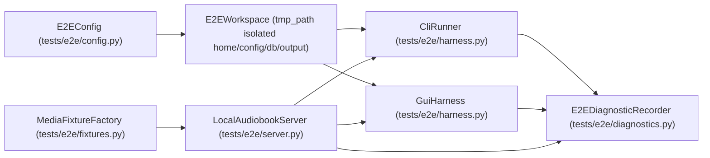

# Testing & Quality Assurance

`audiobook-dl` uses `pytest`, `ruff`, and `mypy` for automated verification across unit tests, mocked integration tests, source adapter tests, and end-to-end (E2E) subprocess/GUI tests.

## Suite Layout

| Location | Scope |
|---|---|
| `tests/test_*.py` | Core CLI parsing, `OPTION_REGISTRY`, TOML config, DPAPI/keyring credentials, SQLite archive (`downloads.db`), scanner, export, pack, sync, web server, metadata, encryption, enrichment, updater, and GUI controller/core tests |
| `tests/sources/test_*.py` | Source adapter URL matching, parsing, search, library listing, and mocked HTTP behavior (`Archive.org`, `Libro.fm`, `RSS`, `Nextory`, `Podimo`, `Storytel`, etc.) |
| `tests/e2e/` | Real subprocess CLI execution, Tkinter GUI lifecycle (`GuiHarness`), HTTP/HLS streaming via `LocalAudiobookServer`, FFmpeg media processing, and diagnostic capture |
| [`tests/conftest.py`](../tests/conftest.py) | Global `autouse` fixture suppressing OS desktop toast notifications during tests |

## Pytest Markers & Common Commands

Custom markers are defined in [`pyproject.toml`](../pyproject.toml):
- `e2e` — End-to-end tests exercising real CLI/GUI processes, HTTP servers, and media pipelines
- `gui` — Tests requiring a Tkinter display
- `ffmpeg` — Tests requiring `ffmpeg` and `ffprobe` executables
- `real_integrity` — Tests exercising real `ffprobe` media integrity verification without stubbing

Run all unit and integration tests (fast, excludes `e2e`):
```shell
python -m pytest -m "not e2e" -q
```

Run only the E2E suite:
```shell
python -m pytest -m e2e -v
```

Run the full test suite:
```shell
python -m pytest -q
```

On headless Linux systems, wrap GUI/E2E tests with `xvfb-run`:
```shell
xvfb-run -a python -m pytest -m e2e -v
```

Linting & type checking (configured in [`pyproject.toml`](../pyproject.toml) and [`.github/workflows/ci.yml`](../.github/workflows/ci.yml)):
```shell
ruff check audiobookdl tests scripts
mypy audiobookdl
```

---

## End-to-End (E2E) Harness Architecture

The `tests/e2e/` harness validates real CLI subprocesses and Tkinter GUI lifecycles against a deterministic local HTTP/HLS server without touching user config directories or hitting external networks:



### E2E Guarantees
- **Isolation**: Every E2E test uses an isolated `tmp_path` workspace (`work/`, `output/`, `config/`, `db/`, `home/` with Windows `AppData` and XDG overrides) and snapshots/restores `os.environ` via `isolated_runtime_state` in [`tests/e2e/conftest.py`](../tests/e2e/conftest.py).
- **Readiness Checks**: `LocalAudiobookServer` polls `/__health`, `CliRunner.check_ready()` verifies CLI startup (`--version`) once per session, `GuiHarness` verifies Tkinter startup, and `require_ffmpeg` checks `ffmpeg`/`ffprobe` availability.
- **Deterministic Media Fixtures**: `MediaFixtureFactory` generates and session-caches valid MP3/AAC-TS audio streams and JPEG cover images via FFmpeg and Pillow without committing binary media blobs to Git.
- **Failure Diagnostics**: On test failure, `pytest_runtest_makereport` attaches captured subprocess `stdout`/`stderr`, redacted HTTP request/response logs, GUI state snapshots, and workspace file trees, and optionally writes artifact bundles when `AUDIOBOOK_DL_E2E_ARTIFACTS_DIR` is set.

### E2E Environment Configuration

| Variable | Default | Description |
|---|---|---|
| `AUDIOBOOK_DL_E2E_TARGET` | `module` | `module` runs `python -m audiobookdl`; `executable` targets built binaries |
| `AUDIOBOOK_DL_E2E_CLI_BIN` | _(unset)_ | Path to CLI executable when `AUDIOBOOK_DL_E2E_TARGET=executable` |
| `AUDIOBOOK_DL_E2E_GUI_BIN` | _(unset)_ | Path to GUI executable for `--self-test` when `AUDIOBOOK_DL_E2E_TARGET=executable` |
| `AUDIOBOOK_DL_E2E_FFMPEG_DIR` | _(unset)_ | Optional explicit directory containing `ffmpeg` and `ffprobe` |
| `AUDIOBOOK_DL_E2E_TIMEOUT` | `30.0` | Timeout in seconds for subprocesses and GUI state polling |
| `AUDIOBOOK_DL_E2E_SERVER_HOST` | `127.0.0.1` | Bind host for `LocalAudiobookServer` |
| `AUDIOBOOK_DL_E2E_ARTIFACTS_DIR` | _(unset)_ | Directory to write per-test diagnostic bundles on failure |
| `AUDIOBOOK_DL_E2E_REQUIRE_FFMPEG` | `0` | Fail instead of skipping when `ffmpeg`/`ffprobe` are unavailable |
| `AUDIOBOOK_DL_E2E_REQUIRE_GUI` | `0` | Fail instead of skipping when Tkinter display is unavailable |
| `AUDIOBOOK_DL_E2E_HEADLESS` | auto | Override headless environment detection (`1`/`0`) |
