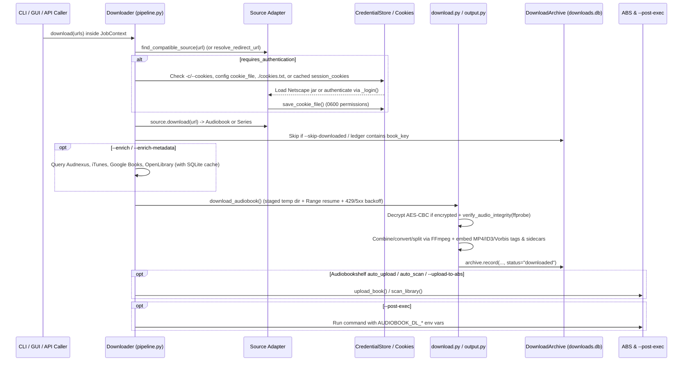
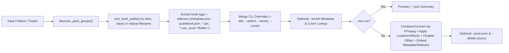
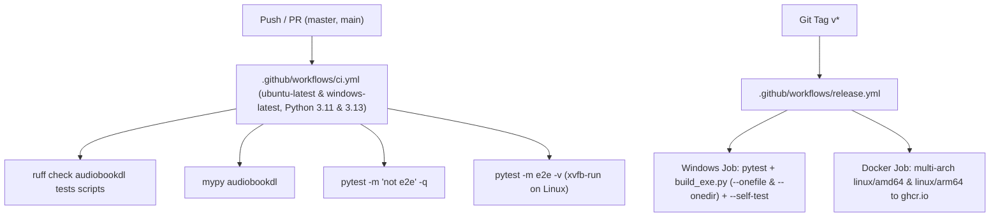

# Runtime & Release Workflows

This guide documents the primary runtime execution pipelines and build/release automation implemented in `audiobook-dl`.

## 1. End-to-End Download Pipeline

Triggered by CLI URLs (`audiobookdl/__main__.py`), `Downloader.download()`, GUI jobs, `sync`, or `POST /api/download`:

### Staging & Integrity Guarantees
- **Multi-part & chapter-split safety**: [`audiobookdl/output/download.py`](../audiobookdl/output/download.py) downloads multi-file books into a sibling temporary `.staging-*` directory and verifies audio integrity with `ffprobe` (`output.verify_audio_integrity()`) before atomically committing targets or updating `downloads.db`.
- **Resumable transfers**: With `--resume`, partial segments stay in `.tmp` files and resume via HTTP `Range` requests (`Content-Range` validated; stale temp files are reset automatically when servers ignore ranges).

---

## 2. Offline Local Repackaging (`audiobook-dl pack`)

[`audiobookdl/pack.py`](../audiobookdl/pack.py) converts local audio folders or track lists into chaptered `.m4b` (or configured `--output-format`) files without contacting a remote source:

---

## 3. Headless `sync` & `serve` Automation

- **`audiobook-dl sync`** ([`audiobookdl/sync.py`](../audiobookdl/sync.py)):
  1. `_resolve_sync_targets()` selects configured `(service, profile)` pairs whose adapter has `supports_library = True` (or specific `--service` / `--profile` targets).
  2. `run_sync_once()` authenticates and calls `list_library()`, upserts discovered items into `downloads.db` (`upsert_catalog_items()`), filters out `downloaded`, `trashed`, and `hidden`-tagged entries, and downloads remaining `pending` URLs unless `--scan-only` or `--dry-run` is active.
  3. `run_sync_loop()` repeats on `--interval <seconds>` when `--watch` is enabled and handles `SIGINT`/`SIGTERM` gracefully.

- **`audiobook-dl serve`** ([`audiobookdl/web.py`](../audiobookdl/web.py)):
  Runs `WebDashboardState` + `ThreadingHTTPServer` bound to `--host` / `--port`, exposing the dark-mode Web UI at `/` and JSON endpoints (`/api/health`, `/api/status`, `/api/services`, `/api/library`, `/api/download`, `/api/pause`, `/api/cancel`, `/api/queue/clear`, `/api/catalog`, `/api/sync`).

---

## 4. CI, Release & Container Packaging

- **Windows Portable Builds** ([`scripts/build_exe.py`](../scripts/build_exe.py)): Packages [`audiobookdl/gui/app.py`](../audiobookdl/gui/app.py) (`audiobook-dl.exe`) with PyInstaller (`--onefile` or `--onedir`, plus `audiobook-dl-cli.exe` console companion in `--onedir` mode), optionally copies or bundles `ffmpeg`/`ffprobe`, and verifies builds via `--self-test`.
- **Docker Image** ([`Dockerfile`](../Dockerfile)): Based on `python:3.12-slim` with `ffmpeg`, non-root user `audiobookdl`, volumes `/config` and `/audiobooks`, and default `CMD ["sync", "--watch", "--interval", "3600"]`.
