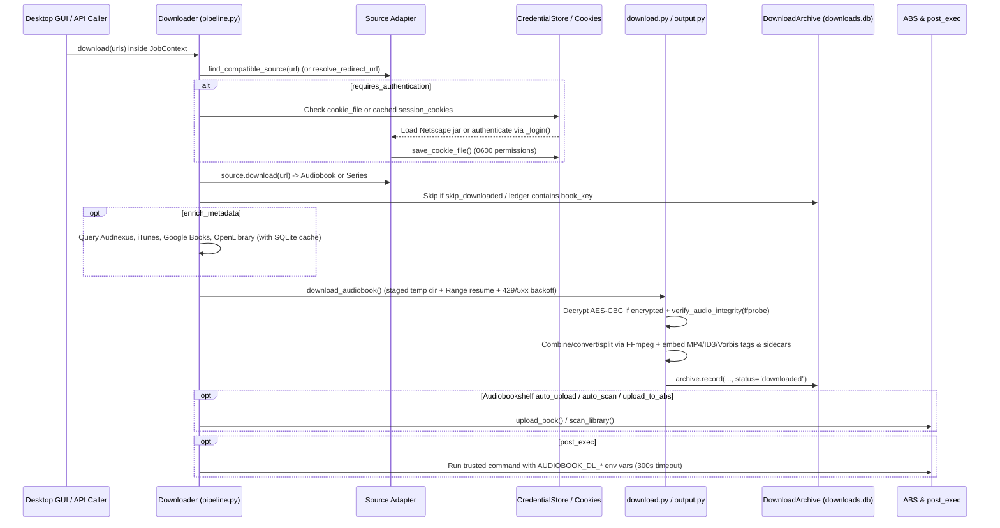
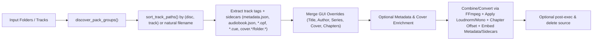
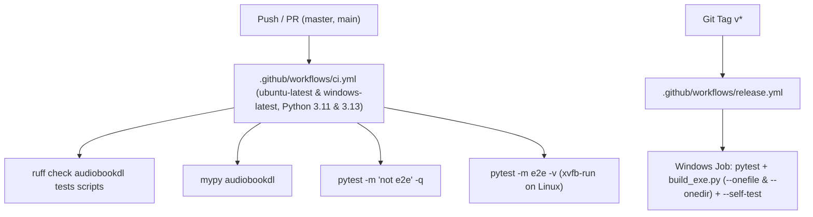

# Runtime & Release Workflows

This guide documents the primary runtime execution pipelines and build/release automation implemented in `audiobook-dl`.

## 1. End-to-End Download Pipeline

Triggered by GUI download jobs, `Downloader.download()`, or GUI library sync:

### Staging & Integrity Guarantees
- **Multi-part & chapter-split safety**: [`audiobookdl/output/download.py`](../audiobookdl/output/download.py) downloads multi-file books into a sibling temporary `.staging-*` directory and verifies audio integrity with `ffprobe` (`output.verify_audio_integrity()`) before atomically committing targets or updating `downloads.db`.
- **Resumable transfers**: With `resume` enabled, partial segments stay in `.tmp` files and resume via HTTP `Range` requests (`Content-Range` validated; stale temp files are reset automatically when servers ignore ranges).
- **DRM / PSSH Inspection**: [`audiobookdl/utils/drm_inspect.py`](../audiobookdl/utils/drm_inspect.py) and the **Inspect…** dialog beside `decryption_key` perform parse-only inspection of ISO BMFF `pssh`/`tenc` boxes, HLS playlists, and DASH MPD `<ContentProtection>` (`cenc:pssh` and `cenc:default_KID`) without license acquisition.

---

## 2. Offline Local Repackaging (`PackPage`)

[`audiobookdl/pack.py`](../audiobookdl/pack.py) converts local audio folders or track lists into chaptered `.m4b` (or configured output format) files without contacting a remote source:

---

## 3. GUI Library Sync

- **`run_sync_once()`** ([`audiobookdl/sync.py`](../audiobookdl/sync.py)):
  1. `_resolve_sync_targets()` selects configured `(service, profile)` pairs whose adapter has `supports_library = True` (or specific selected targets).
  2. Authenticates and calls `list_library()`, upserts discovered items into `downloads.db` (`upsert_catalog_items()`), filters out `downloaded`, `trashed`, and `hidden`-tagged entries, and downloads remaining `pending` URLs unless `scan_only` or `dry_run` is active.
  3. The Desktop GUI schedules periodic sync passes via `AutomationCoordinator` when enabled on the **Library -> Sync** tab.

---

## 4. CI & Release Packaging

- **Windows Portable Builds** ([`scripts/build_exe.py`](../scripts/build_exe.py)): Packages [`audiobookdl/gui/app.py`](../audiobookdl/gui/app.py) (`audiobook-dl.exe`) with PyInstaller (`--onefile` or `--onedir`), optionally copies or bundles `ffmpeg`/`ffprobe`, and verifies builds via `--self-test`.
